# Funcionalidades implementadas — EcoPulse

O que está entregue, por tela, com o requisito do desafio, a issue ou o Pull Request de cada item e os prints. O resumo por requisito está no [README](../README.md#3-funcionalidades-implementadas) e os requisitos, em [requisitos.md](requisitos.md).

Cada item entrou nesta lista quando o Pull Request correspondente foi mergeado. As legendas dizem a data do print, a largura da tela e se o backend era o real (`docker compose`) ou o falso (`npm run mock`).

| Seção | O que mostra |
|---|---|
| [1. Página inicial e login](#1-página-inicial-e-login) | Página pública de apresentação, tela de login e login em toda a aplicação |
| [2. Dashboard](#2-dashboard) | Tabela de serviços, cards, indicadores das 24 h, ranking, avisos e atualização automática |
| [3. Regiões e mapa](#3-regiões-e-mapa) | Mapa de bolhas, lista de regiões por CO₂e e simulação de migração |
| [4. Emissões](#4-emissões) | Histórico de um serviço por período, zoom no gráfico e exportação em CSV e PDF |
| [5. Comparação](#5-comparação) | Serviços lado a lado, dispersão, eficiência, ranking com ordenação e CSV |
| [6. Relatório e impressão](#6-relatório-e-impressão) | Relatório do período e impressão do Dashboard e da Comparação |
| [7. Ajuda](#7-ajuda) | Guia de uso, guia de leitura e fórmulas |
| [8. Configuração e contas](#8-configuração-e-contas) | Intervalo de atualização, convites, papéis e perfil |
| [9. Interface](#9-interface) | Identidade visual, tema claro, acessibilidade e números |
| [10. Coleta, cálculo e plataforma](#10-coleta-cálculo-e-plataforma) | Descoberta e coleta, API, cálculo por coleta, tratamento de falhas e Docker |

## 1. Página inicial e login

- **RNF01 — Página inicial de apresentação ([#438](https://github.com/DEVassos/ecopulse-app/issues/438)):** quem abre `http://localhost:5173/` sem sessão chega em `/inicio`, uma página pública com a chamada do produto, o fluxo métrica → kWh → CO₂e, uma prévia do painel marcada como "Dados ilustrativos", os seis recursos já implementados e o atalho **Entrar no painel**, que passa pelo login e abre o Dashboard. Atrás da chamada toca o mesmo vídeo do login (#436), com véu mais fechado; com `prefers-reduced-motion: reduce`, nada de vídeo nem de animação. As outras telas protegidas continuam indo direto para o login. [Detalhes e verificação](../frontend/README.md#página-inicial-438).

  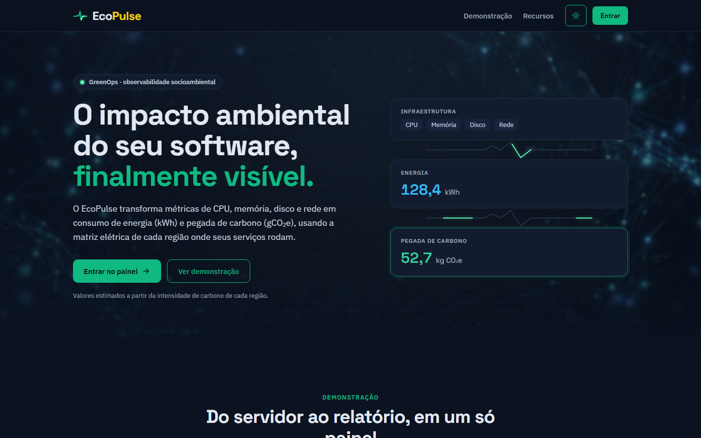

  _Build do `docker compose` em 22/11/2026, 1440 px, tema escuro._

- **DW06 / RP06 — Login administrativo JWT (#20, PR #208):** `POST /api/auth/login` confere a senha com bcrypt e emite JWT HS256; `GET /api/auth/me` valida o token no middleware reutilizável do backend.

- **DW06 / RP06 — Tela de login e área restrita (#25, PR #243):** `/login` confere o formulário antes de chamar o backend e mostra "E-mail ou senha incorretos." quando o `POST /api/auth/login` responde 401. Com o login, o token fica no `sessionStorage` da aba e toda chamada leva `Authorization: Bearer`; um 401 com sessão aberta encerra a sessão e volta para `/login`. `/configuracao` só abre com sessão e confirma o login em `GET /api/auth/me`; **Sair** apaga o token. Nesta entrega o dashboard, Emissões e Comparação ainda eram públicos; a #257, abaixo, passou a exigir login em todas as páginas.

  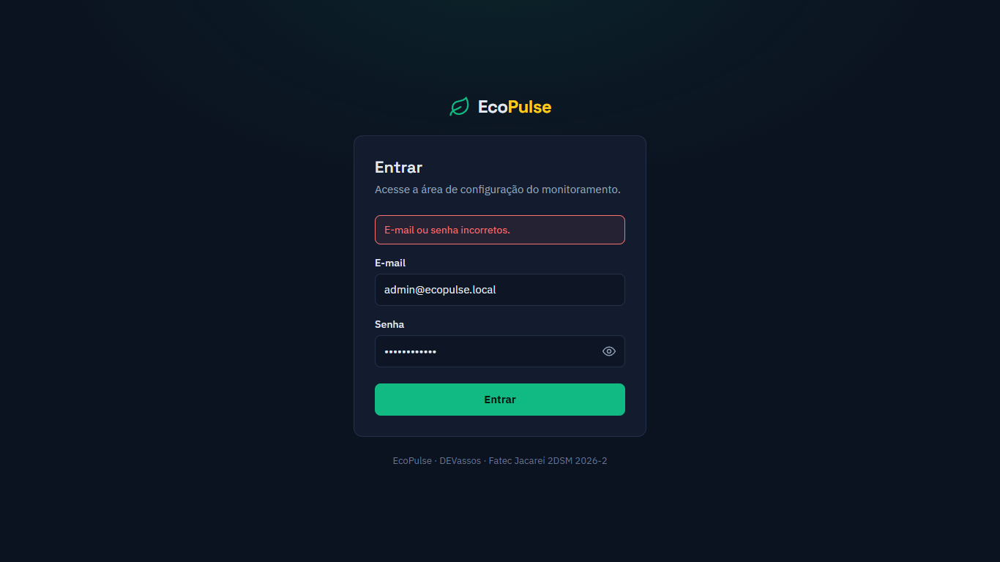

  _Backend real (`docker compose`) em 01/11/2026: o backend respondeu 401 e a tela continua em `/login`, com a mensagem acima dos campos._

  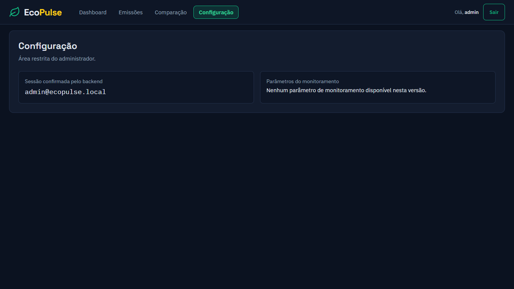

  _Depois do login com o administrador do seed, em 01/11/2026: `GET /api/auth/me` devolveu o e-mail lido no token, e o cabeçalho mostra **Sair**._

- **DW06 / RP06 / RNF05 — Aplicação inteira com login (#257):** o backend exige `Authorization: Bearer <JWT>` em `/api/services` e `/api/collections` e responde 401 sem token válido; `/health`, o login e `GET /api/monitoring-settings` continuam públicos. No frontend, `/login` é a única página aberta sem sessão: o dashboard, Emissões, Comparação e Configuração levam ao login e, depois dele, voltam para a mesma tela, com os filtros da URL. Sem sessão não há busca nem polling; um token expirado encerra a sessão e o login avisa "Sua sessão expirou.". O modo demonstração, sem backend, continua abrindo direto com dados ilustrativos ([ADR 0009](adr/0009-aplicacao-inteira-com-login.md)).

## 2. Dashboard

- **RF09, RF12 — Tabela operacional de serviços (#69):** dashboard com cada serviço monitorado, energia e CO₂e das últimas 24 h (#330), CPU, última leitura, localização (código da região na célula; cidade, país e nome da região ao passar o mouse) e status (ativo, indisponível, sem métricas ou removido, quando o serviço sai da lista do agregador), com busca por nome e ordenação por coluna. A coluna **Fator da região (gCO₂e/kWh)** mostra a intensidade de carbono usada na última coleta, que explica por que CPU alta em região limpa emite menos que CPU baixa em região suja; potência estimada, RAM, disco e rede ficam no tooltip da CPU, o intervalo no da última leitura, e a janela de detalhes repete tudo (#298). Só o problema ganha cor: o selo Ativo e o card Ativos ficam neutros, e a linha indisponível ou sem métricas tem o botão **Ver histórico** ao lado do status (#272). A tela consome `GET /api/services` (#115) pela base definida em `VITE_API_URL`; sem ela (variável vazia), o frontend sobe em modo demonstração com dados ilustrativos (`npm run mock`) — como executar em [frontend/README.md](../frontend/README.md). Ao lado do código da região, o selo **Rede limpa** (folha e texto) marca os serviços de regiões com intensidade de agora em até 100 g CO₂e/kWh, o limite de [docs/calculos.md](calculos.md#limite-de-rede-limpa), lida de `GET /api/regions`; o tooltip mostra a intensidade e o % renovável, e sem intensidade conhecida não há selo (RF12, RF13, #324, PR #367). O mesmo selo aparece na lista de regiões e no rótulo das bolhas do mapa ([detalhes](../frontend/README.md#selo-de-rede-limpa-rf12-rf13-324)).

  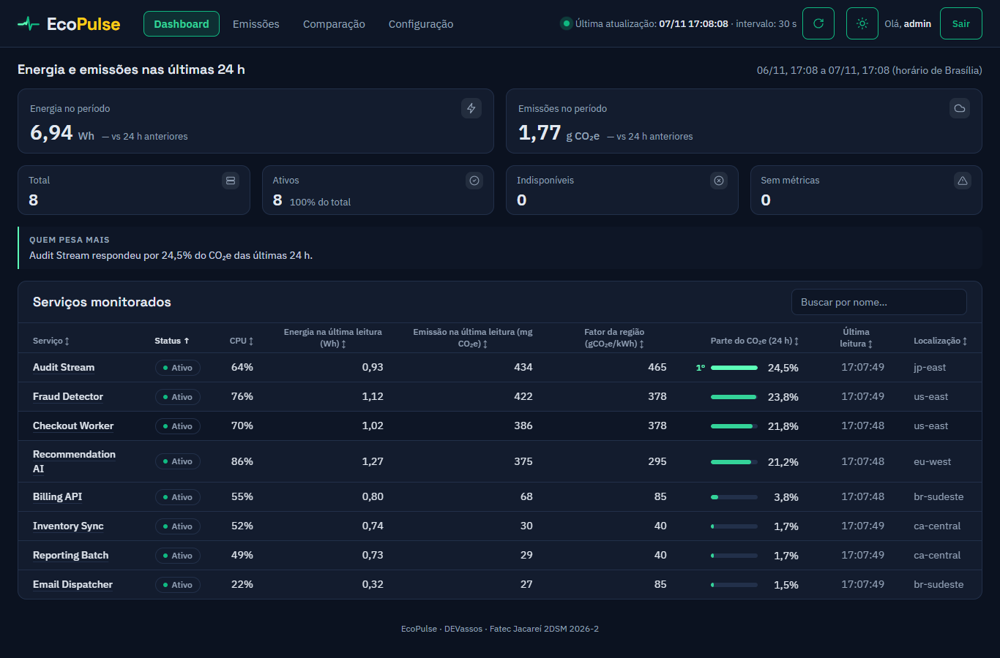

  _Tabela ligada ao backend real (`docker compose`) em 07/11/2026, 17h08, num banco novo com poucos minutos de coletas, em 1366 px: a coluna **Fator da região (gCO₂e/kWh)** vai de 40 (ca-central) a 465 (jp-east), e é ela que explica a emissão: o Audit Stream, com 64% de CPU, emite mais que o Recommendation AI, com 86%, porque a região dele tem fator maior. Os cabeçalhos quebram em duas linhas para as nove colunas caberem sem rolagem (#298)._

  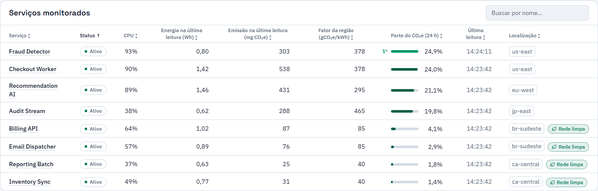

  _Selo **Rede limpa** com o backend real (`docker compose`) em 17/11/2026, 14h24, em 1440 px: só os quatro serviços de `br-sudeste` (85 g CO₂e/kWh, 83% renovável) e `ca-central` (40 g, 89%) têm o selo; `us-east` (378), `eu-west` (295) e `jp-east` (465) ficam acima do limite de 100 (#324)._

  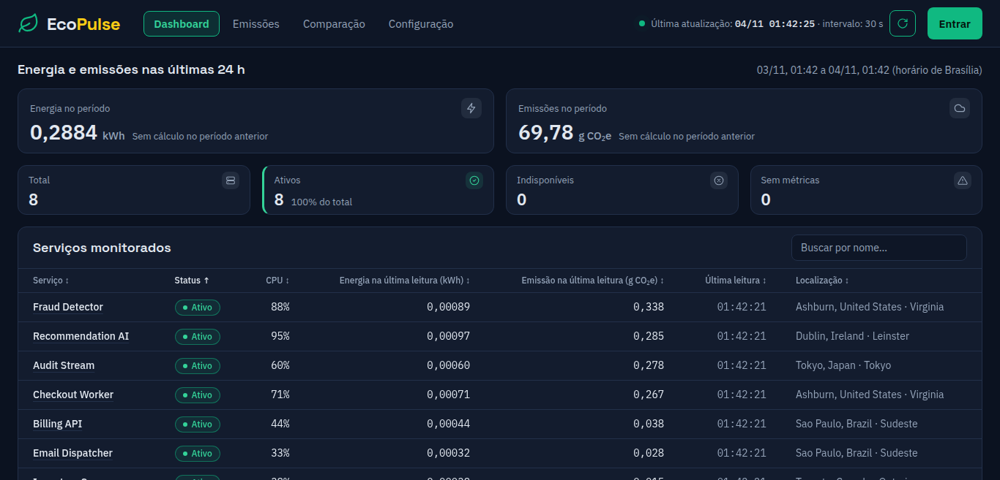

  _Tabela ligada ao backend real (`docker compose`) em 06/11/2026, numa janela de 1366×657 e com a sessão aberta ("Olá, admin" e **Sair**, #257): ordem inicial por gravidade, status logo depois do nome com o selo Ativo neutro (#272), energia (Wh) e emissão (mg CO₂e) da última leitura numa unidade só por coluna, indicada no cabeçalho (#271), e seis linhas visíveis sem rolar (#259)._

- **RF08, RF09 — Cards de estado dos serviços (#21, PR #202):** entre os indicadores do período e a tabela, cards compactos com o total de serviços monitorados e quantos estão ativos, indisponíveis e sem métricas, contados na mesma resposta de `GET /api/services` e atualizados no mesmo ciclo. Os removidos ficam fora do total, e a cor só aparece quando há serviços naquele estado. Sem dados, os cards não aparecem; numa falha, mantêm o último dado, apagado, com "Desatualizado desde …".

  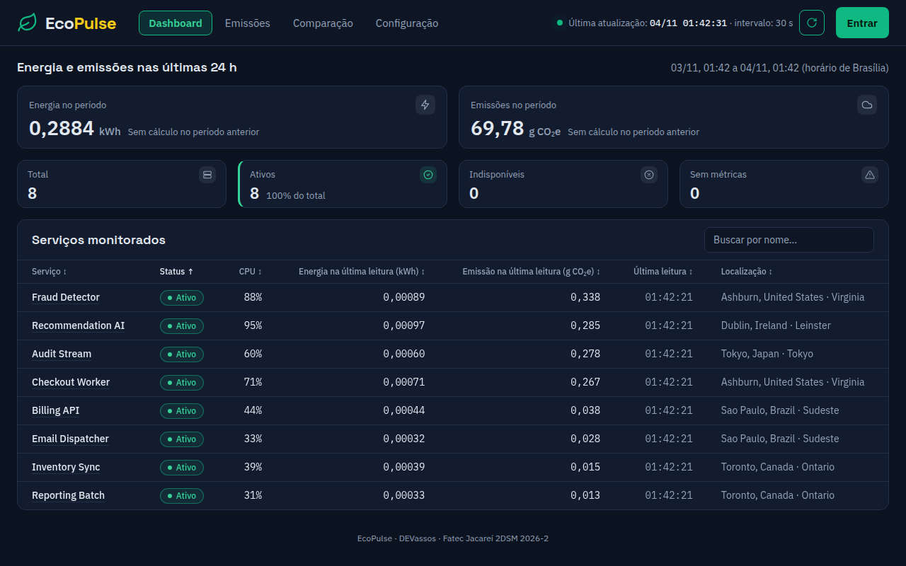

  _Dashboard com o backend real (`docker compose`) em 06/11/2026: 7 serviços ativos, sem contar 1 removido, e Indisponíveis e Sem métricas zerados, nos cards compactos abaixo dos indicadores do período (#259). Nenhum card tem cor: Ativos é estado saudável e fica neutro, e os outros dois só ganham cor com contagem acima de zero (#272)._

- **RF08 — Indicadores agregados e comparação por período (#175, PR #215):** no topo do dashboard, logo abaixo do cabeçalho (#259), a tela mostra a energia e o CO₂e das últimas 24 h, na unidade que o valor pede (Wh ou kWh, mg ou g), com o período em horário de Brasília, e a variação contra as 24 h anteriores: ▲ em laranja quando subiu, ▼ em verde quando caiu e ±0% em cinza (#271). Sem cálculo no período, o valor é "—", nunca zero; sem base para a variação, a nota diz o motivo em vez de inventar um percentual (#234, abaixo). A API usa `GET /api/services/summary?from=&to=`, documentada em [docs/api.md](api.md).

  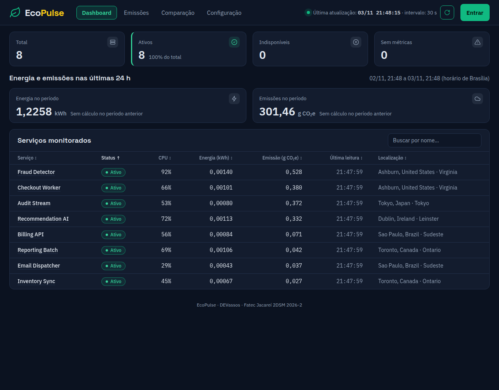

  _Dashboard com o backend real (`docker compose`) em 06/11/2026, 10h02: 1,05 kWh e 258 g CO₂e nas últimas 24 h, na unidade que o valor pede, com "▼ 21,4%" e "▼ 22,1%" em verde, porque energia e CO₂e caíram em relação às 24 h anteriores (#271)._

- **RF08 — Indicadores com período anterior (#234, PR #390):** o painel de energia e emissões mostra as últimas 24 h e a variação contra as 24 h anteriores, vindas de uma única resposta de `GET /api/services/summary` (com `totals`, `previous` e `servicesByStatus`); sem cálculo no período anterior, o painel diz isso em vez de mostrar 100%. As coletas com falha do período aparecem embaixo dos indicadores.

  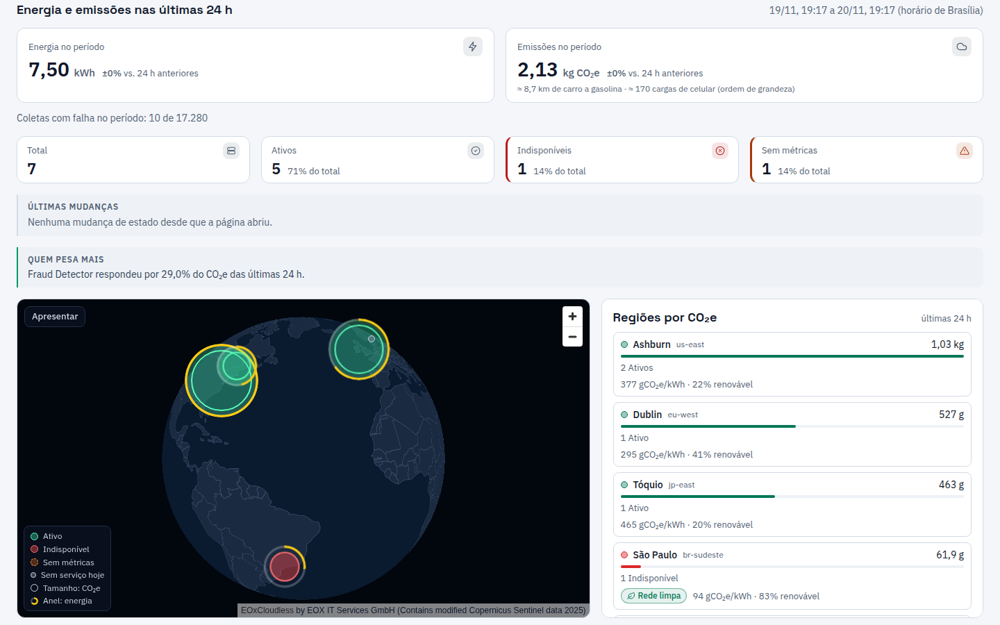

- **RF14 — Quem pesa mais no CO₂e (#260):** a tabela de serviços mostra a parte de cada serviço no CO₂e das últimas 24 h, com barra (o 1º lugar em neon e com o rótulo "1º"), e a frase acima dela diz quem respondeu por mais. A ordem inicial segue o período (maior CO₂e das 24 h primeiro, #330) e não muda a cada leitura. As partes exibidas somam 100,0%, e a coluna e a frase ficam em cinza quando a última busca falha. A API é `GET /api/services/ranking?metric=co2e&from=&to=`, com o contrato aprovado na #50 e implementada na #287 (PR #291).

  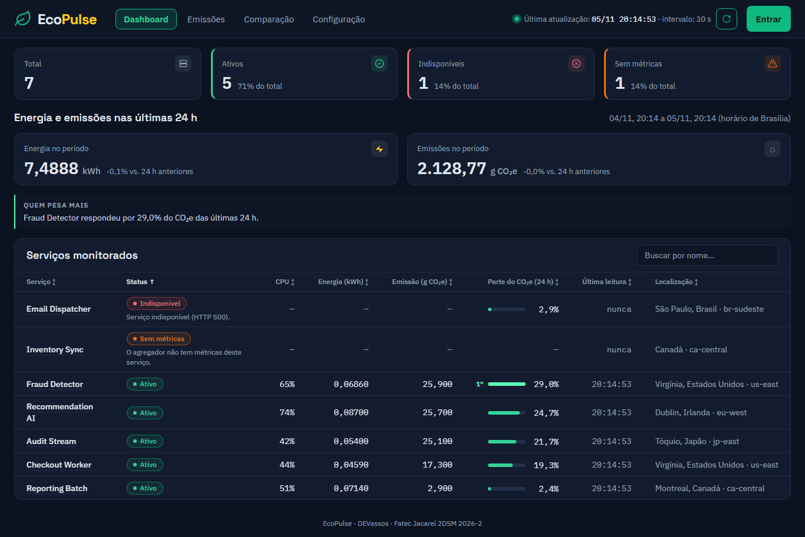

  _Dashboard com o backend real (`docker compose`) em 07/11/2026, 14h25, num banco novo com poucos minutos de coletas do agregador: o Fraud Detector respondeu por 27,6% do CO₂e das últimas 24 h, e a coluna soma 100,0%._

- **RF09, RF14 — Tabela com energia e CO₂e das 24 h (#330, PR #368):** as colunas da tabela de serviços passam a ser os totais de cada serviço nas mesmas 24 h dos cards do topo (a soma da coluna **CO₂e 24 h** é igual ao card **Emissões no período**), vindos do `GET /api/services/ranking` já buscado a cada ciclo, sem requisição nova; a tabela abre pelo maior emissor e as colunas ficam em cinza, nunca zero, quando o ranking falha. A energia e o CO₂e da última leitura (~30 s) foram para a janela de detalhes ([detalhes](../frontend/README.md#energia-e-emissão-na-tabela)).

  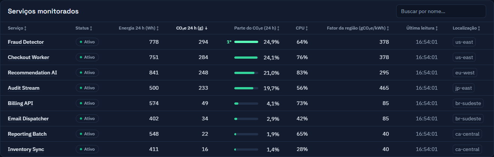

  _Tabela ligada ao backend real (`docker compose`) em 17/11/2026, 16h54, em 1366 px: **Energia 24 h (Wh)**, **CO₂e 24 h (g)** e **Parte do CO₂e (24 h)** logo depois do Status, ordem pelo CO₂e do período (Fraud Detector, 294 g, 24,9%), e a leitura mais recente agrupada em CPU, fator e horário (#330)._

  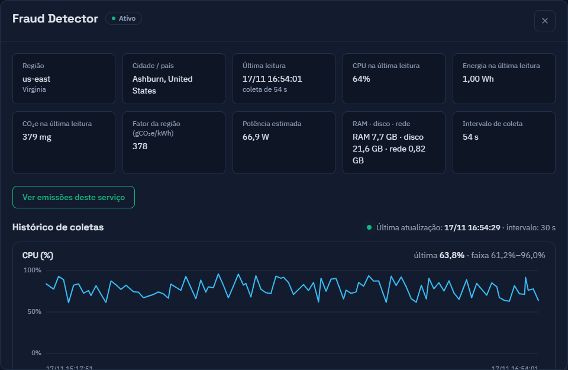

  _Janela de detalhes do Fraud Detector na mesma data: **Energia na última leitura** (1,00 Wh) e **CO₂e na última leitura** (379 mg) ao lado da CPU, com o fator, a potência e os recursos da mesma coleta (#330)._

- **RF07, DW05 — Equivalências do CO₂e no card de emissões (#333, PR #350):** abaixo do total de **Emissões no período**, o dashboard mostra a mesma conta em duas unidades do dia a dia — quilômetros de carro a gasolina e cargas de celular — com a etiqueta **ordem de grandeza** e os dois fatores, a fonte e a data de consulta no tooltip da linha. São dois algarismos significativos no padrão brasileiro; abaixo de 0,01 a unidade vira "< 0,01", nunca zero, e sem CO₂e calculado a linha não aparece. A conta é só de apresentação e não é gravada ([fatores, contas e exemplo em docs/calculos.md](calculos.md#equivalências); [detalhes em frontend/README.md](../frontend/README.md#indicadores-agregados-rf08)).

  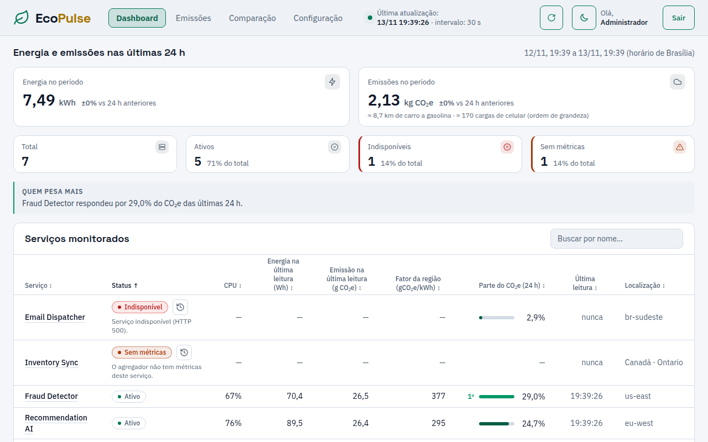

  _Dashboard com o backend falso (`npm run mock`) em 13/11/2026, em 1280 px: 2,13 kg CO₂e no período e, abaixo, "≈ 8,7 km de carro a gasolina · ≈ 170 cargas de celular (ordem de grandeza)". A fonte dos dois fatores aparece no tooltip da linha ([segundo print](img/sprint-3-equivalencias-fonte.png))._

- **RNF02 — Indicador de última atualização (#89, #434):** selo na linha do título **Energia e emissões nas últimas 24 h** do Dashboard, à direita, com o horário da última busca bem-sucedida, o intervalo, o botão **Atualizar agora** e **Imprimir / PDF** ao lado, e um ponto verde pulsando enquanto os dados estão em dia; se uma busca falha, ele fica laranja e passa a dizer "Desatualizado desde …", sem apagar os dados da tela. Até a #434 o selo ficava no cabeçalho, e o menu quebrava em duas linhas em 1366 px; agora o cabeçalho fica em uma linha a partir de cerca de 1.110 px ([detalhes](../frontend/README.md#atualização-em-tempo-real)). Na página Emissões vale a mesma lógica: o selo do cartão fica na linha do título do serviço, à esquerda de **Baixar CSV** e **Imprimir / PDF**, sem uma faixa só para os botões.

  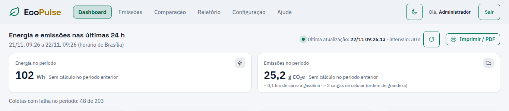

  _Dashboard com o backend real (`docker compose`) em 22/11/2026, 9h26, em 1366 px e no tema claro: o menu e as ações da pessoa numa linha só; abaixo, a linha do título "Energia e emissões nas últimas 24 h", com o período embaixo e, à direita, "Última atualização: 22/11 09:26:13 · intervalo: 30 s", o botão de atualizar e **Imprimir / PDF**._

- **RF11, RNF02 — Atualização automática sem recarregar (#100, #114):** o dashboard busca os dados de novo a cada intervalo (`VITE_REFRESH_INTERVAL_MS`, padrão 30 s), pausa com a aba oculta e tem o botão **Atualizar agora**; se uma atualização falha, os dados anteriores continuam na tela e aparece o erro com **Tentar novamente**.

  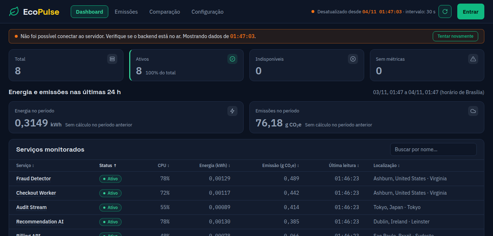

  _Backend parado em 04/11/2026 (mesmo efeito de `docker compose stop backend`): na atualização seguinte, a faixa laranja compacta diz "Mostrando dados de 01:47:03" e oferece **Tentar novamente**, o selo fica laranja ("Desatualizado desde …") e a tabela continua na tela com os números em cinza, como os cards, para não parecerem atuais (#203, #261). Sem nenhum dado na tela, aparece o aviso de erro grande._

- **RF02, RF05, RF06 — Avisos de mudança de estado (#331, PR #374):** a cada atualização, o dashboard compara a lista de serviços com a anterior, sem requisição nova, e avisa serviço novo, removido, indisponível, sem métricas e de volta a ativo: um aviso discreto no canto — no celular, no topo, abaixo do cabeçalho, para não cobrir o mapa (#388) —, que some em 8 s e não tira o foco, e a lista **Últimas mudanças** abaixo dos cards de estado, com as 10 mais recentes e o horário em cada frase. Na tabela, a linha que mudou ganha um destaque breve, e CPU e fator que mudaram ganham ▲/▼; com "reduzir movimento", o destaque fica parado. A carga da página nunca avisa nada ([detalhes](../frontend/README.md#avisos-de-mudança-de-estado-rf02-rf05-rf06-331)).

  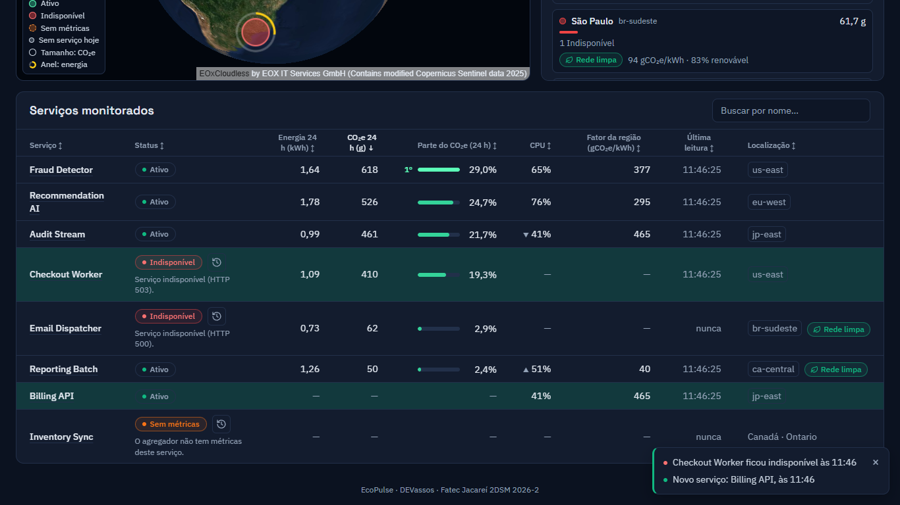

  _Dashboard com o backend falso (`npm run mock`) em 18/11/2026, em 1366 px, com a resposta seguinte ao **Atualizar agora** alterada para derrubar o Checkout Worker e incluir a Billing API: as duas linhas com o destaque, setas na CPU de Audit Stream e Reporting Batch, e o aviso "Checkout Worker ficou indisponível às 11:46 · Novo serviço: Billing API, às 11:46" (#331)._

  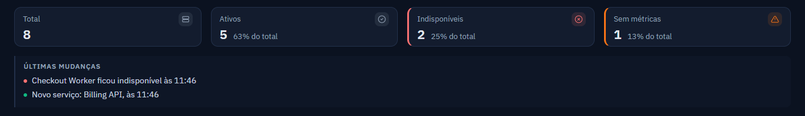

  _A mesma sessão depois que o aviso sumiu: **Últimas mudanças** guarda as duas frases, a mais grave em cima (#331)._

  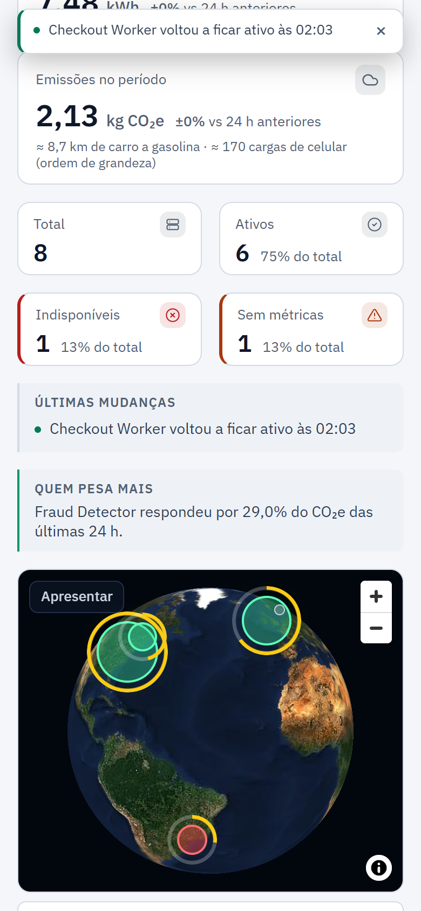

  _Em 390 px, com o mapa das regiões no rodapé da tela e o aviso "Checkout Worker voltou a ficar ativo" (#388): o aviso fica no topo, com uma frase e o resto em **Últimas mudanças**, e os botões + e − do mapa continuam visíveis e clicáveis. Com a página no topo, ele aparece logo abaixo do cabeçalho, sem cobrir **Atualizar agora**. Em 1366 px ele volta ao canto inferior direito com até 3 frases ([print](img/sprint-3-avisos-mudancas-desktop.png))._

- **RF09, RF10 — Detalhes e histórico do serviço (#135):** clicar num serviço da tabela abre uma janela com status, localização, última leitura, CPU, energia e CO₂e da última leitura (#330) e até 100 coletas mais recentes do serviço (`GET /api/collections`), com o período exibido na legenda. Acima da tabela, um gráfico de linha mostra a evolução da CPU nessas coletas, interrompido nas coletas com erro ou sem métricas (#132, PR #201), e quatro botões em cima do gráfico (**CPU**, **Memória**, **Disco**, **Rede**) trocam a métrica sem nova busca: CPU em %, com eixo fixo de 0 a 100%, e as outras três em GB, como as colunas da tabela, com o eixo acompanhando o maior valor da série (#394). O histórico se atualiza no mesmo intervalo do dashboard; se uma busca falha, as coletas continuam na tela com "Desatualizado desde …". Como verificar em [frontend/README.md](../frontend/README.md). Buracos maiores que o intervalo normal aparecem como “Sem coleta por …”, indicando ausência de registro — não prova de indisponibilidade. A janela exibe até 100 coletas recentes.

  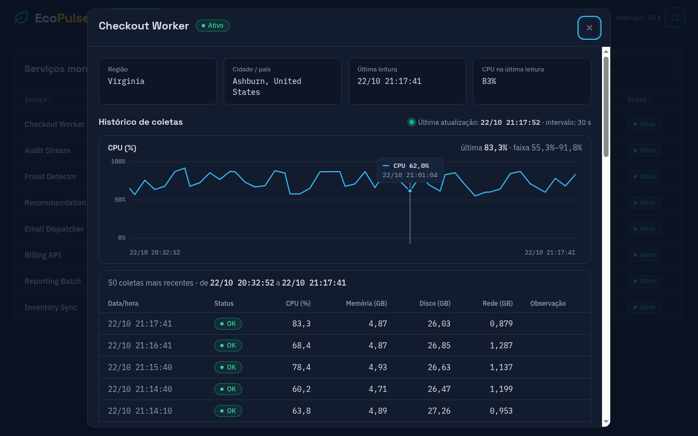

  _Janela do Checkout Worker em 22/10/2026, com o backend real (`docker compose`) e o cursor sobre uma coleta do gráfico._

- **RNF01 — Dashboard no celular sem esconder energia e CO₂e (#263):** abaixo de 600 px, o CO₂e das últimas 24 h (desde a #330; antes, a emissão da última leitura) aparece também sob o nome de cada serviço, e a tabela de serviços e a matriz da Comparação mostram uma sombra na borda direita enquanto há colunas escondidas. O menu rola até o item da página aberta, e o selo de atualização não quebra o horário nem o intervalo no meio.

  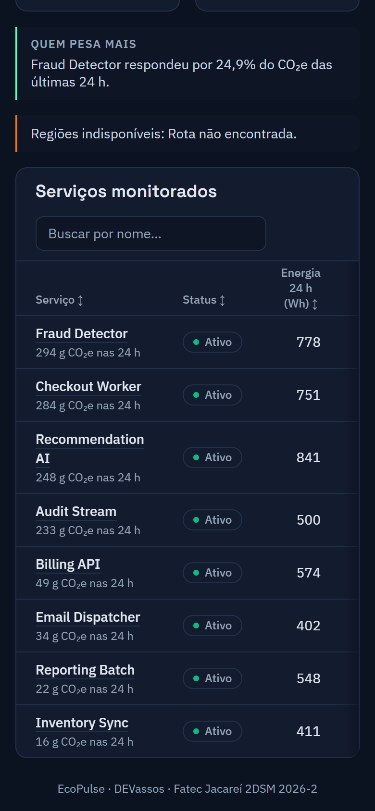

  _Dashboard com o backend real (`docker compose`) em 17/11/2026, numa tela de 390 px e com a sessão aberta: sob o nome de cada serviço, o CO₂e das últimas 24 h (Fraud Detector, 294 g), na ordem do período, e as colunas das 24 h a uma rolagem de distância (#263, #330)._

## 3. Regiões e mapa

- **RF12, RF13 — Regiões por CO₂e e mapa de bolhas com o backend real (#342, #322, #351, PR #373; três linhas por região, #434):** entre a frase **Quem pesa mais** e a tabela, o dashboard mostra um globo com uma bolha por região e, ao lado, a lista **Regiões por CO₂e** das últimas 24 h, as mesmas dos cards do topo: a soma da lista é igual ao card **Emissões no período**. O tamanho da bolha cresce com o CO₂e, o anel pela energia e a cor do pior estado dos serviços da região; regiões sem serviço hoje viram um ponto neutro. Escolher uma região no mapa, na lista ou na tabela destaca a mesma região nos três lugares e leva o mapa até ela. Os dados vêm de `GET /api/regions` (coordenadas, intensidade e % renovável, #319) e `GET /api/regions/summary` (energia, CO₂e e estados por região no período, #320); se só essas rotas falham, o lugar da lista mostra "Regiões indisponíveis" com a mensagem do erro, ou "Regiões desatualizadas" com o último dado em cinza. No celular, o mapa fica em cima da lista e o globo e as bolhas encolhem para caber ([detalhes](../frontend/README.md#mapa-das-regiões-rf13-322)). Desde a #434, cada região ocupa três linhas (nome, código e selo **Rede limpa** com o CO₂e; a barra; serviços à esquerda e rede à direita), e as cinco regiões cabem ao lado do mapa sem rolagem.

  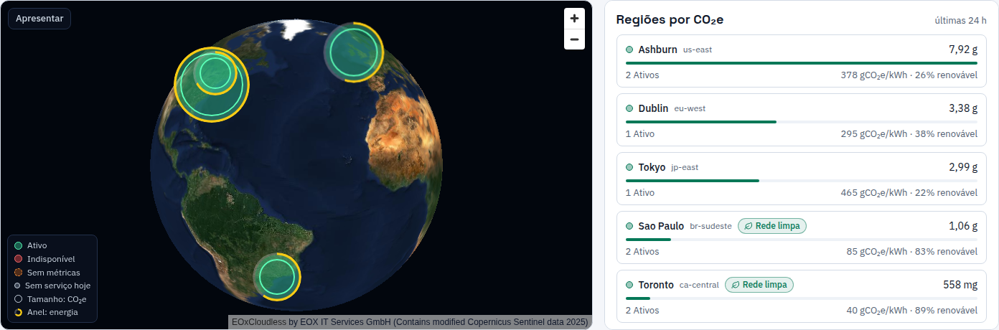

  _Dashboard com o backend real (`docker compose`) em 22/11/2026, 9h17, em 1920 px, num banco novo com cerca de 20 min de coletas: Ashburn (`us-east`) emitiu mais (7,92 g) com dois serviços e a intensidade de 378 g CO₂e/kWh; Sao Paulo (`br-sudeste`, 85 g/kWh) e Toronto (`ca-central`, 40 g/kWh) têm o selo **Rede limpa** ao lado do nome. O crédito das imagens da EOX fica no canto do mapa (#351)._

- **RF15 — Alternativa mais limpa: simulação de migração regional (US12 #53; #382, PR #383; #326, PR #384; duas colunas, #434):** com uma região selecionada no mapa, na lista ou na tabela, abaixo do mapa abre o painel da região com o bloco **Alternativa mais limpa nas últimas 24 h**, sempre com a região de menor intensidade entre todas as da Carbon API, inclusive as sem serviço hoje. Desde a #395 o bloco é um cartão que começa pelo veredito ("Mover para <cidade> reduziria o CO₂e desta região em cerca de Y%", com o selo de rede limpa quando o destino tem até 100 g/kWh), mostra o CO₂e de hoje e o simulado em duas barras no mesmo eixo, a diferença em palavras ("X g a menos de CO₂e nas últimas 24 h") e a linha da conta em kWh e g/kWh para quem quiser refazer; logo abaixo, **Por que a diferença** compara a intensidade do período na origem (CO₂e ÷ energia) com a de agora no destino ("15,1 vezes menor") e diz a energia considerada. A tabela de fatores é o seletor de destino: da mais limpa para a mais suja, com intensidade, CO₂e simulado e diferença, a mais limpa destacada e as regiões sem intensidade bloqueadas; destino mais sujo aparece como aumento, nunca como redução negativa. **Ver alternativa mais limpa** leva a câmera até o destino, marcado no mapa como **Destino simulado** do tamanho do CO₂e simulado e com o nome embaixo, e **Voltar para <origem>** desfaz. A conta troca só o fator da região e preserva a energia ([fórmula, ressalvas e exemplo em docs/calculos.md](calculos.md#simulação-de-migração-regional)); o painel declara o que ela não considera (latência, custo de nuvem, disponibilidade, hardware ou arquitetura, energia para mover os dados) e a hora da intensidade usada ([detalhes](../frontend/README.md#simulação-de-migração-rf15-326)).

  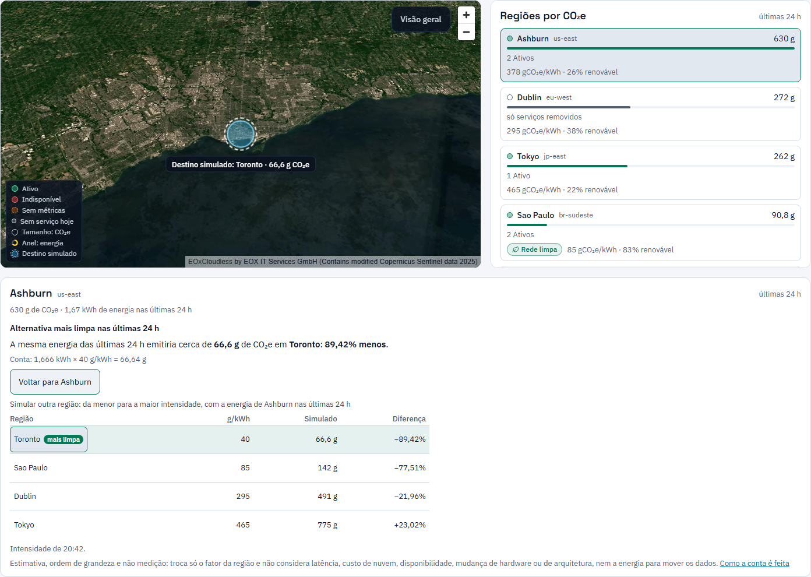

  _Dashboard com o backend real (`docker compose up --build`) em 19/11/2026, 9h29, em 1440 px, com cerca de 36 h de coletas: Ashburn (`us-east`, 378 g CO₂e/kWh) emitiu 636 g com 1,68 kWh nas últimas 24 h; a mesma energia em Toronto (`ca-central`, 40 g/kWh) daria 67,29 g (a linha da conta mostra 1,682 kWh × 40 g/kWh, com a energia arredondada a 4 algarismos), 89,42% menos. A tabela mostra também Sao Paulo, Dublin e Tokyo, este com aumento de 23,02%. O texto do painel neste print é o anterior à #395._

  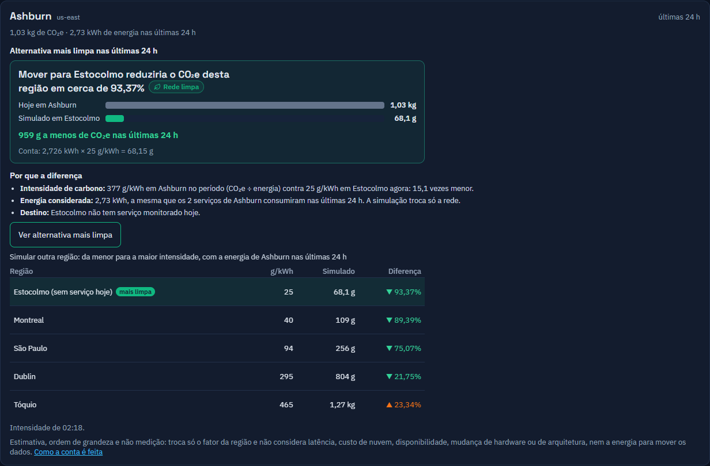

  _Painel de Ashburn com o backend falso em 22/11/2026, 1280 px (#395): "Mover para Estocolmo reduziria o CO₂e desta região em cerca de 93,37%", 1,03 kg hoje contra 68,1 g simulado no mesmo eixo, 959 g a menos, a conta 2,726 kWh × 25 g/kWh e, em **Por que a diferença**, 377 g/kWh no período contra 25 g/kWh agora (15,1 vezes menor)._

  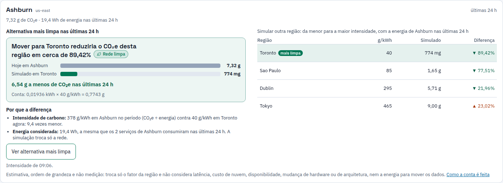

  _Painel de Ashburn com o backend real (`docker compose`) em 22/11/2026, 9h16, em 1440 px (#434): a partir de 1100 px, o cartão "Mover para Toronto reduziria o CO₂e desta região em cerca de 89,42%" e **Por que a diferença** ficam à esquerda e a tabela **Simular outra região** à direita, no lugar da metade vazia. Quando a região selecionada já é a de menor intensidade (Toronto), o painel diz "Esta já é a região de menor intensidade de carbono." e nenhuma linha da tabela recebe a etiqueta "mais limpa"._

## 4. Emissões

- **RF07, RF09, RF10 — Página Emissões (#190, PRs #200 e #216):** o item **Emissões** do menu abre `/emissoes`, com a emissão estimada de CO₂e e a energia de um serviço no período escolhido. O período se escolhe numa pílula com ‹ ›, atalhos (Hoje, Ontem, Últimos 7 e 30 dias) e um calendário próprio, com as datas em DD/MM/AAAA (#273). O serviço e as datas ficam na URL, então o link abre no mesmo filtro. O agrupamento é automático pelo tamanho do período: cada coleta até 2 h (`GET /api/collections`), 15 min até 1 dia e 1 hora acima disso (`GET /api/collections/series`). O resumo mostra emissão, energia, média, pico (os mesmos do chip do gráfico, #271), com a etiqueta **estimado** e o método no tooltip (#272), intensidade da região e coletas com falha, sem cálculo e tempo sem coleta. **Tempo real** busca de novo no intervalo do dashboard. Sem cálculo aparece "—", nunca zero, e numa falha o resumo fica apagado, com "Desatualizado desde …". O gráfico em SVG, em barras por intervalo (#410), mostra o traço da menor e da maior coleta, a média, a maior barra com o chip "pico · N× média", os trechos sem coleta hachurados e as falhas (#272), e dá para alternar para o modo acumulado. A janela de detalhes do serviço leva direto à página. Como verificar em [frontend/README.md](../frontend/README.md#página-emissões-190); print em [docs/img/sprint-2-emissoes.png](img/sprint-2-emissoes.png).

- **RF10, RNF01 — Emissões em barras, com a miniatura do período no zoom (#410):** em **Por intervalo** (e **Por coleta**), o gráfico de Emissões passa de linha a barras: cada barra é a emissão daquele intervalo e ocupa o intervalo inteiro, a maior fica em tom cheio com o chip do pico, a do intervalo em andamento é vazada e tracejada (soma parcial, dito na legenda) e onde não há cálculo não há barra. A faixa da menor e da maior coleta vira um traço sobre a barra. O **Acumulado** continua em linha. Com um trecho ampliado, uma miniatura embaixo do gráfico mostra o período inteiro com o trecho destacado ([detalhes](../frontend/README.md#página-emissões-190)).

  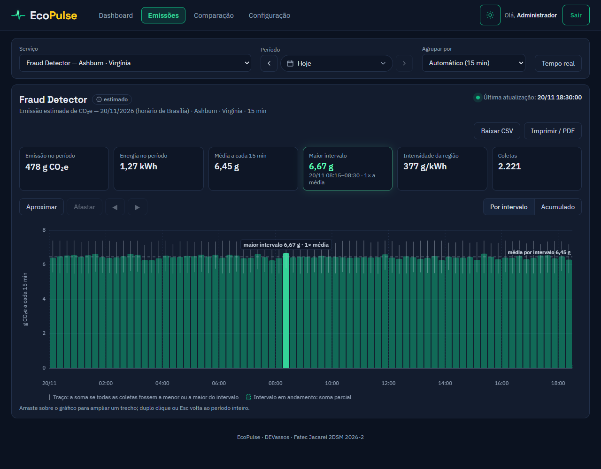

  _Página Emissões com o backend falso (`npm run mock`), em 1280 px, tema escuro, com o relógio do navegador em 20/11/2026 18:30: Fraud Detector, "Hoje", 74 intervalos completos de 15 min (478 g de CO₂e no período); a maior barra, de 08:15 a 08:30, com 6,67 g, em tom cheio, e o traço da menor e da maior coleta sobre cada barra. O intervalo das 18:30 acabou de começar e quase não aparece. A miniatura do período está no print do zoom, acima._

- **RF10, RNF01 — Zoom no gráfico de Emissões (#396):** **Aproximar**, **Afastar**, **◀** e **▶**, acima do gráfico, mostram um trecho do período no mesmo eixo, sem nova busca, encaixado nos intervalos do agrupamento. Durante o zoom, os cards dizem "no trecho", pico, média e dica valem para o trecho, e uma faixa mostra o trecho, quanto ele representa do período e os totais do período inteiro, com **Restaurar período**. Trocar o serviço ou o período restaura; o **Tempo real** mantém o trecho; no **Acumulado** a curva recomeça no trecho; a impressão sai com o trecho e o cabeçalho diz qual é; o CSV continua com o período inteiro ([detalhes](../frontend/README.md#página-emissões-190)).

  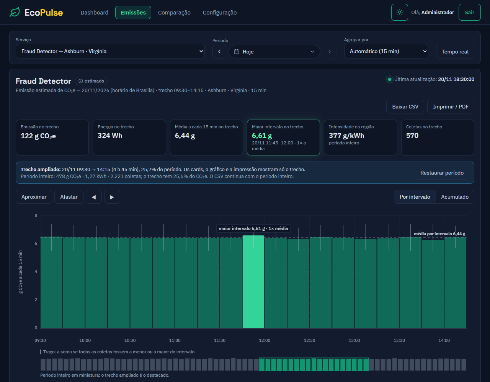

  _Página Emissões com o backend falso (`npm run mock`), em 1280 px, com o relógio do navegador em 20/11/2026 18:30 (para o "Hoje" ter 18 h 30 min de coletas): Fraud Detector depois de dois **Aproximar** e um **▶**. Os cards dizem "no trecho" (122 g de CO₂e, 324 Wh, 570 coletas), a faixa mostra o trecho 09:30 → 14:15 e os totais do período inteiro (478 g, 1,27 kWh, 2.221 coletas), e o gráfico vai de 09:30 a 14:15. Print refeito na #410, com as barras e a miniatura do período._

- **RF10, RNF01 — Zoom por arrasto no gráfico de Emissões (#397):** com o mouse, arrastar sobre o gráfico mostra uma faixa com o início, o fim e a duração do trecho e, ao soltar, amplia esse trecho como os botões do #396; duplo clique ou **Esc** voltam ao período inteiro, e um clique simples continua abrindo só a dica do ponto. No toque, o arrasto segue percorrendo os pontos e o zoom fica nos botões ([detalhes](../frontend/README.md#página-emissões-190)).

  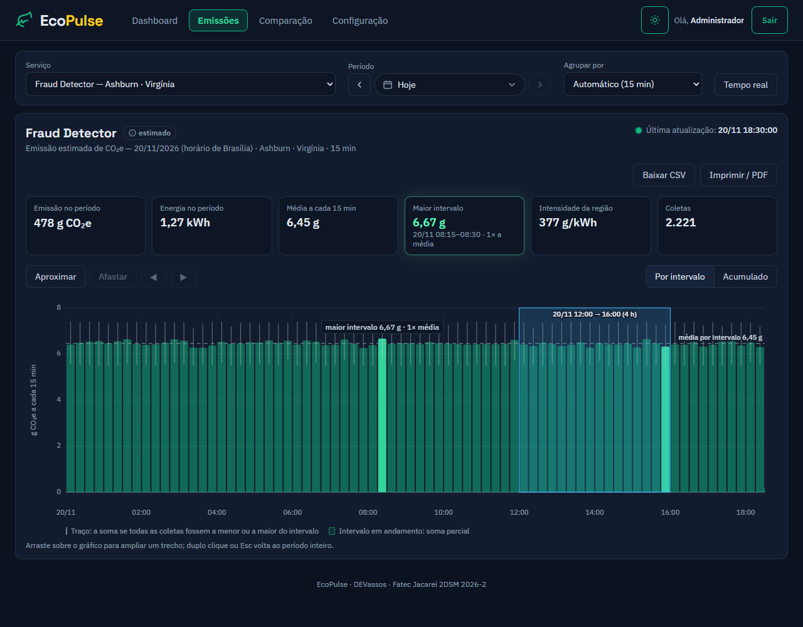

  _Página Emissões com o backend falso (`npm run mock`), em 1280 px, com o relógio do navegador em 20/11/2026 18:30: Fraud Detector, "Hoje", durante o arrasto das 12:00 às 16:00; a faixa azul diz "20/11 12:00 → 16:00 (4 h)", e a dica do ponto fica escondida até soltar. Print refeito na #410, com as barras._

- **RF09, RNF01 — Eixo de Emissões ajustado ao trecho com dados (#332, PR #344):** quando o monitoramento de um serviço começa depois de 20% do período escolhido, o gráfico de Emissões marca o início ("monitoramento começou entre 19:30 e 19:45") e oferece **Ajustar ao trecho com dados**, que encurta o eixo; KPIs e totais continuam sendo do período inteiro, e o texto sob o título avisa isso ([detalhes](../frontend/README.md#página-emissões-190)).

  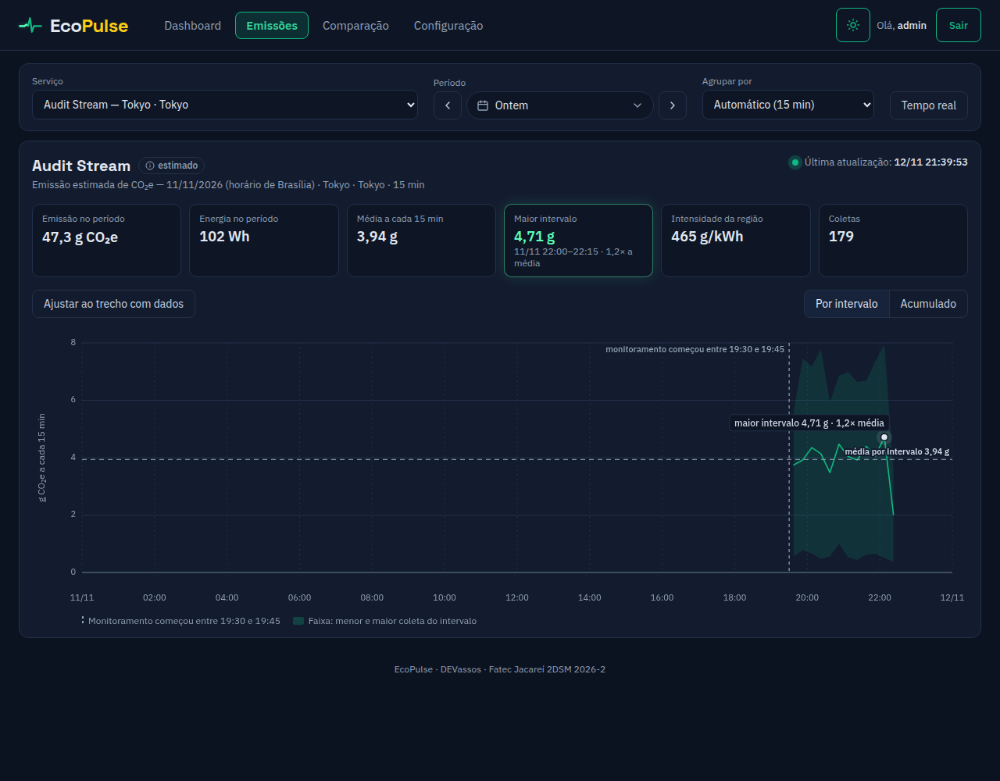

  _Página Emissões com o backend real (`docker compose`) em 12/11/2026, em 1280 px, com o período "Ontem" (11/11) do Audit Stream: o monitoramento começou entre 19:30 e 19:45, e a linha tracejada marca o início; à esquerda dela, quase todo o dia ficou sem dados. O botão **Ajustar ao trecho com dados** fica acima do gráfico._

- **RNF05 — Exportação do período em CSV e PDF (US13 #54; #24, PR #386; #13, PR #387):** na página Emissões, **Baixar CSV** entrega todas as coletas do serviço no período escolhido, uma por linha (horário de Brasília, status, CPU, memória, disco, rede, intervalo, energia, CO₂e, fator da região, cálculo e erro), em UTF-8, com vírgula como separador e ponto decimal, o padrão das ferramentas de BI (no Excel em português, pelo menu Dados → De Texto/CSV); valor ausente fica vazio, nunca 0, e a soma das colunas bate com os cards. As coletas vêm em partes de `GET /api/collections`, com progresso e **Cancelar**, e uma falha no meio não entrega arquivo pela metade. **Imprimir / PDF** abre a impressão do navegador com um relatório A4 no tema claro: cabeçalho com o logo, DEVassos, serviço, período, região e agrupamento, os KPIs, o gráfico e a tabela por intervalo com o total e os trechos sem coleta, repetindo o cabeçalho da tabela em cada página ([detalhes](../frontend/README.md#exportação-do-período-us13-54-24)).

  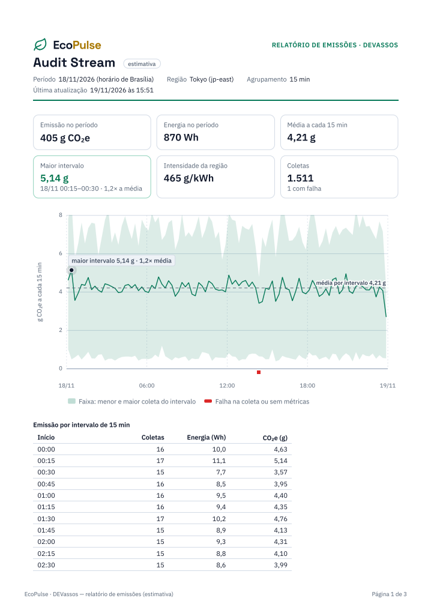

  _Prévia de impressão com o backend real (`docker compose up --build`) em 19/11/2026, 12h01, em largura A4: Audit Stream (`jp-east`) em 18/11, com 1.511 coletas, 405 g de CO₂e e 870 Wh; a tabela segue com 96 intervalos de 15 min nas páginas seguintes, com o total (404,54 g) no fim. O CSV do mesmo dia tem 1.511 linhas, e a soma da coluna `co2e_g` dá 404,54 g._

## 5. Comparação

- **RF15 — Comparação entre serviços (#193, PR #214; #194, PR #219; #218):** o item **Comparação** do menu abre `/comparacao`, com 2 a 10 serviços lado a lado no mesmo período (até 31 dias): coletas, médias de CPU, memória, disco e rede, e energia e CO₂e somados, por `GET /api/services/compare`. O menor e o maior CO₂e ficam destacados, o período aparece acima da tabela, e serviço sem coletas aparece como "sem coletas", nunca zero. Abaixo da tabela, barras de energia e de CO₂e por serviço, cada grandeza na sua escala, com os mesmos valores e destaques. Serviços e datas ficam na URL, e o período usa o mesmo seletor de Emissões (#273). A matriz abre pelo impacto — energia, a intensidade da região (CO₂e ÷ energia) e o CO₂e —, e as métricas coletadas ficam no bloco **Detalhe das métricas** (#328, PR #377): o serviço de menor CO₂e diz no destaque se a diferença vem de **matriz mais limpa** ou de **menor consumo**, e uma barra de potência média por recurso mostra quantos watts e que parcela do total cada um dos quatro recursos responde em cada serviço, com tabela alternativa e "sem dado no período" quando falta alguma das quatro médias. Acima das barras, um gráfico de linhas mostra o CO₂e de cada serviço **ao longo do período** — uma linha por serviço no mesmo eixo do tempo, uma busca por serviço em `GET /api/collections/series` —, com o nome na ponta de cada linha, o total do período na legenda, leitura por teclado e a linha interrompida onde o serviço não tem cálculo no intervalo (#406). Print do gráfico em [docs/img/sprint-3-comparacao-series.png](img/sprint-3-comparacao-series.png) e da tela em [docs/img/sprint-3-comparacao.png](img/sprint-3-comparacao.png). Como verificar em [frontend/README.md](../frontend/README.md#comparação-entre-serviços-194).

  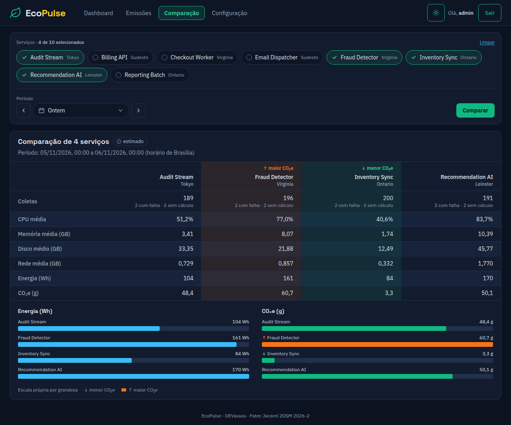

  _Quatro serviços comparados com o backend real (`docker compose`) no dia 05/11/2026, escolhido no seletor de período (#273): Recommendation AI gastou mais energia (170 Wh), mas Fraud Detector emitiu mais CO₂e (60,7 g), porque a região dele tem intensidade de carbono maior; Inventory Sync teve o menor CO₂e (3,3 g). Energia em ciano e CO₂e em verde, com só o maior CO₂e em laranja (#274)._

- **RF15, RF07 — Dispersão "Carga ou região?" na Comparação (#399):** abaixo das barras, cada serviço comparado vira um ponto, com a energia no eixo X e o CO₂e no Y, os dois a partir de zero, e cada região vira uma reta tracejada saindo da origem, com a intensidade de carbono do período como inclinação ([docs/calculos.md](calculos.md#intensidade-efetiva-de-uma-região-no-período)). Pontos na mesma reta diferem só pela energia; a distância vertical entre duas retas, na mesma energia, é o efeito de trocar de região. Os pontos são cinza, e só o menor e o maior CO₂e ganham cor, com a seta no nome e o texto na legenda. O ponteiro perto de um ponto, ou Tab e as setas, destaca o serviço e mostra a conta energia × intensidade = CO₂e com os números da matriz; serviço sem cálculo no período não vira ponto em zero e aparece listado. Ao lado fica o quadro **Como ler**. Como verificar em [frontend/README.md](../frontend/README.md#comparação-entre-serviços-194).

  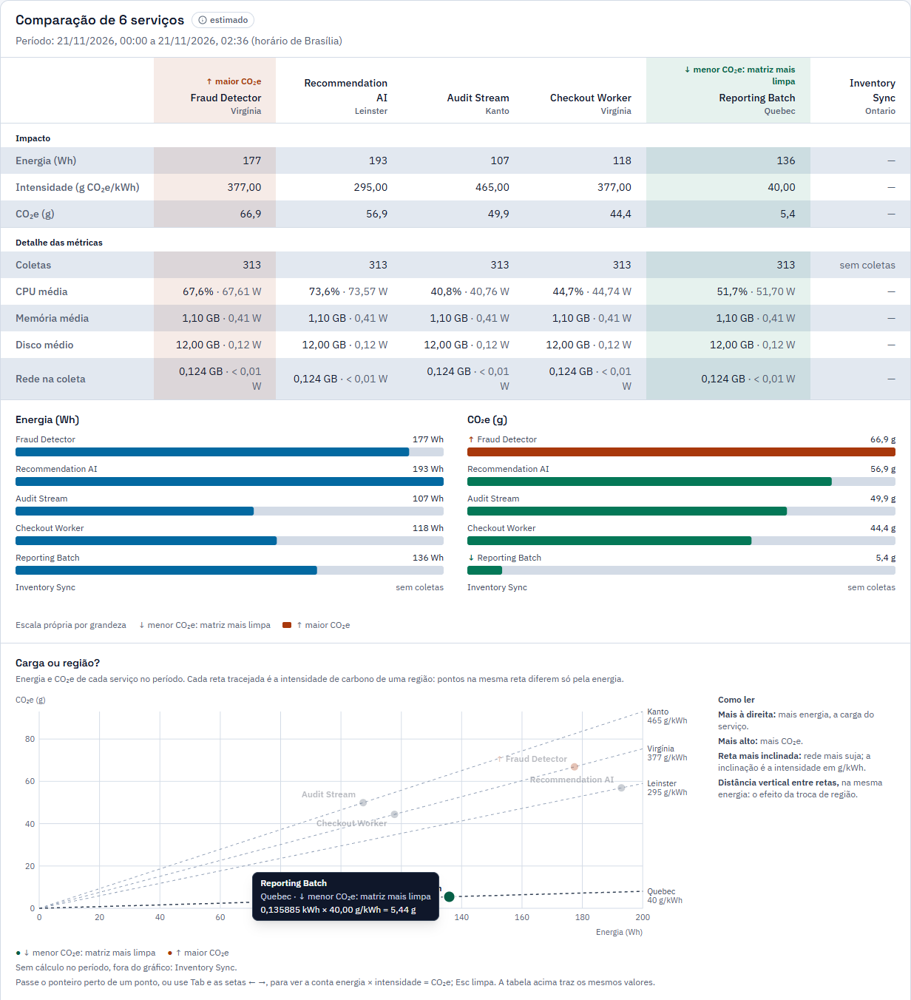

  _Backend falso (`npm run mock`) em 21/11/2026, 02:36: cinco pontos em quatro retas (Kanto 465, Virgínia 377, Leinster 295 e Quebec 40 g/kWh). Fraud Detector e Checkout Worker ficam na mesma reta, a de Virgínia. A dica de Reporting Batch mostra 0,135885 kWh × 40,00 g/kWh = 5,44 g, o CO₂e da matriz (5,4 g na célula e 5,435 g no tooltip dela). Inventory Sync, sem coletas, fica fora do gráfico e listado._

- **RF14, RF15 — Eficiência energética e de carbono (#329):** a Comparação mostra a **potência média (W)** e a **intensidade (g CO₂e/kWh)** de cada serviço no período escolhido (até 31 dias), com o selo "mais eficiente" no menor valor de cada linha — e nenhum selo quando dois serviços exibem o mesmo número. A potência média é a energia monitorada dividida pelo **tempo monitorado**, não pelo período: as duas pontas saem das mesmas coletas calculadas, e a linha **Tempo monitorado** mostra a base da conta (as 5,4 h de um período de 24 h, por exemplo), para o número ser reproduzível ([docs/calculos.md](calculos.md#eficiência-energética-e-de-carbono)). A tela avisa que a conta mede o quanto cada serviço gasta para estar no ar, não a carga de trabalho. O Dashboard ganha a coluna "Potência média (W)" das mesmas 24 h dos cards do topo.

- **RF15, RNF01 — Ranking, ordenação, CSV e destaque na Comparação ([#431](https://github.com/DEVassos/ecopulse-app/issues/431), PR [#433](https://github.com/DEVassos/ecopulse-app/pull/433)):** logo abaixo do título da comparação, os serviços aparecem em ranking do menor para o maior CO₂e, cada um com a conta "energia × intensidade = CO₂e"; serviço sem cálculo fica no fim, com "sem cálculo no período", nunca com zero. A ordem (CO₂e, energia, intensidade, potência média ou nome) muda no **Ordenar por** e no **Inverter** do ranking ou nos cabeçalhos da matriz, e vale ao mesmo tempo para o ranking, a matriz, as barras, a dispersão, a potência por recurso e o CSV. **Baixar CSV**, ao lado de **Imprimir / PDF**, entrega uma linha por serviço, na ordem da tela. O serviço apontado com o mouse ou com o foco do teclado em um bloco fica em destaque nos outros, e um alerta acima do ranking cita os serviços com coletas com falha ou sem cálculo no período. Como verificar em [frontend/README.md](../frontend/README.md#comparação-entre-serviços-194).

## 6. Relatório e impressão

- **RF08, RF14 — Relatório do período gerado por regras (US13 #54; #402 e #403):** o item **Relatório** do menu abre `/relatorio`, que compara o período escolhido (o mesmo seletor de Emissões, com o período na URL) com o período anterior de mesma duração, logo antes dele, mostrando as duas janelas com data e hora. Abre com uma frase que diz o achado ("As emissões subiram 13,1%: 255 g de CO₂e contra 226 g no período anterior"), quatro cards com a variação (CO₂e, energia, intensidade média e coletas com cálculo), **De onde veio a variação**, que divide a diferença em efeito energia e efeito intensidade média (ΔC = ΔE × I₀ + E₁ × ΔI, as duas partes somam a variação) em barras divergentes a partir do zero — o que aumentou o CO₂e à direita, o que reduziu à esquerda, e a variação como saldo —, e os achados em ordem de impacto em CO₂e — alta ou queda de cada serviço com a causa, concentração e confiança dos dados —, cada um com tipo em cor e texto, evidência, causa e **O que fazer** com o link para a tela onde agir. Os achados saem de regras fixas, sem IA, com os limiares escritos na própria página; o total é a soma de `GET /api/services/ranking` no mesmo período, igual à de `GET /api/services/summary`. Se só o período anterior falha, o relatório sai sem comparação e diz isso; **Imprimir / PDF** gera o relatório em A4 ([fórmulas, limiares e exemplo em docs/calculos.md](calculos.md#relatório-do-período); [detalhes](../frontend/README.md#relatório-do-período-us13-54-403)).

  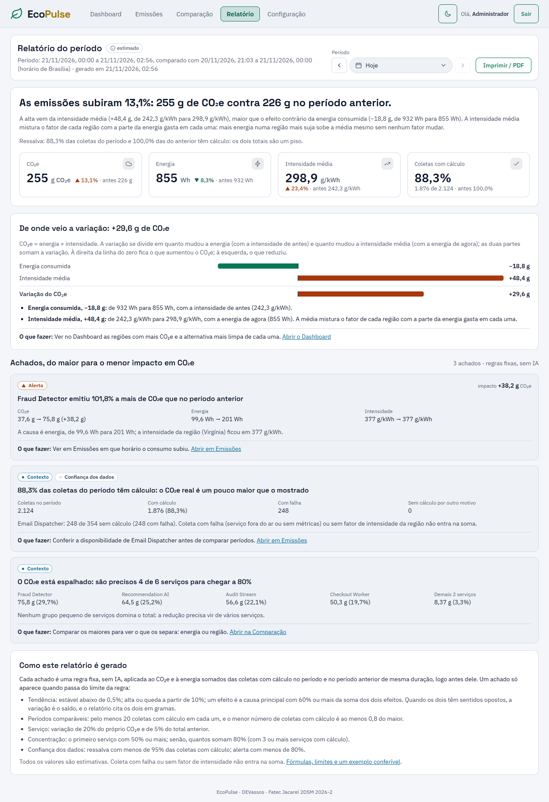

  _Relatório com o backend falso (`npm run mock`) em 21/11/2026, 02h56, em 1280 px, período "Hoje". O mock devolve quase o mesmo CO₂e nos dois períodos ("O CO₂e ficou estável"); para mostrar os achados de tendência, a resposta do ranking foi alterada no navegador pelo Playwright (`page.route`): no período anterior, Fraud Detector com metade da energia e Reporting Batch com 80% a mais; no período escolhido, 70% das coletas do Email Dispatcher com falha. A energia caiu 8,3%, mas foi para regiões mais sujas: a intensidade média subiu 23,4%, e o CO₂e, 13,1%. Os dois efeitos têm sentidos opostos (energia −18,8 g, intensidade média +48,4 g, saldo +29,6 g), por isso a frase cita os dois em gramas e não em "% da variação"._

- **Diferencial (fora do edital) — Impressão / PDF no Dashboard e na Comparação (ES08, DW04; #408, dentro de US13 [#54](https://github.com/DEVassos/ecopulse-app/issues/54)):** as duas páginas ganham o botão **Imprimir / PDF**, que abre a impressão do navegador para salvar em PDF (o mesmo que o Ctrl+P). Cada uma tem a sua folha A4 no `frontend/src/styles/print.css`, com cabeçalho de relatório (logo, título, período) e pé de página próprio: o painel sai com os cards, a lista de regiões e a tabela de serviços inteira, sem o mapa (é um canvas) e sem o campo de busca; a comparação sai com o gráfico de CO₂e, a decomposição de potência e a matriz completa, sem os chips de serviço. O relatório sai sempre no tema claro. Os detalhes estão no [README do frontend](../frontend/README.md#impressão-e-pdf-no-dashboard-e-na-comparação-408).

## 7. Ajuda

- **RNF05, RNF01, RF07 — Página Ajuda com abas (US14 #55; #398; #404):** o item **Ajuda** do menu abre `/ajuda`, com as abas **Como usar** (o caminho do Dashboard às análises em cinco passos, cada um com o link da tela), **Guia de leitura** (os quatro estados com o selo da tabela e o que cada um faz com os números; "sem cálculo" não é zero, período `[início, fim)`, rede limpa, última atualização e unidades), **Fórmulas** (potência → energia → CO₂e com o exemplo oficial de [docs/calculos.md](calculos.md#exemplo-numérico-e-precisão), 50,87 W, 0,000847833 kWh e 0,072066 g, mais simulação de região, potência média e equivalências, calculados pelas mesmas constantes do código) e **Administração**: o papel da sessão, o que só o administrador altera (o intervalo de atualização da tela, que não muda a coleta, e os convites de uso único com papel), o que os dois papéis fazem e o que ninguém altera pela tela — coeficientes do modelo, intensidade de carbono da Carbon API e lista de serviços —, com o motivo. As abas seguem o padrão de acessibilidade (→, ←, Home e End trocam de aba), e a aba aberta fica na URL (`/ajuda?aba=administracao`), com o "voltar" do navegador desfazendo a troca. [Como verificar](../frontend/README.md#ajuda-rnf05-398).

  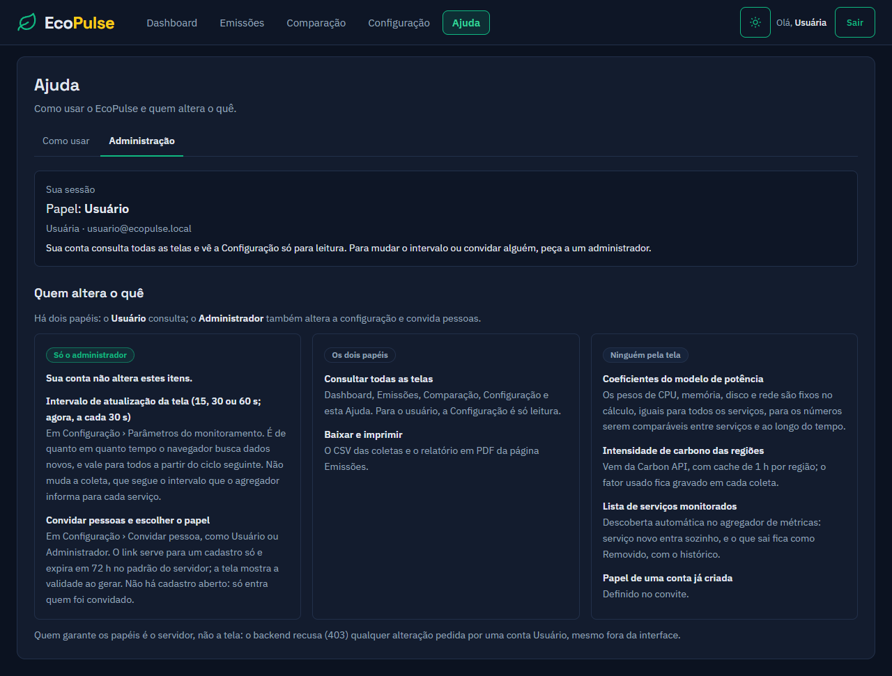

  _Backend falso (`npm run mock`) em 21/11/2026, em 1280 px, com a conta `usuario@ecopulse.local`: "Papel: Usuário", "Sua conta não altera estes itens." no grupo **Só o administrador**, o intervalo com os valores aceitos pelo backend (15, 30 ou 60 s) e o que ninguém altera pela tela._

  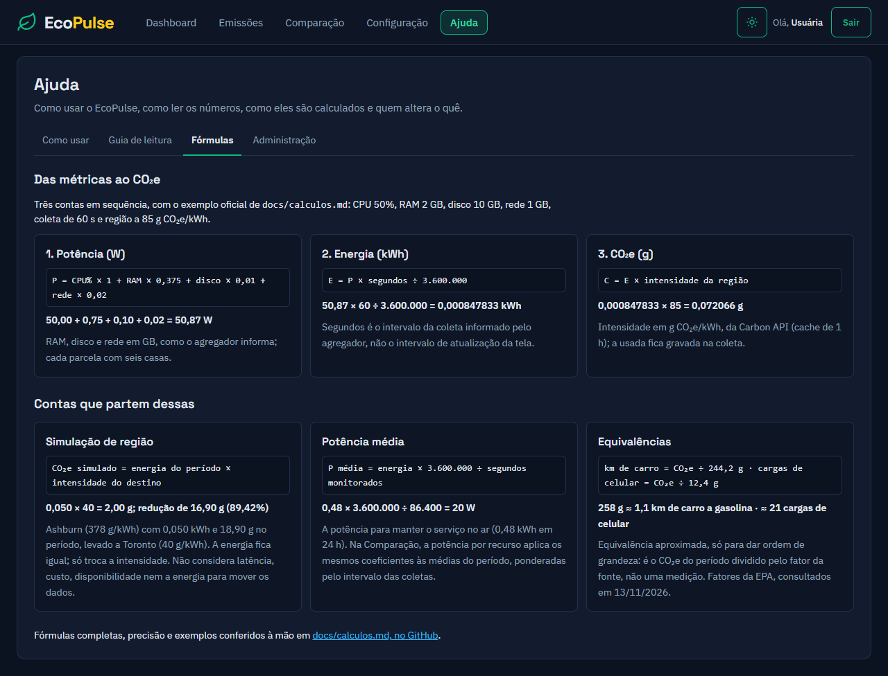

  _A aba **Fórmulas** no mesmo dia e na mesma largura: as três contas do exemplo oficial (50,87 W; 0,000847833 kWh; 0,072066 g) e, abaixo, a simulação Ashburn → Toronto (redução de 16,90 g, 89,42%), a potência média (20 W) e as equivalências de 258 g (#404)._

## 8. Configuração e contas

- **RF11 — Contrato backend da configuração ([#250](https://github.com/DEVassos/ecopulse-app/issues/250)):** GET público e PUT com JWT para intervalo de atualização da tela (15/30/60 s, padrão 30). A interface é a da #176, abaixo. [Contrato e verificação HTTP](api.md#get-apimonitoring-settings); [migração sem apagar volumes](../database/README.md#configuração-de-monitoramento-250).

- **RF05, RF06, RF11 — Intervalo configurável e estado com motivo (#176):** na **Configuração**, o administrador escolhe o intervalo da atualização automática (15, 30 ou 60 s) e salva com `PUT /api/monitoring-settings`. O dashboard lê `GET /api/monitoring-settings` a cada ciclo, então a troca vale em todas as abas e navegadores no ciclo seguinte, sem recarregar; sem resposta, usa `VITE_REFRESH_INTERVAL_MS` como reserva. Na tabela e na janela de detalhes, um serviço **Indisponível** mostra o motivo seguro (`statusReason`) abaixo do selo. Como verificar em [frontend/README.md](../frontend/README.md#estado-com-motivo-176).

  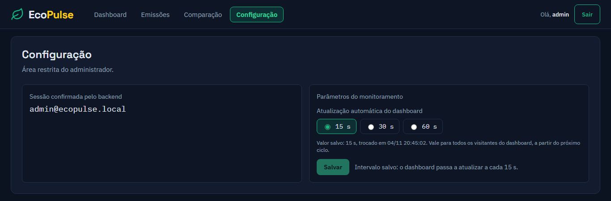

  _Backend real (`docker compose`) em 04/11/2026: depois de salvar 15 s, o dashboard buscou `GET /api/services` aos 13, 28 e 43 s._

- **DW06 / RP06 / RNF05 — Cadastro por convite e papéis (US15 [#195](https://github.com/DEVassos/ecopulse-app/issues/195); #196, PR #392; #197, PR #393):** cada conta tem o papel **Administrador** ou **Usuário**, levado no JWT. As duas consultam todas as telas; só o administrador altera a configuração e convida, e o backend responde 403 à conta usuário. Na **Configuração**, o administrador gera um convite com e-mail e papel e copia o link (uso único, validade de `INVITATION_TTL_HOURS` horas, só o hash do token no banco; não há envio de e-mail). O link abre `/cadastro`, sem sessão, com o e-mail e o papel do convite e a regra de senha conferida antes de enviar; a conta é criada e o convite marcado como usado na mesma transação. Convite usado, expirado ou inexistente mostra o motivo, sem formulário. Volumes criados antes da #196 recebem a [migração 003](../database/README.md#papéis-e-convites-196). [Contratos](api.md#post-apiinvitations).

  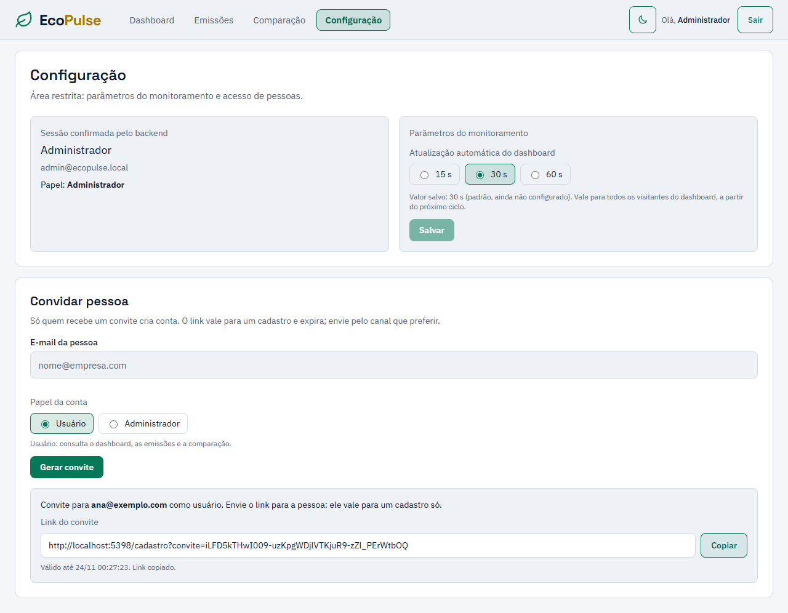

  _Compose isolado com o backend da #196 em 21/11/2026, 1280 px: convite para `ana@exemplo.com` como usuário, depois de **Copiar**._

  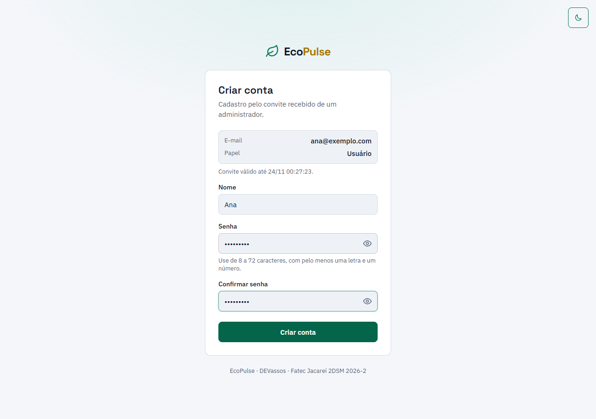

  _O link aberto sem sessão: e-mail e papel vêm do convite; a conta criada entra com a senha escolhida e vê a Configuração só para leitura ([print](img/sprint-3-configuracao-usuario.png))._

- **DW06 / RP06 / RNF05 — Perfil: nome e senha da própria conta (#400, #401):** qualquer conta, administrador ou usuário, abre o **Perfil** pelo nome no cabeçalho (no celular, pelo **Menu**) e troca o próprio nome (`PATCH /api/auth/me`), que aparece no cabeçalho sem novo login, e a própria senha (`PUT /api/auth/me/password`), com a senha atual conferida pelo backend e a nova na regra do cadastro. E-mail e papel aparecem só para leitura. Senha atual errada responde 400 e aparece no campo, sem encerrar a sessão; trocar a senha não encerra as sessões já abertas, porque o JWT vale até expirar, e a tela e a [API](api.md#put-apiauthmepassword) dizem isso. Como verificar em [frontend/README.md](../frontend/README.md#perfil-401).

  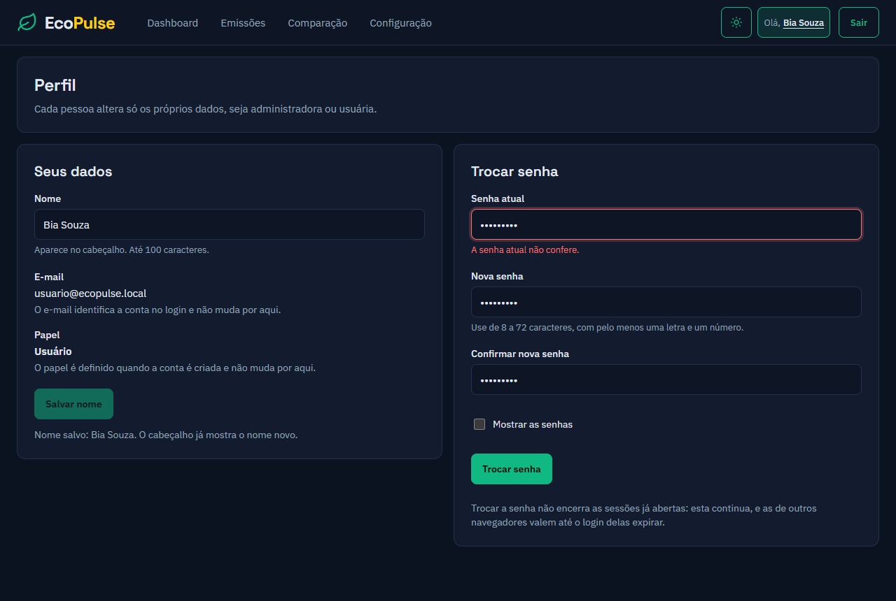

  _Backend falso (`npm run mock`), 1280 px, tema escuro, em 21/11/2026, como `usuario@ecopulse.local`: o nome salvo já aparece no cabeçalho, e a senha atual errada fica no campo, com a sessão aberta._

## 9. Interface

- **RNF01 — Fundo azul, verde nos destaques e logo pulsante (#180, PR #184):** a base da paleta voltou ao azul-escuro e o verde ficou só em ações e destaques (botão vazado nas ações secundárias, item ativo do menu, neon no que pede atenção), em resposta ao feedback da Sprint Review 1. O logo pulsa uma vez a cada atualização bem-sucedida dos dados, como sinal de "ao vivo", e fica parado em falha ou com "reduzir movimento". Regras e contrastes em [docs/identidade-visual.md](identidade-visual.md).

  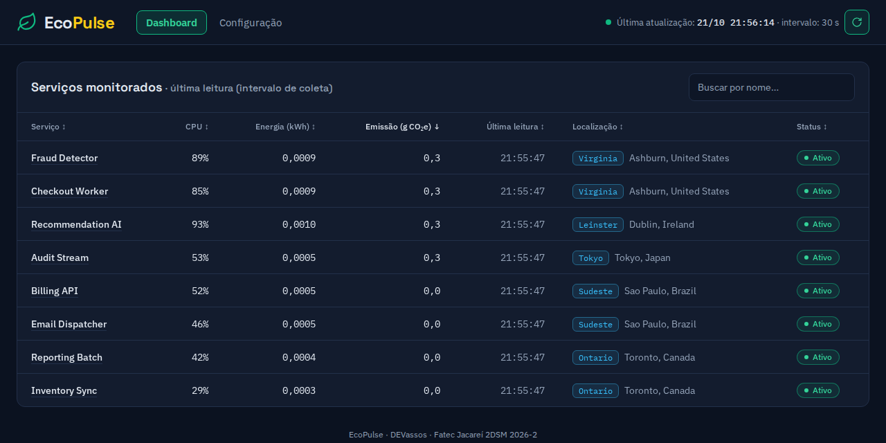

- **RNF01 — Tema claro alternável com o escuro (#265, PR #280):** o botão de tema no cabeçalho e na tela de login troca o atributo `data-theme` da página e guarda a escolha no navegador; os tokens de cor são redefinidos para o tema claro com o mesmo contraste mínimo, e as duas aparências valem para todas as páginas e gráficos.

- **RNF01 — Acessibilidade: leitura do período, placeholder, alvos e teclado (#262, PR #278):** link **Pular para o conteúdo** no primeiro Tab, alvos de toque de pelo menos 24 px nos botões de ordenação e de atualizar, placeholder dos campos com contraste de texto pequeno, período do painel lido pelo leitor de tela e resumo do gráfico de Emissões sem anúncio a cada ciclo; **Atualizar agora** com 44 px.

- **RNF01 — Números em algarismos tabulares (#266, PR #281):** CPU, energia, emissão, horários, eixos e a matriz da comparação usam a fonte de texto com `tabular-nums` no lugar da fonte mono, então vírgulas e casas ficam alinhadas sem mudar a família tipográfica.

## 10. Coleta, cálculo e plataforma

- **RF01, RF02, RF03, RF04 — Descoberta e coleta periódica (#95, #98, #99):** o backend descobre os serviços no agregador de métricas, consulta `/metrics/{id}` e grava o histórico no PostgreSQL; o _worker_ roda em segundo plano e reconcilia serviços que aparecem, ficam indisponíveis ou voltam a exportar métricas.

- **RF10 — API dos serviços e histórico de coletas (#115, #116, #119):** `GET /api/services` devolve os serviços monitorados com a última leitura, e `GET /api/collections?service_id=&from=&to=&limit=` devolve o histórico de coletas (com `limit` de 1 a 500), com CORS liberado para o dashboard. `GET /api/collections/series?service_id=&from=&to=&bucket=` (#207) agrupa as coletas de um serviço em intervalos de 15 min, 1 h ou 1 dia, com contagem, energia e CO₂e por intervalo e o total do período. Contrato completo em [docs/api.md](api.md).

- **RF07 — Cálculo socioambiental por coleta (#133, PR #139):** métricas válidas são convertidas em potência, energia e emissão de CO₂e com o fator regional da API de carbono. Se o fator não estiver disponível, a métrica continua registrada e o cálculo fica indisponível, sem criar valor estimado. As colunas "Energia" e "Emissão" da tabela mostram o resultado da última coleta, com cerca de 30 s de operação, numa unidade só por coluna, a do maior valor, indicada no cabeçalho: uma energia de 0,00091 kWh aparece como 0,91 na coluna "Energia (Wh)", e um valor positivo pequeno demais aparece como "< 0,01", nunca como zero (#203, #271) ([detalhes](../frontend/README.md#energia-e-emissão-na-tabela)).

- **RF05/RF06 — Motivo seguro da indisponibilidade ([#251](https://github.com/DEVassos/ecopulse-app/issues/251)):** `GET /api/services` inclui `statusReason` da última coleta somente para `indisponivel`, normalizado para não expor detalhes internos; demais estados recebem `null`. [Contrato](api.md#get-apiservices). Na tela, o motivo aparece com a #176, na seção Configuração e contas.

- **RNF04 / TP03 — Erros tipados e tratamento de falhas no backend (#174, PR #233):** `shared/errors.ts` define `AppError` e as subclasses (400, 401, 404, 500 e 502) e `middlewares/error-handler.ts` converte qualquer falha no envelope `{"error":{"code","message"}}`, sem stack nem SQL; falhas da API de métricas, da API de carbono e do banco viram estado visível para o frontend em vez de resultado inválido.

- **RNF04 — Resposta da API conferida antes de aparecer na tela (#161):** o frontend confere o formato de `GET /api/services` e `GET /api/collections` (#161), e também de `GET /api/services/summary` e `GET /api/services/compare` (#237, PR [#252](https://github.com/DEVassos/ecopulse-app/pull/252)), contra o contrato de [docs/api.md](api.md) a cada busca. Um item sem `id` ou com CPU em texto faz a busca ser tratada como falha: os dados anteriores continuam com "Desatualizado desde …" e **Tentar novamente**, e o item inválido não aparece. Atende ao apontamento do cliente na review da Sprint 1. Como verificar em [frontend/README.md](../frontend/README.md#conferência-das-respostas-da-api-161).

  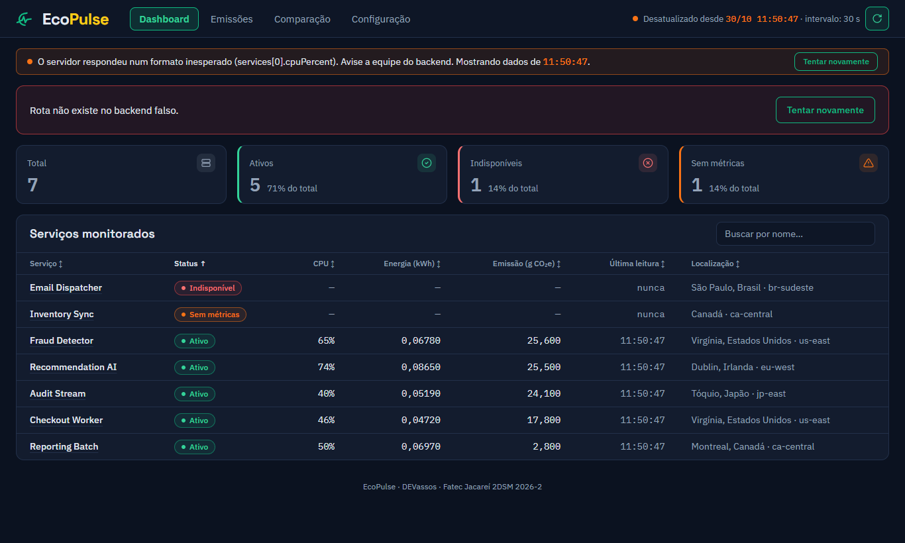

  _Backend falso com `MOCK_SERVICES=cpu-texto` em 30/10/2026, 11h50: a faixa laranja aponta o campo recusado e a tabela mantém os dados de 11:50:47. O aviso "Rota não existe no backend falso." é do painel de indicadores: nessa data, o backend falso ainda não respondia `GET /services/summary` (#239)._

  _Selo em 21/10/2026, com o backend real (`docker compose`)._

- **RNF05, DW07 — Execução com Docker (#91, #113, #81):** backend, frontend (nginx) e PostgreSQL sobem juntos por `docker compose up --build`, com volume persistente para o banco e todas as variáveis documentadas em [.env.example](../.env.example) (#82). Passo a passo no [README](#8-como-executar).
