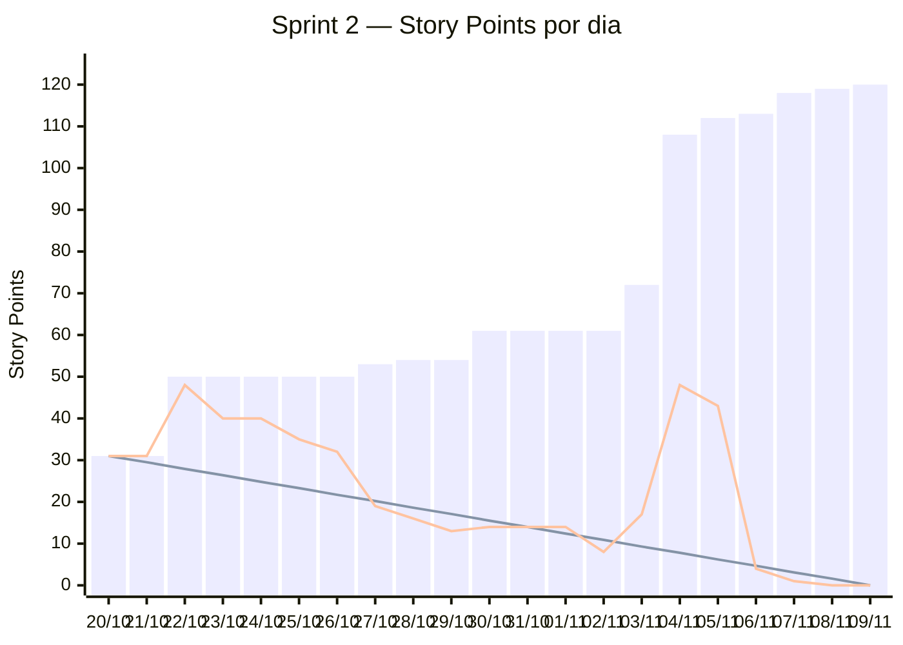

# Burndown — Sprint 2

_Gerado em 16/11/2026 23:00 por `.github/scripts/burndown.sh 2` a partir das issues da milestone [Sprint 2](https://github.com/DEVassos/ecopulse-app/milestones) e do campo **Story Points** do [quadro](https://github.com/orgs/DEVassos/projects/6). Período da sprint: 20/10 a 09/11/2026; dados até 09/11._

Como ler: **barras** = escopo da sprint no dia (soma dos pontos das tarefas já na milestone); **linha que desce reta** = ideal, de 31 pontos no primeiro dia até 0 no último dia da sprint; **outra linha** = pontos ainda abertos no fim de cada dia. Restante acima do ideal indica atraso; barra que sobe indica escopo acrescentado durante a sprint.

## Resumo

| Indicador | Story Points |
|---|---|
| Escopo no primeiro dia (20/10) | 31 |
| Escopo em 09/11 | 120 |
| Concluído (issues fechadas) | 120 |
| Restante | 0 |

## Dia a dia

| Dia | Escopo | Ideal | Restante | Issues fechadas no dia | Issues que entraram no dia |
|---|---|---|---|---|---|
| 20/10 | 31 | 31 | 31 | — | — |
| 21/10 | 31 | 29.5 | 31 | — | — |
| 22/10 | 50 | 27.9 | 48 | [#180](https://github.com/DEVassos/ecopulse-app/issues/180) | [#188](https://github.com/DEVassos/ecopulse-app/issues/188), [#189](https://github.com/DEVassos/ecopulse-app/issues/189), [#190](https://github.com/DEVassos/ecopulse-app/issues/190), [#193](https://github.com/DEVassos/ecopulse-app/issues/193), [#194](https://github.com/DEVassos/ecopulse-app/issues/194), [#203](https://github.com/DEVassos/ecopulse-app/issues/203) |
| 23/10 | 50 | 26.4 | 40 | [#21](https://github.com/DEVassos/ecopulse-app/issues/21), [#132](https://github.com/DEVassos/ecopulse-app/issues/132), [#173](https://github.com/DEVassos/ecopulse-app/issues/173) | — |
| 24/10 | 50 | 24.8 | 40 | — | — |
| 25/10 | 50 | 23.3 | 35 | [#188](https://github.com/DEVassos/ecopulse-app/issues/188), [#193](https://github.com/DEVassos/ecopulse-app/issues/193) | — |
| 26/10 | 50 | 21.7 | 32 | [#189](https://github.com/DEVassos/ecopulse-app/issues/189) | — |
| 27/10 | 53 | 20.2 | 19 | [#20](https://github.com/DEVassos/ecopulse-app/issues/20), [#190](https://github.com/DEVassos/ecopulse-app/issues/190), [#194](https://github.com/DEVassos/ecopulse-app/issues/194), [#203](https://github.com/DEVassos/ecopulse-app/issues/203) | [#218](https://github.com/DEVassos/ecopulse-app/issues/218), [#222](https://github.com/DEVassos/ecopulse-app/issues/222) |
| 28/10 | 54 | 18.6 | 16 | [#218](https://github.com/DEVassos/ecopulse-app/issues/218), [#222](https://github.com/DEVassos/ecopulse-app/issues/222), [#231](https://github.com/DEVassos/ecopulse-app/issues/231) | [#231](https://github.com/DEVassos/ecopulse-app/issues/231) |
| 29/10 | 54 | 17.1 | 13 | [#175](https://github.com/DEVassos/ecopulse-app/issues/175) | — |
| 30/10 | 61 | 15.5 | 14 | [#6](https://github.com/DEVassos/ecopulse-app/issues/6), [#236](https://github.com/DEVassos/ecopulse-app/issues/236), [#239](https://github.com/DEVassos/ecopulse-app/issues/239) | [#236](https://github.com/DEVassos/ecopulse-app/issues/236), [#237](https://github.com/DEVassos/ecopulse-app/issues/237), [#239](https://github.com/DEVassos/ecopulse-app/issues/239) |
| 31/10 | 61 | 14 | 14 | — | — |
| 01/11 | 61 | 12.4 | 14 | — | — |
| 02/11 | 61 | 10.9 | 8 | [#25](https://github.com/DEVassos/ecopulse-app/issues/25), [#174](https://github.com/DEVassos/ecopulse-app/issues/174) | — |
| 03/11 | 72 | 9.3 | 17 | [#140](https://github.com/DEVassos/ecopulse-app/issues/140) | [#250](https://github.com/DEVassos/ecopulse-app/issues/250), [#251](https://github.com/DEVassos/ecopulse-app/issues/251), [#257](https://github.com/DEVassos/ecopulse-app/issues/257), [#258](https://github.com/DEVassos/ecopulse-app/issues/258) |
| 04/11 | 108 | 7.8 | 48 | [#250](https://github.com/DEVassos/ecopulse-app/issues/250), [#251](https://github.com/DEVassos/ecopulse-app/issues/251) | [#259](https://github.com/DEVassos/ecopulse-app/issues/259), [#260](https://github.com/DEVassos/ecopulse-app/issues/260), [#261](https://github.com/DEVassos/ecopulse-app/issues/261), [#262](https://github.com/DEVassos/ecopulse-app/issues/262), [#263](https://github.com/DEVassos/ecopulse-app/issues/263), [#265](https://github.com/DEVassos/ecopulse-app/issues/265), [#266](https://github.com/DEVassos/ecopulse-app/issues/266), [#267](https://github.com/DEVassos/ecopulse-app/issues/267), [#271](https://github.com/DEVassos/ecopulse-app/issues/271), [#272](https://github.com/DEVassos/ecopulse-app/issues/272), [#273](https://github.com/DEVassos/ecopulse-app/issues/273), [#274](https://github.com/DEVassos/ecopulse-app/issues/274) |
| 05/11 | 112 | 6.2 | 43 | [#176](https://github.com/DEVassos/ecopulse-app/issues/176), [#257](https://github.com/DEVassos/ecopulse-app/issues/257), [#258](https://github.com/DEVassos/ecopulse-app/issues/258) | [#287](https://github.com/DEVassos/ecopulse-app/issues/287), [#289](https://github.com/DEVassos/ecopulse-app/issues/289) |
| 06/11 | 113 | 4.7 | 4 | [#237](https://github.com/DEVassos/ecopulse-app/issues/237), [#259](https://github.com/DEVassos/ecopulse-app/issues/259), [#261](https://github.com/DEVassos/ecopulse-app/issues/261), [#262](https://github.com/DEVassos/ecopulse-app/issues/262), [#263](https://github.com/DEVassos/ecopulse-app/issues/263), [#265](https://github.com/DEVassos/ecopulse-app/issues/265), [#266](https://github.com/DEVassos/ecopulse-app/issues/266), [#267](https://github.com/DEVassos/ecopulse-app/issues/267), [#271](https://github.com/DEVassos/ecopulse-app/issues/271), [#272](https://github.com/DEVassos/ecopulse-app/issues/272), [#273](https://github.com/DEVassos/ecopulse-app/issues/273), [#274](https://github.com/DEVassos/ecopulse-app/issues/274), [#287](https://github.com/DEVassos/ecopulse-app/issues/287), [#293](https://github.com/DEVassos/ecopulse-app/issues/293) | [#293](https://github.com/DEVassos/ecopulse-app/issues/293) |
| 07/11 | 118 | 3.1 | 1 | [#260](https://github.com/DEVassos/ecopulse-app/issues/260), [#297](https://github.com/DEVassos/ecopulse-app/issues/297), [#298](https://github.com/DEVassos/ecopulse-app/issues/298) | [#297](https://github.com/DEVassos/ecopulse-app/issues/297), [#298](https://github.com/DEVassos/ecopulse-app/issues/298) |
| 08/11 | 119 | 1.6 | 0 | [#289](https://github.com/DEVassos/ecopulse-app/issues/289), [#301](https://github.com/DEVassos/ecopulse-app/issues/301) | [#301](https://github.com/DEVassos/ecopulse-app/issues/301) |
| 09/11 | 120 | 0 | 0 | [#307](https://github.com/DEVassos/ecopulse-app/issues/307) | [#307](https://github.com/DEVassos/ecopulse-app/issues/307) |

## Fora da soma

- Histórias (`tipo:historia`) e épicos: os pontos deles já estão nas tarefas filhas.
- Issues sem Story Points no quadro: [#122](https://github.com/DEVassos/ecopulse-app/issues/122), [#159](https://github.com/DEVassos/ecopulse-app/issues/159), [#160](https://github.com/DEVassos/ecopulse-app/issues/160), [#161](https://github.com/DEVassos/ecopulse-app/issues/161), [#162](https://github.com/DEVassos/ecopulse-app/issues/162), [#163](https://github.com/DEVassos/ecopulse-app/issues/163), [#164](https://github.com/DEVassos/ecopulse-app/issues/164), [#165](https://github.com/DEVassos/ecopulse-app/issues/165), [#166](https://github.com/DEVassos/ecopulse-app/issues/166), [#168](https://github.com/DEVassos/ecopulse-app/issues/168), [#172](https://github.com/DEVassos/ecopulse-app/issues/172), [#177](https://github.com/DEVassos/ecopulse-app/issues/177), [#178](https://github.com/DEVassos/ecopulse-app/issues/178), [#181](https://github.com/DEVassos/ecopulse-app/issues/181), [#186](https://github.com/DEVassos/ecopulse-app/issues/186), [#187](https://github.com/DEVassos/ecopulse-app/issues/187), [#198](https://github.com/DEVassos/ecopulse-app/issues/198), [#205](https://github.com/DEVassos/ecopulse-app/issues/205), [#210](https://github.com/DEVassos/ecopulse-app/issues/210), [#212](https://github.com/DEVassos/ecopulse-app/issues/212), [#221](https://github.com/DEVassos/ecopulse-app/issues/221), [#246](https://github.com/DEVassos/ecopulse-app/issues/246), [#292](https://github.com/DEVassos/ecopulse-app/issues/292), [#294](https://github.com/DEVassos/ecopulse-app/issues/294), [#305](https://github.com/DEVassos/ecopulse-app/issues/305).

## Método

- Uma issue entra no escopo no dia em que foi criada (ou no primeiro dia da sprint, se é anterior) e sai do restante no dia em que foi fechada (merge do PR em `develop` para tarefas), no horário de Brasília.
- A lista de issues é a da milestone no momento da geração: issue movida para outra sprint deixa de aparecer em todos os dias, e o motivo fica no [histórico do plano](../../plano-de-entregas.md#histórico-de-alterações-do-plano).
