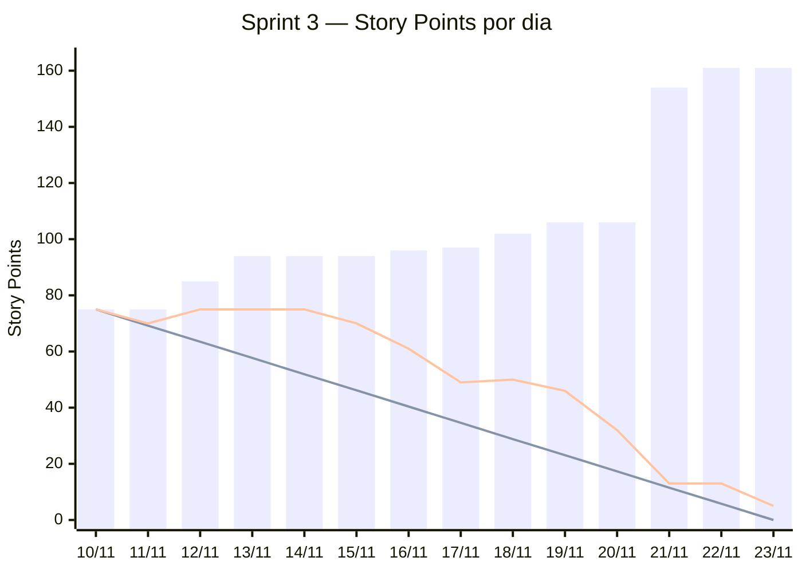

# Burndown — Sprint 3

_Gerado em 26/11/2026 19:25 por `.github/scripts/burndown.sh 3` a partir das issues da milestone [Sprint 3](https://github.com/DEVassos/ecopulse-app/milestones) e do campo **Story Points** do [quadro](https://github.com/orgs/DEVassos/projects/6). Período da sprint: 10/11 a 23/11/2026; dados até 23/11._

Como ler: **barras** = escopo da sprint no dia (soma dos pontos das tarefas já na milestone); **linha que desce reta** = ideal, de 75 pontos no primeiro dia até 0 no último dia da sprint; **outra linha** = pontos ainda abertos no fim de cada dia. Restante acima do ideal indica atraso; barra que sobe indica escopo acrescentado durante a sprint.

## Resumo

| Indicador | Story Points |
|---|---|
| Escopo no primeiro dia (10/11) | 75 |
| Escopo em 23/11 | 161 |
| Concluído (issues fechadas) | 156 |
| Restante | 5 |

## Dia a dia

| Dia | Escopo | Ideal | Restante | Issues fechadas no dia | Issues que entraram no dia |
|---|---|---|---|---|---|
| 10/11 | 75 | 75 | 75 | — | — |
| 11/11 | 75 | 69.2 | 70 | [#256](https://github.com/DEVassos/ecopulse-app/issues/256), [#312](https://github.com/DEVassos/ecopulse-app/issues/312) | — |
| 12/11 | 85 | 63.5 | 75 | [#341](https://github.com/DEVassos/ecopulse-app/issues/341) | [#341](https://github.com/DEVassos/ecopulse-app/issues/341), [#342](https://github.com/DEVassos/ecopulse-app/issues/342) |
| 13/11 | 94 | 57.7 | 75 | [#316](https://github.com/DEVassos/ecopulse-app/issues/316), [#318](https://github.com/DEVassos/ecopulse-app/issues/318), [#319](https://github.com/DEVassos/ecopulse-app/issues/319), [#321](https://github.com/DEVassos/ecopulse-app/issues/321), [#325](https://github.com/DEVassos/ecopulse-app/issues/325), [#332](https://github.com/DEVassos/ecopulse-app/issues/332) | [#346](https://github.com/DEVassos/ecopulse-app/issues/346), [#347](https://github.com/DEVassos/ecopulse-app/issues/347), [#348](https://github.com/DEVassos/ecopulse-app/issues/348), [#349](https://github.com/DEVassos/ecopulse-app/issues/349), [#351](https://github.com/DEVassos/ecopulse-app/issues/351), [#352](https://github.com/DEVassos/ecopulse-app/issues/352) |
| 14/11 | 94 | 51.9 | 75 | — | — |
| 15/11 | 94 | 46.2 | 70 | [#342](https://github.com/DEVassos/ecopulse-app/issues/342) | — |
| 16/11 | 96 | 40.4 | 61 | [#313](https://github.com/DEVassos/ecopulse-app/issues/313), [#322](https://github.com/DEVassos/ecopulse-app/issues/322), [#333](https://github.com/DEVassos/ecopulse-app/issues/333), [#352](https://github.com/DEVassos/ecopulse-app/issues/352) | [#359](https://github.com/DEVassos/ecopulse-app/issues/359), [#362](https://github.com/DEVassos/ecopulse-app/issues/362) |
| 17/11 | 97 | 34.6 | 49 | [#320](https://github.com/DEVassos/ecopulse-app/issues/320), [#324](https://github.com/DEVassos/ecopulse-app/issues/324), [#330](https://github.com/DEVassos/ecopulse-app/issues/330), [#346](https://github.com/DEVassos/ecopulse-app/issues/346), [#347](https://github.com/DEVassos/ecopulse-app/issues/347), [#348](https://github.com/DEVassos/ecopulse-app/issues/348), [#359](https://github.com/DEVassos/ecopulse-app/issues/359), [#362](https://github.com/DEVassos/ecopulse-app/issues/362), [#365](https://github.com/DEVassos/ecopulse-app/issues/365) | [#365](https://github.com/DEVassos/ecopulse-app/issues/365) |
| 18/11 | 102 | 28.8 | 50 | [#327](https://github.com/DEVassos/ecopulse-app/issues/327), [#351](https://github.com/DEVassos/ecopulse-app/issues/351) | [#375](https://github.com/DEVassos/ecopulse-app/issues/375), [#376](https://github.com/DEVassos/ecopulse-app/issues/376), [#380](https://github.com/DEVassos/ecopulse-app/issues/380) |
| 19/11 | 106 | 23.1 | 46 | [#328](https://github.com/DEVassos/ecopulse-app/issues/328), [#331](https://github.com/DEVassos/ecopulse-app/issues/331), [#382](https://github.com/DEVassos/ecopulse-app/issues/382) | [#382](https://github.com/DEVassos/ecopulse-app/issues/382), [#388](https://github.com/DEVassos/ecopulse-app/issues/388) |
| 20/11 | 106 | 17.3 | 32 | [#13](https://github.com/DEVassos/ecopulse-app/issues/13), [#24](https://github.com/DEVassos/ecopulse-app/issues/24), [#323](https://github.com/DEVassos/ecopulse-app/issues/323), [#326](https://github.com/DEVassos/ecopulse-app/issues/326), [#380](https://github.com/DEVassos/ecopulse-app/issues/380) | — |
| 21/11 | 154 | 11.5 | 13 | [#196](https://github.com/DEVassos/ecopulse-app/issues/196), [#197](https://github.com/DEVassos/ecopulse-app/issues/197), [#234](https://github.com/DEVassos/ecopulse-app/issues/234), [#329](https://github.com/DEVassos/ecopulse-app/issues/329), [#349](https://github.com/DEVassos/ecopulse-app/issues/349), [#375](https://github.com/DEVassos/ecopulse-app/issues/375), [#376](https://github.com/DEVassos/ecopulse-app/issues/376), [#388](https://github.com/DEVassos/ecopulse-app/issues/388), [#394](https://github.com/DEVassos/ecopulse-app/issues/394), [#395](https://github.com/DEVassos/ecopulse-app/issues/395), [#396](https://github.com/DEVassos/ecopulse-app/issues/396), [#397](https://github.com/DEVassos/ecopulse-app/issues/397), [#398](https://github.com/DEVassos/ecopulse-app/issues/398), [#399](https://github.com/DEVassos/ecopulse-app/issues/399), [#400](https://github.com/DEVassos/ecopulse-app/issues/400), [#401](https://github.com/DEVassos/ecopulse-app/issues/401), [#402](https://github.com/DEVassos/ecopulse-app/issues/402), [#403](https://github.com/DEVassos/ecopulse-app/issues/403), [#404](https://github.com/DEVassos/ecopulse-app/issues/404), [#406](https://github.com/DEVassos/ecopulse-app/issues/406), [#408](https://github.com/DEVassos/ecopulse-app/issues/408), [#410](https://github.com/DEVassos/ecopulse-app/issues/410), [#431](https://github.com/DEVassos/ecopulse-app/issues/431) | [#394](https://github.com/DEVassos/ecopulse-app/issues/394), [#395](https://github.com/DEVassos/ecopulse-app/issues/395), [#396](https://github.com/DEVassos/ecopulse-app/issues/396), [#397](https://github.com/DEVassos/ecopulse-app/issues/397), [#398](https://github.com/DEVassos/ecopulse-app/issues/398), [#399](https://github.com/DEVassos/ecopulse-app/issues/399), [#400](https://github.com/DEVassos/ecopulse-app/issues/400), [#401](https://github.com/DEVassos/ecopulse-app/issues/401), [#402](https://github.com/DEVassos/ecopulse-app/issues/402), [#403](https://github.com/DEVassos/ecopulse-app/issues/403), [#404](https://github.com/DEVassos/ecopulse-app/issues/404), [#406](https://github.com/DEVassos/ecopulse-app/issues/406), [#408](https://github.com/DEVassos/ecopulse-app/issues/408), [#410](https://github.com/DEVassos/ecopulse-app/issues/410), [#429](https://github.com/DEVassos/ecopulse-app/issues/429), [#431](https://github.com/DEVassos/ecopulse-app/issues/431) |
| 22/11 | 161 | 5.8 | 13 | [#434](https://github.com/DEVassos/ecopulse-app/issues/434), [#436](https://github.com/DEVassos/ecopulse-app/issues/436), [#438](https://github.com/DEVassos/ecopulse-app/issues/438) | [#434](https://github.com/DEVassos/ecopulse-app/issues/434), [#436](https://github.com/DEVassos/ecopulse-app/issues/436), [#438](https://github.com/DEVassos/ecopulse-app/issues/438) |
| 23/11 | 161 | 0 | 5 | [#167](https://github.com/DEVassos/ecopulse-app/issues/167), [#169](https://github.com/DEVassos/ecopulse-app/issues/169), [#275](https://github.com/DEVassos/ecopulse-app/issues/275), [#311](https://github.com/DEVassos/ecopulse-app/issues/311), [#429](https://github.com/DEVassos/ecopulse-app/issues/429) | — |

## Fora da soma

- Histórias (`tipo:historia`) e épicos: os pontos deles já estão nas tarefas filhas.
- Issues sem Story Points no quadro: [#356](https://github.com/DEVassos/ecopulse-app/issues/356), [#378](https://github.com/DEVassos/ecopulse-app/issues/378), [#423](https://github.com/DEVassos/ecopulse-app/issues/423), [#426](https://github.com/DEVassos/ecopulse-app/issues/426), [#440](https://github.com/DEVassos/ecopulse-app/issues/440), [#442](https://github.com/DEVassos/ecopulse-app/issues/442).

## Método

- Uma issue entra no escopo no dia em que foi criada (ou no primeiro dia da sprint, se é anterior) e sai do restante no dia em que foi fechada (merge do PR em `develop` para tarefas), no horário de Brasília.
- A lista de issues é a da milestone no momento da geração: issue movida para outra sprint deixa de aparecer em todos os dias, e o motivo fica no [histórico do plano](../../plano-de-entregas.md#histórico-de-alterações-do-plano).
