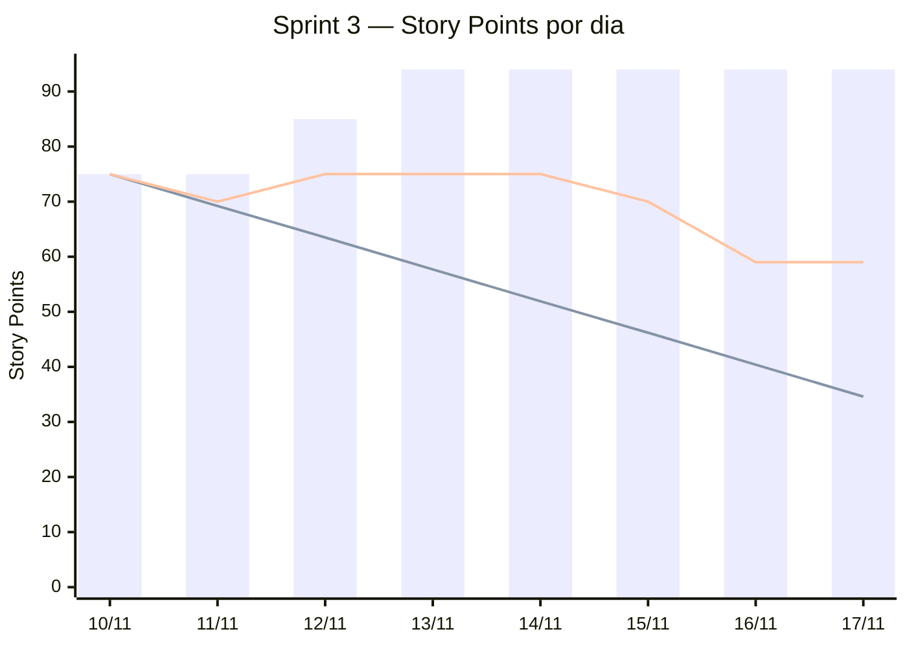

# Burndown — Sprint 3

_Gerado em 17/11/2026 12:12 por `.github/scripts/burndown.sh 3` a partir das issues da milestone [Sprint 3](https://github.com/DEVassos/ecopulse-app/milestones) e do campo **Story Points** do [quadro](https://github.com/orgs/DEVassos/projects/6). Período da sprint: 10/11 a 23/11/2026; dados até 17/11._

Como ler: **barras** = escopo da sprint no dia (soma dos pontos das tarefas já na milestone); **linha que desce reta** = ideal, de 75 pontos no primeiro dia até 0 no último dia da sprint; **outra linha** = pontos ainda abertos no fim de cada dia. Restante acima do ideal indica atraso; barra que sobe indica escopo acrescentado durante a sprint.

## Resumo

| Indicador | Story Points |
|---|---|
| Escopo no primeiro dia (10/11) | 75 |
| Escopo em 17/11 | 94 |
| Concluído (issues fechadas) | 35 |
| Restante | 59 |

## Dia a dia

| Dia | Escopo | Ideal | Restante | Issues fechadas no dia | Issues que entraram no dia |
|---|---|---|---|---|---|
| 10/11 | 75 | 75 | 75 | — | — |
| 11/11 | 75 | 69.2 | 70 | [#256](https://github.com/DEVassos/ecopulse-app/issues/256), [#312](https://github.com/DEVassos/ecopulse-app/issues/312) | — |
| 12/11 | 85 | 63.5 | 75 | [#341](https://github.com/DEVassos/ecopulse-app/issues/341) | [#341](https://github.com/DEVassos/ecopulse-app/issues/341), [#342](https://github.com/DEVassos/ecopulse-app/issues/342) |
| 13/11 | 94 | 57.7 | 75 | [#316](https://github.com/DEVassos/ecopulse-app/issues/316), [#318](https://github.com/DEVassos/ecopulse-app/issues/318), [#319](https://github.com/DEVassos/ecopulse-app/issues/319), [#321](https://github.com/DEVassos/ecopulse-app/issues/321), [#325](https://github.com/DEVassos/ecopulse-app/issues/325), [#332](https://github.com/DEVassos/ecopulse-app/issues/332) | [#346](https://github.com/DEVassos/ecopulse-app/issues/346), [#347](https://github.com/DEVassos/ecopulse-app/issues/347), [#348](https://github.com/DEVassos/ecopulse-app/issues/348), [#349](https://github.com/DEVassos/ecopulse-app/issues/349), [#351](https://github.com/DEVassos/ecopulse-app/issues/351), [#352](https://github.com/DEVassos/ecopulse-app/issues/352) |
| 14/11 | 94 | 51.9 | 75 | — | — |
| 15/11 | 94 | 46.2 | 70 | [#342](https://github.com/DEVassos/ecopulse-app/issues/342) | — |
| 16/11 | 94 | 40.4 | 59 | [#313](https://github.com/DEVassos/ecopulse-app/issues/313), [#322](https://github.com/DEVassos/ecopulse-app/issues/322), [#333](https://github.com/DEVassos/ecopulse-app/issues/333), [#352](https://github.com/DEVassos/ecopulse-app/issues/352) | — |
| 17/11 | 94 | 34.6 | 59 | — | — |

## Fora da soma

- Histórias (`tipo:historia`) e épicos: os pontos deles já estão nas tarefas filhas.
- Issues sem Story Points no quadro: [#356](https://github.com/DEVassos/ecopulse-app/issues/356), [#359](https://github.com/DEVassos/ecopulse-app/issues/359), [#362](https://github.com/DEVassos/ecopulse-app/issues/362).

## Método

- Uma issue entra no escopo no dia em que foi criada (ou no primeiro dia da sprint, se é anterior) e sai do restante no dia em que foi fechada (merge do PR em `develop` para tarefas), no horário de Brasília.
- A lista de issues é a da milestone no momento da geração: issue movida para outra sprint deixa de aparecer em todos os dias, e o motivo fica no [histórico do plano](../../plano-de-entregas.md#histórico-de-alterações-do-plano).
