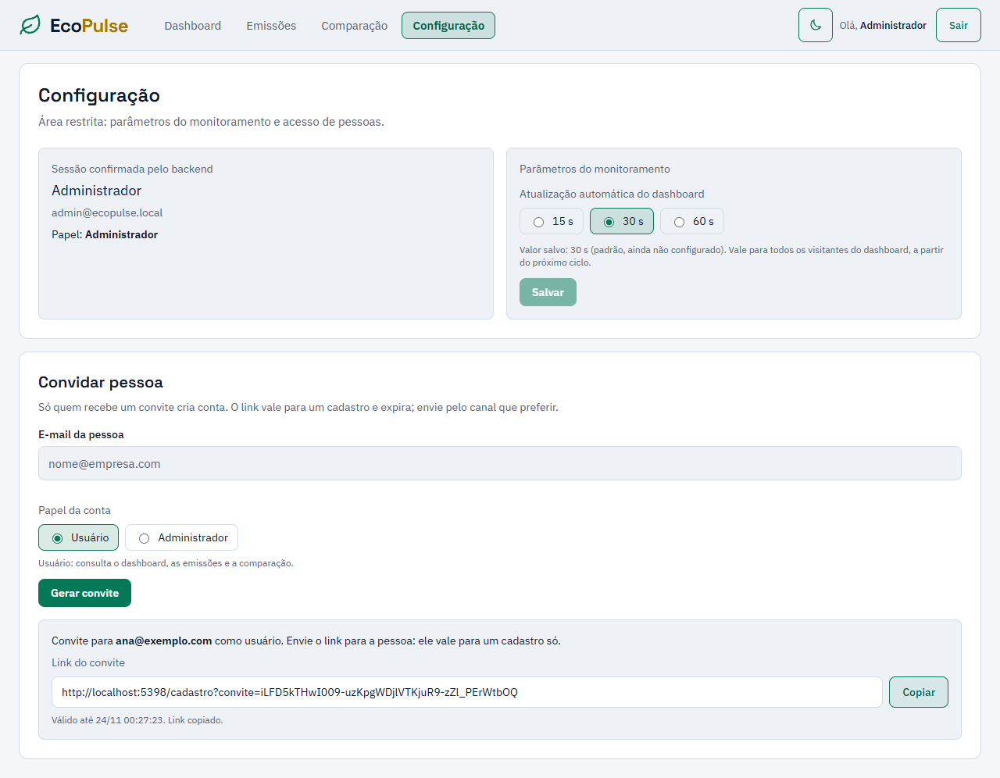
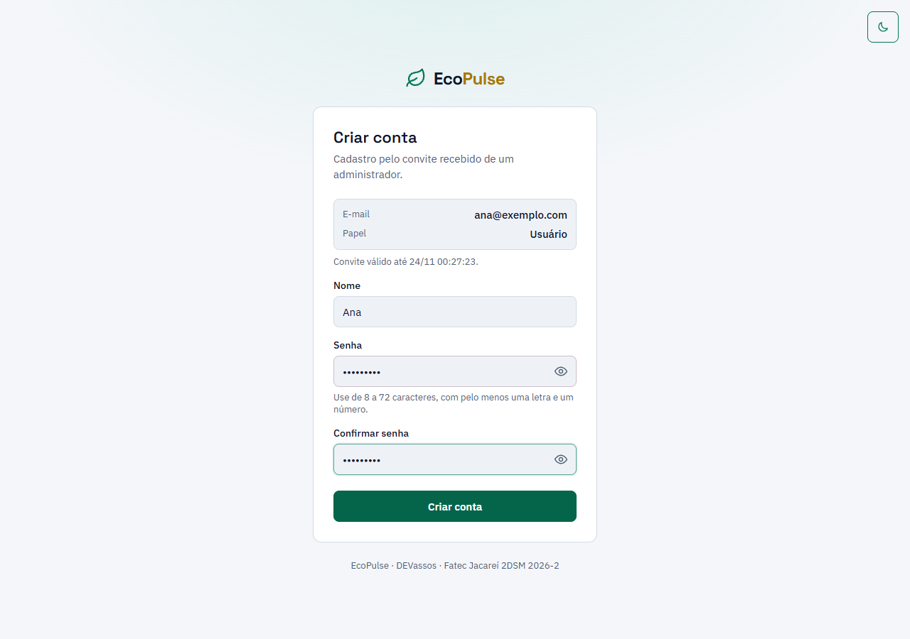
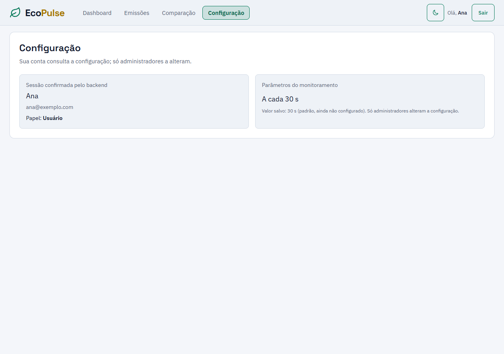

# `frontend` — EcoPulse

Interface web (dashboard EcoPulse) que mostra a energia estimada e as emissões de CO₂e dos serviços monitorados. Stack: React 19 + TypeScript 6.0 (Vite 8), react-router e Tailwind CSS 4; lint com ESLint.

## Requisitos

- Node.js 20.19+ ou 22.13+ (exigência do Vite 8 e do ESLint 10) e npm.

## Organização das pastas

| Pasta / arquivo | Responsabilidade |
|---|---|
| `src/main.tsx` | ponto de entrada: carrega os estilos globais e monta o React com o `BrowserRouter` |
| `src/App.tsx` | rotas: `/login` e `/cadastro` (cadastro por convite, #197), as únicas abertas sem sessão, e, dentro do `ProtectedRoute` (#257), `/` (dashboard), `/emissoes` (emissões por serviço), `/comparacao` (comparação entre serviços) e `/configuracao`; envolve tudo no `AuthProvider` e no `MonitoringProvider` |
| `src/pages/` | telas (`DashboardPage`, `EmissionsPage`, `ComparePage`, `LoginPage`, `RegisterPage`, `SettingsPage`) |
| `src/components/` | componentes reutilizáveis e sem HTTP (`AppHeader`, `Brand`, `KpiPanel`, `MetricTile`, `ServicesTable`, `RegionList`, `ServiceDetailsDialog`, `CollectionsHistoryTable`, `MetricHistoryChart`, `CompareChart`, `EstimateTag`, `StatusBadge`, `LastUpdated`, `MissingValue`, `LoadingState`, `ErrorState`, `UpdateFailedBanner`, `ChangeToast`, `RecentChanges`, `EmptyState`, `AuthLayout`, `FormField`, `ProtectedRoute`), com `.css` próprio ou classes do Tailwind |
| `src/services/` | **único lugar com HTTP**: `api.ts` (cliente base, `VITE_API_URL`, `Authorization: Bearer` com sessão aberta, erros → `ApiError`), `auth.service.ts` (`POST /auth/login` e `GET /auth/me`, com o papel da conta), `invitations.service.ts` (`POST /invitations`, `GET /invitations/:token` e `POST /auth/register`, #197), `contract.ts` (conferência das respostas, ver [abaixo](#conferência-das-respostas-da-api-161)), `services.service.ts` (`GET /services`), `collections.service.ts` (`GET /collections` de um serviço), `emissions.service.ts` (série de emissões: `GET /collections` e `GET /collections/series`, com conferência da resposta), `compare.service.ts` (`GET /services/compare`); `demo-data.ts` e `emissions.demo.ts` com os dados ilustrativos do modo demonstração; testes em `*.test.ts` ao lado do arquivo testado (vitest) |
| `src/contexts/` · `src/providers/` | `MonitoringContext`/`MonitoringProvider`: intervalo da atualização automática; `AuthContext`/`AuthProvider`: sessão (JWT no `sessionStorage`), login e logout |
| `src/hooks/` | `useInvitation` (convite do link de cadastro, #197), `useMonitoring`, `usePolling` (atualização periódica sem recarregar a página), `useServices` (lista de serviços com polling, erro e atualizar agora), `useStatusChanges` (compara cada lista com a anterior: avisos de mudança de estado e setas da tabela), `useCollections` (histórico de coletas de um serviço, com o mesmo polling), `useEmissions` (série de emissões, com tempo real opcional), `useComparison` (comparação entre serviços, uma busca por filtro), `useAuth` (sessão do `AuthProvider`), `useCurrentUser` (confirma a sessão em `GET /auth/me`) |
| `src/utils/` | funções puras: validação dos formulários de login e de cadastro, com a regra de senha do backend (`validation.ts`), destino depois do login (`login-redirect.ts`), formatação pt-BR (`format.ts`), contagem dos serviços por estado (`summary.ts`), trechos e eixo do gráfico de métricas do histórico, com a métrica escolhida (`metric-chart.ts`), datas do filtro, agrupamento, resumo e formatação das emissões (`emissions.ts`) lista de regiões do Dashboard (`region-map.ts`: nome, lugar, ordem e quem fica fora do mapa) e regiões do mapa e da simulação (`regions.ts`: junção de `GET /api/regions` com `GET /api/regions/summary`, pior estado, região mais limpa, simulação de migração pela fórmula de `docs/calculos.md`, escala da bolha e limite de rede limpa) |
| `src/styles/global.css` | ordem das camadas de CSS, Tailwind, tokens de cor e fonte e reset mínimo |
| `src/styles/layout.css` | estrutura comum das páginas (`.page`, `.content`, `.panel`) |
| `mock/server.mjs` | **backend falso** só para desenvolvimento e revisão (ver abaixo); não vai para produção |
| `Dockerfile` · `nginx.conf` · `.dockerignore` | imagem do container (ver [Execução em container](#execução-em-container)) |

## Variáveis de ambiente

Lidas do `.env` da **raiz** do repositório (modelo em `.env.example`; `envDir: '..'` no `vite.config.ts`).

| Variável | Obrigatória | Padrão (`.env.example`) | Descrição |
|---|---|---|---|
| `VITE_API_URL` | não | `http://localhost:3000/api` | base da API do backend, vista pelo navegador. **Sem ela o frontend roda em modo demonstração** (dados ilustrativos e faixa de aviso no topo). No container ela é embutida no bundle durante o build: depois de mudar, suba com `--build` |
| `VITE_REFRESH_INTERVAL_MS` | não | `30000` | intervalo **reserva** da atualização automática: vale no modo demonstração e enquanto `GET /monitoring-settings` não responde; com o backend no ar, o intervalo é o configurado na página Configuração (#176) (mínimo `5000`; máximo `2147483647`, o limite do `setTimeout`). Como a `VITE_API_URL`, é embutida no bundle no build do container |

## Atualização em tempo real

- `usePolling` busca ao abrir a tela e de novo a cada intervalo, só depois que a busca anterior terminou.
- Com a aba oculta o polling pausa; ao voltar para a aba, busca na hora.
- Ao sair da tela, o timer é limpo e a requisição pendente é cancelada (`AbortController`).
- O intervalo vem do backend (#176): o `MonitoringProvider` lê `GET /monitoring-settings` ao abrir e de novo a cada ciclo, então uma troca feita na Configuração, em qualquer aba ou navegador, vale para todos no ciclo seguinte. Se a rota falhar ou responder fora do contrato, fica o último valor lido (antes do primeiro, o `VITE_REFRESH_INTERVAL_MS`).
- O cabeçalho mostra "Última atualização: dd/mm HH:MM:SS · intervalo: N s" e o botão **Atualizar agora**; antes da primeira busca bem-sucedida (inclusive se ela falhar), mostra "Aguardando a primeira atualização" com o intervalo e o botão.
- Durante uma busca o botão fica com `aria-disabled` (não `disabled`), para quem navega pelo teclado não perder o foco a cada ciclo. O selo não é `role="status"`: o horário não é anunciado a cada ciclo, e a falha é anunciada pelo aviso de erro.
- Se uma atualização falhar com dados na tela, eles continuam visíveis, o selo fica laranja ("Desatualizado desde…") e, acima dos cards, aparece a faixa compacta laranja `UpdateFailedBanner` (cerca de 40 px): a mensagem do erro, "Mostrando dados de HH:MM:SS." e **Tentar novamente**. A mensagem é a que o hook entrega: "Não foi possível conectar ao servidor…" quando a rede cai, ou a do corpo do erro num 500. O aviso grande (`ErrorState`) fica só para a falha sem nenhum dado.
- A faixa é `role="status"`, e não `alert`: a região viva fica montada enquanto há dados, e o leitor de tela anuncia a falha uma vez, e não a cada ciclo do polling.

## Avisos de mudança de estado (RF02, RF05, RF06, #331)

- `useStatusChanges` compara cada lista de `GET /services` com a anterior, sem requisição nova, e gera uma frase com o horário para cada mudança: "Novo serviço: Billing API, às 14:32", "Billing API ficou indisponível às 14:32", "… ficou sem métricas …", "… voltou a ficar ativo …" e "… saiu do agregador …" (estado `removido` ou fora da lista). A primeira lista da página só vira referência: a carga nunca avisa nada. Uma busca que falhou mantém a mesma lista e também não avisa.
- O aviso (`ChangeToast`) aparece no canto inferior direito com até 3 frases, a mais grave primeiro, e some em 8 s (ou no ×). Ele não recebe foco; a região `role="status"` com `aria-live="polite"` fica sempre montada, e o leitor de tela anuncia o lote uma vez.
- **Últimas mudanças** (`RecentChanges`), abaixo dos cards de estado, guarda as 10 mais recentes desde que a página abriu, em duas colunas a partir de 6 linhas na tela larga.
- Na tabela, a linha que mudou de estado ganha um clarão verde de 4 s, e CPU e fator que subiram ou desceram desde a lista anterior ganham ▲ ou ▼ antes do número (o leitor de tela lê "subiu" ou "desceu"). Com "reduzir movimento", a linha fica com um contorno parado até a atualização seguinte. Se a busca seguinte falha, as setas somem enquanto o selo diz "Desatualizado desde…": o número é da atualização anterior, não um valor que acabou de mudar.

## Conferência das respostas da API (#161)

- Os tipos do TypeScript somem no build ([erased types](https://www.typescriptlang.org/docs/handbook/2/basic-types.html#erased-types)) e não garantem o formato que o servidor devolveu. Por isso `services.service.ts` e `collections.service.ts` pedem a resposta como `unknown` e a conferem contra [docs/api.md](../docs/api.md) antes de entregá-la aos hooks.
- A conferência usa os leitores de `src/services/contract.ts`, sem biblioteca. Cada campo é checado pelo tipo do contrato: id em texto não vazio, medidas como número finito ≥ 0 ou `null`, datas que o `Date.parse` do navegador reconhece (o backend manda ISO 8601) e estados só entre os valores conhecidos. Campo que aceita `null` precisa vir na resposta. Os campos de cálculo das coletas (#188) podem faltar.
- Um único item fora do contrato recusa a resposta inteira com `ApiError`. A tela segue o fluxo de falha que já tem: com dados na tela, eles continuam com "Desatualizado desde…" e a faixa com **Tentar novamente**; sem dados, aparece só o aviso grande. O item inválido nunca entra na tabela.
- A mensagem diz o primeiro campo recusado, para quem investiga saber onde olhar: "O servidor respondeu num formato inesperado (services[3].id). Avise a equipe do backend." Um 2xx com corpo que não é JSON gera a mesma mensagem, sem o campo.
- `monitoring.service.ts` confere `GET`/`PUT /monitoring-settings` (#176): intervalos inteiros maiores que zero, lista de valores não vazia e `updatedAt` em ISO 8601 ou `null`. O `statusReason` de `GET /services` é texto ou `null`, e a chave ausente vale `null`, para a tela funcionar antes e depois de o backend da #176 subir. O mesmo vale para os sete campos da última coleta (#297: `regionCode`, `collectionIntervalSeconds`, `memoryGb`, `diskGb`, `networkGb`, `powerWatts`, `carbonIntensityGco2ePerKwh`): ausentes valem `null`; presentes, precisam ser número ≥ 0 (o intervalo, inteiro ≥ 1) ou `null`, senão a resposta é recusada citando o campo.
- `auth.service.ts` confere o `token` do login e o `id`/`email` de `GET /auth/me` (#25): um 200 sem token não abre sessão.
- `fetchServicesSummary` (`GET /services/summary`) e `compare.service.ts` (`GET /services/compare`) conferem a resposta do mesmo jeito (#237): um campo fora do contrato recusa a resposta inteira. No dashboard, o painel de indicadores dá lugar ao erro com **Tentar novamente** (se já havia um resumo, ele continua apagado, como desatualizado); na Comparação, a página mostra o erro e não monta a tabela nem os gráficos.
- A página Emissões confere a sua de outro jeito: envelope inválido (`collections` ou `buckets` que não são lista, `totals` fora do formato) recusa a resposta, mas uma coleta ou um intervalo inválido fica de fora sozinho e é contado, e a página avisa quantos foram descartados. As funções `parseCollectionsPage` e `parseSeriesResponse` (`emissions.service.ts`) têm testes próprios.

## Menu no celular e tooltip único (#274)

- Abaixo de 600 px, a faixa do menu some e o cabeçalho ganha o botão **Menu** (`MobileMenu`, em `src/components/AppHeader.tsx`), ao lado de **Sair**. Ele abre uma grade com Dashboard, Emissões, Comparação e Configuração, cada uma com o ícone sobre o rótulo, e fecha ao tocar num item, ao tocar fora, com Esc (o foco volta ao botão) e ao trocar de página, inclusive pelo "voltar" do navegador. O botão tem `aria-expanded` e `aria-controls`; abaixo de 360 px, ele mostra só o ícone, e o nome "Menu" continua para o leitor de tela. No fim do painel ficam o nome e o e-mail de quem entrou e o tema ("Tema escuro" ou "Tema claro", com o mesmo botão de alternar do cabeçalho largo), porque na linha da marca só cabem **Menu** e **Sair**.
- O `title` do navegador saiu dos botões só de ícone (atualizar, ‹ ›, fechar, ver histórico), das notas (variação, dado antigo, valor ausente, etiqueta **estimado**) e do chip do pico. No lugar dele, `TooltipLayer` (montado uma vez no `App.tsx`) mostra o texto do atributo `data-tooltip` de qualquer elemento num cartão escuro acima dele e dentro da tela (`src/utils/tooltip-position.ts`), com o ponteiro e com o foco do teclado; ele fecha ao sair, ao clicar, ao rolar e com Esc. Usa o popover do navegador, para ficar acima da janela de detalhes, que é um `<dialog>` modal. Enquanto está aberto, o elemento ganha `aria-describedby` apontando para ele, se o texto não for o próprio nome do botão.
- Energia e CO₂e compactos, na tabela do dashboard, nos cards de 24 h e na matriz da Comparação (`CompactValue`), levam o valor exato em destaque no tooltip, com 4 algarismos significativos na unidade do próprio valor (`formatPrecise`, em `src/utils/units.ts`): o "1,44" da coluna mostra "1,438 Wh".
- No toque, o tooltip não abre ao passar o dedo; os textos dele continuam no leitor de tela pelos rótulos e descrições de cada elemento.

## Login (#25, #257)

- `/login` confere o formulário antes de chamar o backend: e-mail vazio ou mal formado e senha vazia mostram a mensagem no próprio campo, e o foco vai para o primeiro campo com erro.
- `POST /auth/login` (#20) devolve o JWT. O `AuthProvider` guarda o token no `sessionStorage` (chave `ecopulse.session`), que some ao fechar a aba e não passa para outras abas. Credencial errada (401) vira "E-mail ou senha incorretos.".
- Com sessão aberta, toda chamada feita por `services/api.ts` leva `Authorization: Bearer <token>`.
- **Toda a aplicação exige login (#257).** `/login` é a única página aberta sem sessão. Em `App.tsx`, o `ProtectedRoute` é a rota-pai do dashboard, de Emissões, da Comparação e da Configuração: sem sessão, leva para `/login` e guarda a tela pedida com a query (`/emissoes?servico=…&de=…`, em `utils/login-redirect.ts`); depois do login, a pessoa volta exatamente para ela. Só caminhos internos são aceitos como destino.
- Sem sessão nenhuma página monta, então nenhuma busca nem polling começa. Ao clicar em **Sair**, ou quando a API responde 401 com sessão aberta (token expirado ou recusado), a sessão acaba, as páginas desmontam e o polling para junto. No caso do 401, o login avisa "Sua sessão expirou. Entre novamente para continuar de onde parou.".
- Sem sessão o cabeçalho não aparece (só existe dentro das páginas protegidas). Com sessão, mostra o nome que o backend devolveu no login e **Sair**; o e-mail e o papel aparecem no tooltip (no celular, no menu).
- A Configuração confirma a sessão em `GET /auth/me` e mostra o nome, o e-mail e o papel lidos do banco (#196).
- Em **Parâmetros do monitoramento** (#176), só o administrador (#197) escolhe o intervalo da atualização automática entre os valores de `allowedIntervalsSeconds` (hoje 15, 30 e 60 s) e clica em **Salvar** (`PUT /monitoring-settings`, com o token). O botão só se habilita quando o valor muda. O resultado aparece ao lado, numa região `role="status"`; um 400 mostra a mensagem do backend, e um 401 encerra a sessão como nas outras rotas. A conta `usuario` vê só o valor salvo e "Só administradores alteram a configuração."; se tentar a troca por fora, o backend responde 403. A leitura (`GET /monitoring-settings`) continua pública, então o intervalo salvo vale para toda sessão.
- O `ProtectedRoute` só melhora a navegação: **quem protege os dados é o backend**, que responde 401 sem token válido em `/api/services` e `/api/collections` ([docs/api.md](../docs/api.md)). `GET /api/monitoring-settings` continua público (#176).
- **Modo demonstração** (sem `VITE_API_URL`): não há backend para conferir a senha, e os dados são ilustrativos. Dashboard, Emissões e Comparação abrem direto, com a faixa de aviso; a Configuração continua exigindo sessão, e o login avisa que precisa da API. A decisão está no [ADR 0009](../docs/adr/0009-aplicacao-inteira-com-login.md).

## Convites e cadastro por convite (US15, #197)

Só quem recebe um convite cria conta; contratos das rotas em [docs/api.md](../docs/api.md#post-apiinvitations) (#196).

- **Convidar pessoa** é um painel da Configuração que só aparece para administrador (o papel vem de `GET /auth/me`). O administrador informa o e-mail e o papel (**Usuário** ou **Administrador**) e clica em **Gerar convite** (`POST /invitations`). A tela mostra o link, o botão **Copiar** (área de transferência; sem permissão, o link fica selecionado para Ctrl+C) e a validade. Não há envio de e-mail. E-mail com conta mostra o 409 do backend ("Já existe uma conta com este e-mail.").
- **Cadastro** em `/cadastro?convite=<token>`, aberta sem sessão, no mesmo visual do login. `useInvitation` lê o convite (`GET /invitations/:token`) e a tela mostra o e-mail e o papel em somente leitura, a validade e os campos **Nome**, **Senha** e **Confirmar senha**. Nome vazio, senha fora da regra (8 a 72 caracteres, com letra e número, a mesma do backend) ou confirmação diferente aparecem no próprio campo, **sem chamar o backend**. Com tudo certo, `POST /auth/register` cria a conta e a tela vai para `/login`, que mostra "Conta criada. Entre com seu e-mail e senha." e já traz o e-mail.
- Convite inexistente (404), já usado ou expirado (410) e link sem token mostram o motivo, sem o formulário. Falha de rede mostra **Tentar novamente**. Com uma sessão aberta na aba, a tela pede para sair antes de usar o convite.
- O papel só decide o que a tela oferece: quem bloqueia é o backend, que responde 403 à conta `usuario` em `POST /invitations` e no `PUT /monitoring-settings`. O 403 não encerra a sessão; só o 401 encerra.
- Sessão salva antes da #196 (sem papel) é descartada ao abrir a página, e a pessoa entra de novo.



_Compose isolado com o backend da #196 em 21/11/2026, 1280 px: convite para `ana@exemplo.com` como usuário, depois de **Copiar** ("Link copiado.")._



_O link aberto numa janela sem sessão: e-mail e papel vêm do convite; nome e senha preenchidos, antes de **Criar conta**._



_A conta criada pelo convite: sem **Convidar pessoa** e com o intervalo só para leitura._

## Cards de estado

- Acima da tabela, `KpiPanel` mostra quatro cards `MetricTile`: **Total**, **Ativos**, **Indisponíveis** e **Sem métricas**. As contagens vêm de `summarizeStatus` (`src/utils/summary.ts`), sobre a mesma lista de `GET /api/services` da tabela, e mudam no mesmo ciclo do polling.
- Os removidos não entram no total, porque saíram da lista do agregador. Quando há algum, o card do total diz "sem contar N removidos".
- Cada estado tem rótulo, ícone e a cor do `StatusBadge`: a cor nunca é a única pista. Só problema ganha cor (#272): **Ativos** é o estado saudável e fica sempre neutro, sem tom nem borda. **Indisponíveis** e **Sem métricas** ganham a cor e a borda só com contagem maior que zero; com zero, ficam neutros e sem nota, para não criar falso alarme. Com contagem, a nota ao lado do número dá a proporção ("14% do total").
- Os cards são compactos (cerca de 89 px de altura), para sobrar espaço para a tabela em telas de notebook.
- Os cards só aparecem depois da primeira busca bem-sucedida: sem dados, a tela mostra o carregamento ou o erro, nunca zeros. Se uma atualização falha, eles continuam com o último dado, com os números apagados (`--muted`), junto com o erro e o selo "Desatualizado desde…".
- `MetricTile` é genérico (rótulo, valor, unidade, nota, ícone e tom), para os cards de energia e CO₂e do painel de indicadores agregados.

## Indicadores agregados (RF08)

- `SummaryPanel` fica no topo do dashboard, logo abaixo do cabeçalho e acima dos cards de estado (#259: o impacto vem primeiro), e mostra **Energia no período** e **Emissões no período** das **últimas 24 h**, na unidade que o valor pede ("841 Wh", "1,23 kWh", "301 g CO₂e"; [regra das unidades](#unidades-de-energia-e-emissão-271)), com o período no título em horário de Brasília (`timeZone: 'America/Sao_Paulo'`). O estado dos serviços fica só nos cards do `KpiPanel` (#21): o `services` de `GET /api/services/summary` é o estado **atual** e não depende do período, por isso o painel não o repete.
- O `DashboardPage` chama `GET /api/services/summary` (por `fetchServicesSummary`, em `src/services/services.service.ts`) a cada ciclo do polling, duas vezes: as últimas 24 h e as 24 h anteriores a elas. A nota de cada card é a variação com seta: "▲ 12,4% vs 24 h anteriores" em laranja (energia e CO₂e são métricas em que menos é melhor), "▼ 8,1%" em verde e "±0%" em cinza abaixo de 0,5%. De 100% a 999%, sem casa decimal ("▲ 880%"); acima de 999%, "▲ 10×+". Sem base (sem cálculo nas 24 h anteriores, total anterior zero ou comparação não carregada), a nota é "— vs 24 h anteriores" e o motivo fica no tooltip. O valor exato, com sinal e uma casa, também fica no tooltip; o leitor de tela ouve "subiu" ou "caiu" no lugar da seta.
- Equivalência do CO₂e (#333): abaixo do valor de **Emissões no período**, o card mostra duas unidades do dia a dia ("≈ 8,7 km de carro a gasolina · ≈ 170 cargas de celular (ordem de grandeza)" para 2,13 kg CO₂e), calculadas por `src/utils/equivalents.ts` com os fatores de [docs/calculos.md § Equivalências](../docs/calculos.md#equivalências) — 244,2 g CO₂e/km de carro e 12,4 g CO₂ por carga de celular, da calculadora de equivalências da EPA consultada em 13/11/2026. Dois algarismos significativos no padrão brasileiro; abaixo de 0,01 a unidade vira "< 0,01", nunca zero. O tooltip da linha traz o fator, a fonte e a data de consulta, e o mesmo texto vai num `sr-only`, para quem usa leitor de tela ou toque (sem hover); a linha é só de apresentação e não é gravada. Sem CO₂e calculado (`null`) ou com total zero, ela não aparece.
- Sem cálculo no período, o valor é o traço do `MissingValue` ("sem cálculo" para leitor de tela), nunca zero. Nos ciclos seguintes ao primeiro, a variação anterior continua na tela até chegar a nova resposta, sem piscar "Comparando período anterior…".
- Um aviso de erro por página (#271): falha do resumo ou da comparação aparece como `ErrorState` abaixo da faixa de falha da lista (`UpdateFailedBanner`, #217), só quando a lista em si não falhou; se a lista falhou com dados na tela, a faixa já diz o que houve. Os cards ficam com os números apagados e a seta da variação sem cor até a próxima busca bem-sucedida.
- Enquanto a primeira resposta não chega, os dois cards mostram "…" e "Calculando o período…", nunca "—" nem zero, e já ocupam o lugar deles, para a página não pular quando o resumo chega (#259). Os cards de estado ficam logo abaixo, na versão compacta do `MetricTile` (`compact`, cerca de 64 px).
- No modo demonstração (sem `VITE_API_URL`) o painel não aparece: não há dados de demonstração para o resumo.
- Com o backend falso (`npm run mock`, #239), o painel soma as coletas que o mock gera a cada 30 s. Como elas se repetem dia a dia, a variação contra as 24 h anteriores fica perto de zero.

## Estado com motivo (#176)

- O badge de estado já traz texto e cor. Abaixo dele, a tabela mostra o **motivo** em texto, e a janela de detalhes repete o motivo acima dos dados (`utils/status.ts`):
  - **Indisponível:** o `statusReason` de `GET /services`, que é a mensagem da coleta mais recente (ex.: "Serviço indisponível (HTTP 500)."). Sem mensagem, aparece "A última coleta falhou, sem motivo informado.".
  - **Sem métricas:** "O agregador não tem métricas deste serviço." · **Removido:** "Saiu da lista do agregador." (textos fixos: o banco não guarda motivo para esses dois).
  - **Ativo:** sem texto extra.
- O serviço com falha continua na lista, no topo da ordem por gravidade.

## Unidades de energia e emissão (#271)

A API devolve energia em kWh e CO₂e em gramas. A tela escolhe a unidade em `src/utils/units.ts`, para a mesma grandeza não aparecer como 118 Wh numa tela, 0,1187 kWh em outra e 0,00091 kWh numa terceira.

- **Num conjunto** (coluna da tabela de serviços, linha da comparação, eixo do gráfico de emissões, barras da comparação), todos os números usam a mesma unidade, a do maior valor do conjunto, e ela vai no cabeçalho ou no título do eixo. `scaleFor` escolhe a maior unidade em que esse valor fica em pelo menos 1 (mWh, Wh, kWh ou MWh; mg, g, kg ou t) e as casas pela ordem de grandeza dele: 2 abaixo de 10, 1 abaixo de 100 e nenhuma a partir daí. Assim, os números do conjunto continuam comparáveis e com as vírgulas alinhadas.
- **Um valor sozinho** (card, tooltip, chip do gráfico) usa a unidade dele mesmo, por `formatQuantity`: "841 Wh", "44,6 g", "601 mg". Zero aparece "0 g" ou "0 kWh".
- Um valor positivo menor que a resolução aparece como "< 0,01", nunca como zero. Sem cálculo, continua "—".

## Energia e emissão na tabela

- As colunas **Energia 24 h** e **CO₂e 24 h** (#330) mostram o total de cada serviço nas **mesmas 24 h** dos cards **Energia no período** e **Emissões no período**: a soma da coluna é igual ao card, com diferença só de arredondamento. Elas saem de `GET /api/services/ranking`, que o Dashboard já busca a cada ciclo para a coluna **Parte do CO₂e (24 h)** (seção abaixo); nenhuma requisição nova (RNF03). Antes da #330 a tabela mostrava a **última coleta** (~30 s, em Wh e mg) logo abaixo de totais em kWh e kg, e as duas escalas de tempo se confundiam; a energia e o CO₂e da última leitura agora ficam na [janela de detalhes](#detalhes-e-histórico-do-serviço-135).
- Cada coluna tem uma unidade só, a do maior valor do ranking, e ela vai no cabeçalho: "Energia 24 h (Wh)", "CO₂e 24 h (g)". Todas as linhas usam as mesmas casas, então as vírgulas ficam alinhadas, e o valor exato fica no tooltip ("778,3 Wh" para o 778 da célula). A busca não muda a unidade enquanto se digita. Um valor positivo menor que a resolução aparece como "< 0,01", nunca como zero. Regra completa em [Unidades de energia e emissão](#unidades-de-energia-e-emissão-271).
- Sem valor, as colunas das 24 h dizem o motivo no lugar de zero, os mesmos três da coluna da parte: "ranking do período indisponível" (a busca do ranking falhou antes de qualquer resposta), "serviço fora do ranking" e "sem cálculo no período". Quando o ranking (ou a lista, que o dispara) falha depois de uma resposta, as três colunas ficam em `--muted` com o último valor, e o restante da tabela segue atualizando.
- Número que não é atual fica em `--muted` (#261): o da linha de um serviço **removido** (saiu da lista do agregador) e, quando a última busca falha, os de todas as linhas, como os cards de estado. Removido fica sempre no fim da tabela, qualquer que seja a coluna da ordenação, para o último dado dele não liderar a coluna. A **Última leitura** mostra só a hora quando é de hoje e a data com a hora quando é de outro dia (`formatTimeOrDayTime`).
- O selo **Ativo** fica com o texto neutro (`--muted`) e o ponto verde; só **Indisponível** e **Sem métricas** têm o selo colorido (#272). Ao lado do selo deles, um botão de ícone **Ver histórico** ("Ver histórico de <serviço>" para leitor de tela) abre a mesma janela de detalhes do clique na linha, com o histórico de coletas. Ao fechar, o foco volta para o botão clicado.
- A leitura mais recente fica agrupada depois da parte: **CPU**, **Fator da região** e **Última leitura**, que diz de quando são esses três valores; a tabela não repete o `period` de `GET /api/services`.
- **Fator da região (gCO₂e/kWh)** (#298): a intensidade de carbono usada na última coleta. É o que faz um serviço com CPU alta em região limpa emitir menos que outro com CPU baixa em região suja; o tooltip diz de qual região é. A coluna ordena nos dois sentidos, com "—" no fim, e fica em `--muted` junto com os outros números quando a busca falha. O "—" tem três motivos, cada um com texto para o leitor de tela e tooltip próprio: **sem região** no cadastro (nunca haverá cálculo), **sem leitura** e **sem fator nesta leitura** (cálculo indisponível).
- A potência estimada, a RAM, o disco e a rede da última coleta ficam no tooltip da célula de **CPU** (a potência em destaque: "41,8 W"), e o intervalo da coleta no tooltip da **Última leitura** ("coleta de 46 s"). Quem usa teclado vê os mesmos dados na janela de detalhes.
- **Localização** mostra o código da região (`us-east`) em algarismos tabulares, com cidade, país e nome da região no tooltip, para a coluna do fator caber sem alargar a tabela; sem código, mostra o texto como antes. Ordena pelo código e depois pelo nome, país e cidade.

## Potência média na tabela (RF14, #329)

- A coluna **Potência média (W)** mostra a eficiência energética de `docs/calculos.md` § Eficiência energética e de carbono: a energia das **mesmas 24 h** das colunas vizinhas dividida pelos **segundos monitorados** dessas coletas calculadas (`monitoredSeconds`), em W. Não é a média de `power_watts` (outro conjunto de coletas) nem a carga de trabalho do serviço: ela diz quanto o serviço gasta por hora para estar no ar.
- A unidade fica no cabeçalho, como nas outras colunas, e a célula traz o número com a mesma resolução das colunas do período; o valor com a unidade e a definição ficam no tooltip — que está no **cabeçalho** e no número da célula, então quem navega pelo teclado alcança o texto pelo botão de ordenar.
- As ausências são as mesmas das outras colunas do período, mais uma: energia calculada sem segundos monitorados não vira `0 W`, e o motivo é "sem tempo monitorado". Não há requisição nova: a coluna sai do `monitoredSeconds` que `GET /api/services/ranking` passou a devolver na #329.
- Como verificar (#329): com o backend, na tabela do Dashboard, a potência de um serviço bate com `energia do período × 3 600 000 ÷ monitoredSeconds` (a conta de `docs/calculos.md`) e não com a potência da última leitura; com `npm run mock`, a coluna aparece preenchida e o serviço sem cálculo mostra o motivo no lugar do número.

## Parte do CO₂e nas últimas 24 h (RF14, #260)

- A tabela tem a coluna **Parte do CO₂e (24 h)**: quanto cada serviço respondeu do CO₂e das últimas 24 h. Ela vem de `GET /api/services/ranking?metric=co2e&from=&to=` (contrato aprovado na #50), buscada por `fetchServicesRanking` (`src/services/ranking.service.ts`) a cada ciclo do polling, no mesmo período do painel de indicadores.
- `utils/ranking.ts` divide o CO₂e de cada serviço pela soma dos serviços com cálculo e arredonda as partes a uma casa pelo método do maior resto, então a coluna exibida soma exatamente 100,0% (arredondar linha a linha poderia dar 99,9 ou 100,1 com 8 serviços). Serviço sem cálculo no período mostra "—" e não entra na soma; com total zero, todos os que têm coleta no período aparecem com 0,0%, porque é um cálculo válido.
- A barra segue `docs/identidade-visual.md` § Barras de ranking: trilho em `--border`, barra em `--accent-hover`, e o 1º lugar em `--neon` com o rótulo **1º**. A barra é proporcional ao 1º, que fica cheio; o número ao lado é a parte no total.
- Acima da tabela, **Quem pesa mais** diz, com o período: "Fraud Detector respondeu por 29,0% do CO₂e das últimas 24 h.", e some quando a parte é 0,0%.
- **Três ausências diferentes**, cada uma com o seu texto: "ranking do período indisponível" (a busca do ranking falhou e não houve resposta anterior), "serviço fora do ranking" (a resposta do período não trouxe o serviço) e "sem cálculo no período" (o serviço está no ranking, sem CO₂e calculado nas 24 h). O tooltip repete a explicação de cada uma.
- **Ordem estável:** a ordem inicial é pelo **CO₂e 24 h**, do maior para o menor (#330): a primeira linha é o maior emissor do período, o mesmo da frase **Quem pesa mais**, e a ordem não muda a cada leitura. O nome desempata; as linhas sem cálculo ficam no fim, e um Removido fica sempre na última. Enquanto o ranking não chega, a emissão da última leitura ordena no lugar do total (ela nunca é exibida como total). Clicar em **Status** ordena pela gravidade (#203), com desempate pelo CO₂e das 24 h; clicar em **Parte do CO₂e (24 h)** ou nas colunas das 24 h ordena pelo período, com as linhas sem valor no fim nas duas ordens.
- A resposta é conferida como as outras (#161): um campo fora do contrato — inclusive `metric` diferente da pedida — recusa o ranking inteiro, com o `ErrorState` e **Tentar novamente**. As posições também são conferidas: quem tem a métrica vem primeiro, com 1, 2, 3… na ordem da lista e valores que não crescem, e quem não tem fica no fim com `position: null`; senão o "1º" iria para uma linha sem a barra cheia. Numa falha do ranking com resposta anterior na tela, a última parte continua em cinza, sem o neon, a frase perde o destaque e o aviso começa com "Ranking de CO₂e do período: ", para não se confundir com a falha da lista de serviços. Quando é a lista que falha (backend fora do ar), o ranking não é buscado de novo, e a coluna e a frase ficam em cinza do mesmo jeito, junto com os outros números da tabela (#261).
- No modo demonstração, o ranking sai da leitura ilustrativa de cada serviço, repetida no intervalo dela (a leitura do demo vale 1 h, então 24 h têm 24 leituras). Repetir a leitura a cada 30 s multiplicava a energia por 120 e a coluna de potência mostrava 8 556 W para um serviço de 71,3 W (#329).

## Regiões por CO₂e (RF13, #342)

- Entre **Quem pesa mais** e a tabela, o Dashboard mostra **Regiões por CO₂e**: uma linha por região, da maior para a menor emissão das últimas 24 h (o mesmo período dos indicadores), com a barra proporcional à maior, os serviços por estado ("2 Ativos · 1 Indisponível"), a intensidade da rede e a parte renovável. Região sem cálculo mostra "sem cálculo"; a marca colorida é o pior estado, e "Sem métricas" tem a borda tracejada, para não depender só da cor.
- Os dados vêm de `GET /api/regions` e `GET /api/regions/summary` (`regions.service.ts`, #341), buscados juntos a cada ciclo do polling. `utils/region-map.ts` junta as duas respostas com o `joinRegions` da #321 e separa as regiões com serviço, as **sem serviço hoje** (no grupo recolhido do fim, por nome) e os serviços **fora do mapa**: sem região, com região que a Carbon API não informa ou com região sem coordenada. Eles continuam na tabela, e o aviso diz quantos são; o CO₂e dos sem região conhecida aparece no aviso, para a soma da lista bater com o card **Emissões no período**. Serviços removidos não entram nas contagens.
- **Seleção compartilhada:** cada região da lista é um botão com `aria-pressed`. Clicar numa região destaca, na tabela, as linhas dela (fundo e filete verde à esquerda); na tabela, o código da região na coluna **Localização** também é um botão que seleciona a mesma região na lista, sem abrir a janela do serviço. Clicar de novo desfaz a seleção. O mapa (abaixo) usa a mesma seleção.
- **Com o backend real** (`VITE_API_URL`), a lista e o mapa usam `GET /api/regions` (#319) e `GET /api/regions/summary` (#320), verificados no compose na #351 (PR #373).
- A lista funciona sozinha, sem WebGL, e é a alternativa acessível ao mapa. Uma falha só das regiões (ex.: Carbon API fora do ar) mostra "Regiões indisponíveis: …" no lugar da lista, e o resto do Dashboard continua; com uma resposta anterior, a lista fica com os números em cinza e o aviso diz "Regiões desatualizadas".

## Mapa das regiões (RF13, #322)

- Ao lado da lista de regiões (no celular, acima dela), um globo com **uma bolha por região com serviço**: a cor é o pior estado (os mesmos nomes do selo da tabela), o **tamanho** cresce com o CO₂e das últimas 24 h (`bubbleRadius` da #321) e o anel amarelo é a energia diante da região que mais consumiu. Regiões sem serviço hoje são pontos neutros pequenos, só destinos possíveis. Serviços removidos ficam fora, e quem não tem região ou coordenada entra no aviso da lista.
- **A mesma seleção da lista e da tabela (#342):** escolher uma região em qualquer um dos três leva o mapa até ela, numa viagem em três tempos (sobe até o globo, gira e desce inclinando a câmera). Clicar numa bolha encostada em outras primeiro aproxima o grupo para separá-las; com a bolha separada, o clique seleciona a região. **Visão geral** desfaz a seleção e volta ao globo. Com "reduzir movimento" ligado no sistema, o mapa salta, sem voo. As bolhas atualizam a cada ciclo do polling, sem recriar o mapa.
- **Biblioteca e peso (ADR 0010):** `maplibre-gl` 6.16.0 (versão fixa) carregado por `React.lazy`, com o `LoadingState` "Carregando o mapa…". O app inicial continua com 387,18 kB de JS (121,00 kB com gzip); o mapa só baixa quando há regiões: 1.104,29 kB do MapLibre (298,17 kB com gzip), 150,14 kB do componente com o contorno dos países (43,33 kB com gzip), 75,56 kB de CSS (11,35 kB com gzip) e o worker de 519,00 kB, medidos com `npm ci && npx vite build` em 16/11/2026. O worker é importado com `?worker&url` e informado por `setWorkerUrl`: o MapLibre 6 o procura ao lado do módulo, o build não o copia, e sem ele o contorno dos países não aparece; como `.js`, o nginx o serve como JavaScript (o `.mjs` sairia como `application/octet-stream` e seria recusado por causa do `nosniff`).
- **Imagens de satélite:** EOX Sentinel-2 cloudless 2025, com o crédito no modo automático do MapLibre (combinado com o Gabriel em 13/11): aberto no canto em mapas a partir de 640 px de largura; mais estreito, como no celular, ele começa fechado no botão **i** (#351), para não cobrir as bolhas, e abre com um toque. **Aviso de uso comercial:** essa camada está sob CC BY-NC-SA 4.0, livre só para uso não comercial; uso comercial do EcoPulse exige a licença paga da EOX ou outra fonte de imagens (ADR 0010). Nenhuma camada da Esri está no código.
- **Sem internet:** por baixo das imagens fica o contorno dos países da Natural Earth 1:110m (domínio público, `components/countries-110m.json`, embutido), e o aviso "Sem imagens de satélite agora. O mapa mostra o contorno dos países." aparece no topo. Sem WebGL, o mapa mostra que não abriu, e a lista continua com os dados.
- No celular, a legenda desce para baixo do mapa, para não cobrir as bolhas nem o botão **i** do crédito.
- Num mapa menor que 460 px de lado (no celular, 300 px de altura), o globo da visão geral afasta na mesma proporção e as bolhas encolhem junto, até 60% do tamanho e nunca abaixo de 22 px (`fitZoom` e `mapScale`, em `src/utils/region-map.ts`, #351). Ao girar o celular, o globo volta a caber.

- **Modo apresentação (#323):** com duas ou mais regiões com serviço no mapa, o botão **Apresentar** (canto superior esquerdo) percorre as regiões da maior para a menor emissão, a mesma ordem da lista, com o painel da região aberto (§ Simulação de migração). Em cada uma, o mapa fica 6 s depois de chegar (`PRESENTATION_DWELL_MS`); se o mapa não avisar a chegada, como sem WebGL, a contagem começa depois de 8 s. É um botão só, compacto, que troca de rótulo: **Apresentar** → **Pausar** → **Retomar**; enquanto o modo está ativo, a pausa fica sempre visível (WCAG 2.2.2). Toque, clique, roda do mouse, tecla ou foco pelo teclado dentro do mapa pausa, e escolher uma região na lista ou na tabela também. O modo nunca liga sozinho; sair do Dashboard o desliga, e depois de 1 min pausado ele também desliga, com o botão de volta a **Apresentar** (`PRESENTATION_PAUSE_RESET_MS`). Com "reduzir movimento", a troca de região é um salto, sem voo. Ordem e próxima região em `presentationOrder` e `nextPresentationCode` (`src/utils/region-map.ts`).

## Selo de rede limpa (RF12, RF13, #324)

- O selo **Rede limpa** (folha e texto, nunca só a cor) marca as regiões com intensidade de carbono de agora em até **100 g CO₂e/kWh**, o limite do PO em [docs/calculos.md § Limite de "rede limpa"](../docs/calculos.md#limite-de-rede-limpa) (caso região). Ele aparece em três lugares: na tabela de serviços, ao lado do código da região na coluna **Localização**; na lista de regiões, antes da intensidade, inclusive nas regiões sem serviço hoje; e no rótulo das bolhas do mapa ("…, rede limpa"), lido pelo leitor de tela.
- O tooltip mostra a intensidade e o % renovável em destaque ("40 g CO₂e/kWh · 89% renovável") e a regra embaixo; na tabela, os mesmos números vão em texto para o leitor de tela. Sem intensidade conhecida, ou com a região fora de `GET /api/regions`, não há selo: falta de dado nunca vira "rede limpa".
- A intensidade vem **só de `GET /api/regions`**, por `isCleanGrid` e `gridByCode` de `utils/regions.ts`; o limite é a única constante (`CLEAN_GRID_MAX_GCO2E_PER_KWH`, que muda junto com o documento). Por isso o selo pode discordar da coluna **Fator da região**, que é o fator gravado na última coleta. O Dashboard busca as duas rotas de região com `Promise.allSettled`: se só `GET /api/regions/summary` falha, a lista e o mapa mostram "Regiões indisponíveis", mas o selo da tabela continua. Se a própria lista falha, o selo fica em cinza com o último dado, e o tooltip avisa que é da atualização anterior.

## Simulação de migração (RF15, #326)

- Com uma região **com serviço** selecionada (no mapa, na lista ou na tabela), abaixo do mapa e da lista abre o painel da região (`RegionDetail`): CO₂e e energia das últimas 24 h e o bloco **Alternativa mais limpa nas últimas 24 h**. Região sem serviço não abre o painel, porque não há nada a migrar.
- A frase usa a região de **menor intensidade entre todas as da Carbon API**, inclusive as sem serviço hoje: "A mesma energia das últimas 24 h emitiria cerca de X g de CO₂e em <cidade>: Y% menos". Abaixo vem a linha da conta em kWh e g/kWh ("Conta: 0,118 kWh × 40 g/kWh = 4,72 g"), para quem verifica refazer o cálculo com a fórmula de [docs/calculos.md § Simulação de migração regional](../docs/calculos.md#simulação-de-migração-regional). O percentual tem 2 casas, como no exemplo do documento.
- **Tabela de fatores como seletor:** uma linha por região, exceto a origem, da mais limpa para a mais suja (`sortByCleanest`), com a intensidade, o CO₂e simulado e a diferença. A mais limpa tem a etiqueta "mais limpa"; região sem intensidade aparece "indisponível" e não pode ser escolhida. Escolher uma linha refaz a frase com aquela região. Destino mais sujo mostra "aumento de X g (Y%)", nunca uma redução negativa. **Ver alternativa mais limpa** escolhe a primeira linha, e **Voltar para <origem>** desfaz a escolha.
- O destino fica guardado no Dashboard junto com a origem: trocar a região selecionada zera o destino, e a atualização periódica não mexe nele.
- **Destino no mapa:** com um destino escolhido, a região dele ganha um marcador azul-claro com contorno tracejado (**Destino simulado** na legenda), do tamanho do CO₂e simulado na mesma escala das bolhas, mesmo quando a região não tem serviço; o `aria-label` traz o valor. Enquanto a simulação está aberta, o CO₂e do destino entra no máximo da escala (`co2eScaleMax`): um destino mais sujo que a maior região sai maior que ela, e a origem encolhe um pouco. O marcador não pulsa, porque é simulação e não leitura. Se o destino tem serviço, o marcador ocupa o lugar da bolha dele enquanto a simulação estiver aberta. A câmera vai até o destino e volta com **Voltar para <origem>**; clicar em outra região ou em **Visão geral** encerra a comparação, e a atualização periódica não move a câmera (`cameraTarget`, em `src/utils/region-map.ts`). No celular, os botões do painel rolam a página até o mapa quando ele saiu da tela, para a viagem aparecer.
- **Nome no mapa:** sob a bolha selecionada e sob o destino aparece uma etiqueta com o nome e o CO₂e que o tamanho representa ("Ashburn · 1,03 kg CO₂e", "Destino simulado: Estocolmo · 68,3 g CO₂e"), para o mapa dizer onde a câmera está mesmo com o painel fora da tela. O texto vem de `bubbleCaption` (`src/utils/region-map.ts`); o leitor de tela continua ouvindo o `aria-label` da bolha.
- **Casos sem conta:** sem energia ou CO₂e no período, "Sem dado no período para estimar."; origem com CO₂e 0, a diferença em gramas e "percentual não calculável"; origem com a menor intensidade (empate incluído), "Esta já é a região de menor intensidade de carbono.", com a tabela ainda disponível.
- **Hora da intensidade:** o painel sempre mostra "Intensidade de HH:MM", do `fetchedAt` de `GET /api/regions`. A resposta `source: 'cache'` é o normal durante a hora de cache do backend; só com mais de 1 h o texto avisa que a Carbon API não respondeu.
- A ressalva fica sempre visível: a estimativa troca só o fator da região e não considera latência, custo de nuvem, disponibilidade, mudança de hardware ou de arquitetura, nem a energia para mover os dados. É ordem de grandeza, não medição.
- Toda conta vem de `src/utils/regions.ts` (`migrationRows`, `isCleanestOrigin`, `migrationChange`, sobre o `estimateMigration` da #321) e o texto de `src/utils/region-map.ts` (`intensityTime`, `formatMigrationPercent`, `migrationMath`); o componente não repete fórmula. Depois de uma falha, o painel fica em cinza com o último dado, como a lista e o mapa.

## Página Emissões (#190)

- **Emissões**, no menu do topo, abre `/emissoes`: a emissão estimada de CO₂e de um serviço ao longo do tempo. O serviço, o período e o tempo real ficam na URL (`/emissoes?servico=<id>&de=<AAAA-MM-DD>&ate=<AAAA-MM-DD>&tempo=real`), então o link abre no mesmo filtro e o "voltar" do navegador desfaz a última troca. Sem `servico`, abre no primeiro serviço. `de` inválida ou no futuro cai em hoje; `ate` inválida, no futuro, antes de `de` ou a mais de 31 dias dela vale como o mesmo dia de `de` (são os casos que o seletor de período não deixa escolher). `tempo=real` só liga o tempo real quando o período é o de hoje: um link antigo, ou a página aberta desde antes da meia-noite, mostra as próprias datas, sem atualização automática (#212).
- O período vai de 00:00 da data inicial até 24:00 da final (ou até agora, se for hoje), no fuso do navegador, que aparece no subtítulo: "horário de Brasília" em `America/Sao_Paulo`; nos outros fusos, o deslocamento do UTC naquele dia (ex.: "UTC−4"). Por isso o dia 23/10 em Brasília é pedido como `from=2026-10-23T03:00:00.000Z`.
- Filtros em grupos, numa faixa (#267): **Serviço** · **Período** ([seletor de período](#seletor-de-período-273); até 31 dias) · **Agrupar por** · **Tempo real** à direita (período de hoje, buscado de novo no intervalo do `MonitoringProvider` e pausado com a aba oculta; desliga com o próprio botão, com ‹, com outro período no seletor ou com o "voltar" do navegador, que restaura o período anterior). Cada controle vale na hora, sem botão de enviar; escolher de novo o mesmo período (por exemplo, **Hoje**) busca de novo. Abaixo de 960 px, um grupo por linha. "Por intervalo / Acumulado" fica no card, logo acima do gráfico, porque muda só a forma de exibir.
- Agrupamento automático pelo tamanho do período: até 2 h, **cada coleta**, por `GET /api/collections` (#188, paginado de 500 em 500: a página seguinte começa logo antes da última coleta recebida, válida ou não, para nenhuma coleta fora do formato ser contada duas vezes, #256); até 1 dia, **15 min**; mais que isso, **1 hora**, por `GET /api/collections/series` (#189), que soma no banco. A pessoa pode trocar.
- Resumo: emissão e energia no período, média, pico (com horário e quantas vezes a média), intensidade da região e coletas (com falha, sem cálculo e tempo sem coleta), Sem cálculo, os valores aparecem como "—", nunca zero. Ao lado do nome do serviço, a etiqueta **estimado** (`EstimateTag`, #272) traz no tooltip o método do cálculo (ADR 0006), que antes era uma frase sob o gráfico; o leitor de tela ouve o método inteiro.
- Média e pico são os mesmos no tile e no gráfico (#271), calculados uma vez por `seriesStats` (`src/utils/emissions.ts`): em **Cada coleta**, "Média por coleta" e "Pico de uma coleta"; agrupado, "Média a cada 15 min" (ou 1 hora) e "Maior intervalo", porque a soma de um intervalo não é uma coleta. O intervalo ainda em andamento fica de fora dos dois, porque a soma dele é parcial. No agrupado, o tooltip do tile de pico diz qual foi a maior coleta isolada do período.
- A antiga **Leitura do período** virou fatos sobre o próprio gráfico (#272): um chip sobre o maior ponto ("pico 601 mg · 1,8× média" ou "maior intervalo 6,06 g · 1,4× média"), com a frase inteira e o horário no tooltip dele, e os trechos sem coleta hachurados, com a duração no meio ("sem coleta 16 h 45 min") quando cabe. O rótulo do trecho fica na primeira posição livre (perto do zero, no meio ou no alto) e nunca cobre a média nem o chip; trecho estreito fica só com a hachura e a legenda **Sem coleta**. As frases completas (pico e tempo sem coleta) continuam no resumo do gráfico para leitor de tela (`aria-describedby`).
- **Intensidade da região** é a média da intensidade das coletas calculadas no período, a regra de `totals.carbonIntensityGco2ePerKwh` da #189. Em **Cada coleta** a página faz a mesma média com as coletas recebidas, então o card não muda com o agrupamento.
- **Tempo sem coleta** (no card **Coletas** e na hachura do gráfico, pelos mesmos trechos de `missingSpans`) soma os trechos sem nenhuma coleta registrada, com falha ou não, entre a primeira e a última coleta do período. O tempo antes da primeira e depois da última não conta, porque pode ser só o sistema desligado ou o período ainda em curso. Os trechos têm 15 min em períodos de até 1 dia e 1 hora nos maiores (ou no agrupamento por 1 hora), alinhados como o `date_bin` da #189; assim, **Cada coleta** e **15 min** dão o mesmo número. É ausência de registro, não indisponibilidade.
- O selo `LastUpdated` do cartão mostra "Última atualização: dd/mm HH:MM:SS" (com o intervalo, no **Tempo real**). Se uma busca falha, o resumo e o gráfico continuam com o último dado, com os números apagados (`--muted`), junto com o erro, **Tentar novamente** e o selo laranja "Desatualizado desde …", como no dashboard. Se a primeira busca do filtro falha, o selo fica em "Aguardando a primeira atualização" e só aparece o erro. Trocar o serviço, o período ou o agrupamento limpa o resumo, o horário e o erro anteriores.
- A resposta é conferida em tempo de execução: envelope fora do formato vira erro amigável; item fora do formato fica de fora e a tela avisa quantos.
- Gráfico em SVG próprio (`EmissionsChart`, sem biblioteca): a linha é a emissão de cada coleta ou a **soma** de cada intervalo, desenhada no meio dele. No agrupado, uma faixa clara mostra onde a soma estaria se todas as coletas fossem a menor ou a maior do intervalo, para o pico de uma coleta não sumir na soma. Também tem linha de média (cinza tracejada, a mesma média do tile, #274), maior ponto em cor neutra com o chip do pico (o mesmo pico do tile), sem brilho (o neon fica com o tile **Pico de uma coleta**, #258), e uma faixa vermelha ou cinza abaixo do eixo nos pontos com falha ou sem cálculo. A linha é interrompida onde não há cálculo ou onde a coleta parou.
- **Por coleta / Por intervalo** × **Acumulado**: o acumulado termina no total de "Emissão no período". O intervalo ainda em andamento (hoje) aparece como um ponto vazado fora da linha, porque a soma dele é parcial.
- **Início do monitoramento no meio do período (#332):** quando mais de 20% do período passa antes da primeira coleta (por exemplo, "Ontem" com dados só depois das 19:30), o gráfico ganha uma linha tracejada no início, com o texto "monitoramento começou às 19:33" (ou "entre 19:30 e 19:45" no agrupado, porque o ponto é o intervalo) no trecho vazio quando cabe e sempre na legenda. O botão **Ajustar ao trecho com dados** encurta o eixo para começar no primeiro dado, e **Mostrar o período inteiro** volta. Só o eixo muda: KPIs, totais e a consulta continuam sendo do período inteiro, e uma linha sob o título avisa isso ("Gráfico a partir de 19:30, quando começam os dados; os totais são do período inteiro."). O ajuste vale para o serviço e o período em que foi pedido. A regra fica em `lateStartMs` e `fittedAxisStart` (`src/utils/emissions.ts`), com testes.
- Tooltip: horário (ou intervalo), emissão, acumulado, energia, menor e maior coleta do intervalo e quantas coletas entraram (com falha e sem cálculo).
- A janela de detalhes do serviço tem o botão **Ver emissões deste serviço**, que abre `/emissoes?servico=<id>`.

## Exportação do período (US13 #54, #24)

- No card do serviço da página **Emissões**, **Baixar CSV** e **Imprimir / PDF** valem para o serviço e o período escolhidos no filtro. Tudo acontece no navegador, sem rota nova.
- **CSV:** todas as coletas do serviço no período, uma por linha, da mais antiga para a mais recente, com as colunas `coletado_em` (horário de Brasília com o fuso, `2026-11-19T08:30:12-03:00`), `status`, `cpu_percent`, `memoria_gb`, `disco_gb`, `rede_gb`, `intervalo_s`, `energia_kwh`, `co2e_g`, `fator_gco2e_kwh`, `calculo` e `erro`. UTF-8 com BOM, separador `,` e ponto decimal, o padrão das ferramentas de BI, como pede a #24 (decisão do PO na #54; `CSV_FORMAT`, em `src/utils/csv.ts`). No Excel em português, abrir pelo menu **Dados → De Texto/CSV**, que reconhece a vírgula como separador; a linha `sep=,` não foi usada porque, com ela, o Excel ignora o BOM e os acentos saem errados. Valor ausente fica vazio, nunca 0, e os números saem com todas as casas da API, para a soma bater com os cards. Texto que começa com `=`, `+`, `-` ou `@` ganha um apóstrofo, para a planilha não o executar como fórmula. Nome: `ecopulse-coletas-<serviço>-<de>-a-<ate>.csv`.
- As coletas vêm de `GET /api/collections` em partes de 500 (`src/services/export.service.ts`), cada uma começando 1 ms antes da mais antiga recebida, como na paginação do gráfico (#256). Ao lado do botão aparece "Baixando… N de M coletas" (M é o card **Coletas**), e o próprio botão vira **Cancelar**, com o foco do teclado nele; uma parte fora do contrato ou uma falha de rede recusa a exportação inteira, com a mensagem ao lado dos botões, e nenhum arquivo pela metade é entregue. Período sem coletas avisa em vez de baixar um arquivo vazio. No modo demonstração, sai com as coletas ilustrativas.
- **PDF (#13):** **Imprimir / PDF** abre a janela de impressão do navegador, onde dá para escolher "Salvar como PDF" (o mesmo vale para Ctrl+P na página). Uma folha `@media print` (`src/styles/print.css`) monta um relatório A4 retrato: cabeçalho com o logo, "Relatório de emissões · DEVassos", o serviço, a etiqueta "estimativa", o período, a região ("Tokyo (jp-east)"), o agrupamento e a última atualização (`PrintHeader`); os KPIs, em duas linhas de 3 e sem o fundo da tela, e o gráfico do card; e a tabela por intervalo do gráfico, com início, coletas, energia e CO₂e na escala da maior linha e o total no fim (`PrintTable`, conta em `src/utils/print-report.ts`). Os trechos sem coleta (os mesmos `missingSpans` do gráfico e do card **Coletas**) entram na tabela como linhas em cinza, por exemplo "03:30–10:15 · sem coleta (6 h 45 min)", para quem lê só o papel ver onde a coleta parou. O gráfico é redesenhado na largura da folha no `beforeprint` (`PRINT_CHART_WIDTH`, com `flushSync`, em `EmissionsChart`), porque o `ResizeObserver` não roda durante a impressão. O cabeçalho da tabela se repete em cada página, nenhuma linha quebra entre duas páginas, e o rodapé traz a nota do método, "EcoPulse · DEVassos" e "Página N de M". No agrupamento "Cada coleta" a tabela daria milhares de linhas: o relatório aponta o CSV. Menu, filtros, botões, selo de atualização e rodapé da tela somem no papel. O `print.css` entra no CSS do app inteiro, então as regras valem só com a classe `has-print-report`, que o `usePrintReport` põe no `<html>` enquanto a página Emissões está aberta, e a folha A4 com rodapé é uma página nomeada (`@page relatorio`): nas outras páginas, o Ctrl+P continua como antes. O relatório sai sempre no tema claro: o mesmo hook troca o tema antes da impressão e devolve o da pessoa depois, sem gravar.

## Seletor de período (#273)

- `PeriodPicker` (`src/components/PeriodPicker.tsx`, lógica em `src/utils/calendar.ts`) é o mesmo em Emissões e na Comparação. A pílula mostra o período ativo: o nome do atalho (com as datas ao lado, a partir de 600 px) ou as datas ("01/11 – 04/11/2026"). ‹ e › andam o período pelo próprio tamanho; › fica desligado quando passaria de hoje.
- A pílula abre os atalhos **Hoje**, **Ontem**, **Últimos 7 dias** e **Últimos 30 dias**, que valem na hora, e **Personalizado…**, que abre um calendário de um mês com a semana na segunda-feira. O primeiro clique marca o início e o segundo o fim, em qualquer ordem; entre os dois, a faixa acompanha o ponteiro. Dias futuros e os que passariam de 31 dias a partir do início ficam desabilitados. O rodapé mostra "N dias", **Voltar** (aos atalhos) e **Aplicar**; com um dia só marcado, **Aplicar** escolhe aquele dia.
- Teclado: Tab chega à pílula e Enter abre; no calendário, as setas andam um dia ou uma semana, Home e End vão ao início e ao fim da semana, PageUp e PageDown trocam o mês, Enter escolhe e Esc fecha sem mudar nada, com o foco de volta na pílula. Clicar fora ou sair com Tab também fecha.
- No celular (abaixo de 600 px), o painel abre de baixo para cima sobre o fundo apagado, que fecha ao toque, e os dias e atalhos têm 44 px.
- Na URL e na API o período continua em AAAA-MM-DD; na tela, sempre DD/MM/AAAA, qualquer que seja o idioma do navegador.

## Comparação entre serviços (#194)

- **Comparação**, no menu do topo, abre `/comparacao`: de 2 a 10 serviços no mesmo período (até 31 dias), por `GET /api/services/compare` (#193). Serviços e datas ficam na URL (`/comparacao?servicos=<id>,<id>&de=<AAAA-MM-DD>&ate=<AAAA-MM-DD>`); as datas seguem as regras da página Emissões, e ids que não estão na lista de serviços são ignorados.
- Escolha dos serviços em chips (#267): cada chip é um botão com `aria-pressed`, o nome e a região, e um lugar fixo para o ✓ (não muda de largura ao marcar). Acima, "N de 10 selecionados" e **Limpar**; abaixo, **Período** ([seletor de período](#seletor-de-período-273)) e **Comparar** na mesma linha. Com dois ou mais serviços marcados, escolher o período já compara, como **Comparar**; com menos, ele fica guardado para a próxima comparação.
- Uma coluna por serviço e as linhas em dois blocos (#328): **Impacto**, que abre a matriz com a energia, a intensidade da região (CO₂e ÷ energia, em g CO₂e/kWh) e o CO₂e somados no período, e **Detalhe das métricas**, com coletas (com falha e sem cálculo), CPU, memória, disco e rede médios. Cada linha fica na unidade do maior valor dela ("Energia (Wh)", "Intensidade (g CO₂e/kWh)", "CO₂e (g)"), e o cabeçalho de cada bloco diz o que ele responde, com `scope="colgroup"`, para o leitor de tela anunciar o grupo da célula. Acima do nome do serviço, "↓ menor CO₂e" (verde) e "↑ maior CO₂e" (laranja, o tom de alerta) destacam os extremos do período, com texto e cor, quando ao menos dois serviços têm cálculo e não empatam todos. O destaque do menor CO₂e diz de onde vem a diferença: "menor CO₂e: matriz mais limpa" quando a intensidade cai mais que o consumo, "menor CO₂e: menor consumo" no caso contrário, e só o destaque, sem a causa, quando falta dado para separar as duas. As linhas alternam de cor. O período ecoado pela API aparece acima da tabela, e a etiqueta **estimado** ao lado do título traz no tooltip o método do cálculo e o que entra na soma (#272).
- Serviço sem coletas no período aparece como "sem coletas", e as métricas como "—", nunca zero. Com menos de dois serviços, a tela explica o que falta e não busca.
- Abaixo da tabela, o `CompareChart` (#218) mostra a energia e o CO₂e de cada serviço em barras horizontais, em SVG e sem biblioteca, com os valores, as unidades e as casas da tabela, na mesma ordem das colunas. Cada grandeza tem a sua escala: a barra mais longa é o maior valor dela no período. Energia em ciano e CO₂e em verde, as mesmas cores do gráfico de Emissões (#274); no CO₂e, só o maior muda para laranja, com "↑", e o menor fica verde com "↓", os mesmos destaques da tabela, e a legenda explica as setas. A legenda diz "Escala própria por grandeza", e a regra inteira fica no tooltip dela (#272). Serviço sem coletas ou sem cálculo mostra só o texto ("sem coletas" ou "sem cálculo"), sem barra; um zero calculado mostra o trilho vazio e o valor. Cada gráfico é uma imagem acessível (`role="img"`) com título e descrição que lista o valor de cada serviço. Em telas estreitas, os dois gráficos ficam um embaixo do outro, e o nome longo é cortado com "…" antes do valor.
- Depois do `CompareChart`, o `PowerBreakdownChart` (#328) decompõe a potência média de cada serviço em CPU, memória, disco e rede: uma barra empilhada por serviço, com a largura proporcional ao maior serviço do período, e a legenda de cada recurso com a chave de cor, o nome e o par "W · %" — "68,00 W · 68,0%". As percentagens saem arredondadas pelo maior resto, então somam 100,0%; os watts seguem a resolução de [Unidades de energia e emissão](#unidades-de-energia-e-emissão-271), e uma parcela positiva abaixo de 0,01 W aparece como "< 0,01 W", nunca como zero. Um `<details>` guarda a mesma informação em tabela acessível, com legenda em `sr-only`, cabeçalho de coluna e de linha. Serviço sem as quatro médias de potência não ganha barra e mostra "sem dado no período"; se nenhum serviço tem a decomposição, a seção explica que não há como decompor. Os coeficientes de cada recurso ficam no tooltip e em [docs/calculos.md](../docs/calculos.md#composição-da-potência-por-recurso).
- As linhas de eficiência (#329) ficam no bloco **Impacto**: **Potência média (W)** (energia do período ÷ tempo monitorado das mesmas coletas calculadas) e **Intensidade (g CO₂e/kWh)** (CO₂e ÷ energia). Cada uma elege com o selo `EfficiencyBadge` "mais eficiente" o **único menor valor** entre os serviços comparados: com empate, ou com menos de dois serviços medidos, ninguém recebe o selo, porque dois números iguais na tela não dizem quem é mais eficiente. O empate é decidido no valor **exibido**, com as duas casas da linha (`utils/efficiency.ts`), e não no bruto — senão uma diferença na 9ª casa elegia um dos dois lados de um par que a tela mostra igual.
- O tooltip do rótulo de cada linha de eficiência diz o que a métrica é e o que ela **não** diz (a `POWER_NOTE` avisa que não há dado de carga de trabalho; a `INTENSITY_NOTE` explica que menor é melhor porque a energia veio de matriz mais limpa).
- A linha **Tempo monitorado** (bloco **Detalhe das métricas**) mostra a base da conta da potência média: a soma dos intervalos das coletas calculadas, no formato das outras durações ("5 h 24 min"), com os segundos exatos em destaque no tooltip da aplicação (#274) — a duração truncada não fecha a conta de cabeça. Sem coleta calculada no período, mostra "sem coleta calculada", nunca `0 s`.
- Uma busca por filtro, sem polling. Se ela falha, aparece só o erro com **Tentar novamente**, sem a comparação anterior.
- O backend falso (`npm run mock`) também responde a rota (#239), com os ids dele (`fraud-detector`, `audit-stream`…). **Inventory Sync** aparece como "sem coletas", porque o mock não gera coletas de serviço sem métricas. Um período de 31 dias com muitos serviços leva cerca de 2 s no mock.
- Como verificar (#329): em `/comparacao` com dois serviços, a potência média de cada um bate com `energia × 3 600 000 ÷ tempo monitorado` da linha **Tempo monitorado** (0,218 kWh em 5 h 24 min monitoradas dão 40,37 W, e não os 9,08 W de dividir pelas 24 h do período), o selo "mais eficiente" fica no único menor valor de cada linha e some quando os dois exibem o mesmo número; no Dashboard, a coluna **Potência média (W)** usa a mesma conta.
- Como verificar (#328): em `/comparacao`, com serviços de regiões diferentes, o bloco **Impacto** aparece antes de **Detalhe das métricas**, a intensidade de cada serviço bate com a conta do [docs/calculos.md](../docs/calculos.md#intensidade-de-carbono-por-região) (CO₂e em g ÷ energia em kWh) e as quatro parcelas da barra de potência somam 100,0%. No modo ilustrativo (`VITE_API_URL=` com `npm run dev`) a decomposição já vem preenchida; print em [docs/img/sprint-3-comparacao.png](../docs/img/sprint-3-comparacao.png).

## Detalhes e histórico do serviço

- Clicar numa linha da tabela abre `ServiceDetailsDialog`, um `<dialog>` nativo aberto com `showModal()`. Pelo teclado, o nome do serviço é um botão. O `<dialog>` já prende o foco na janela, fecha com Esc e escurece o fundo; ela fecha também pelo botão × ou por um clique fora, e o foco volta para a tabela.
- A janela mostra os dados da linha (status, região com o código e o nome, cidade/país, última leitura com o intervalo da coleta, CPU, energia e CO₂e da última leitura (#330), fator da região, potência estimada e RAM · disco · rede, #298) e as 100 coletas mais recentes de `GET /collections?service_id=<id>&limit=100`, da mais recente para a mais antiga, com o período exibido na legenda.
- Acima da tabela, `MetricHistoryChart` desenha uma métrica dessas coletas numa linha, da mais antiga para a mais recente, com os horários de início e fim. Quatro botões em cima do gráfico (**CPU**, **Memória**, **Disco**, **Rede**) trocam a métrica sem nova busca: só o campo lido muda, o resto do componente é o mesmo. É SVG puro, sem biblioteca, e o componente recebe as coletas por props, sem HTTP. **CPU** vem em % e mantém o eixo fixo de 0 a 100%, para a linha ser comparável entre serviços e entre dias; **memória**, **disco** e **rede** vêm em GB, como as colunas da tabela, e o eixo acompanha o maior valor da série (#394). A linha é interrompida nas coletas com erro (×) ou sem métricas (anel), marcadas abaixo do eixo e contadas na legenda. Passar o mouse, tocar ou usar as setas, Home e End com o gráfico em foco mostra o valor, o horário e o erro de cada coleta. Com menos de 2 coletas com a métrica escolhida, aparece um texto no lugar do gráfico. A lógica dos trechos e do eixo fica em `src/utils/metric-chart.ts`.
- A linha "Sem coleta por …" aparece quando o intervalo entre duas coletas supera o intervalo informado mais 60 s de tolerância. Esse limite fixo tolera um ciclo atrasado sem sinalizar buraco; com o intervalo normal de 30 s, só aparecem diferenças maiores que 90 s. A linha indica ausência de registro, não prova que o serviço estava indisponível. A tela carrega até 100 coletas (`HISTORY_LIMIT`) para dar mais contexto.
- O histórico usa o mesmo `usePolling` e o mesmo intervalo do dashboard, com selo "Última atualização" próprio. Se uma busca falhar, as coletas anteriores continuam na tela com "Desatualizado desde…" e **Tentar novamente**. Um serviço sem coletas mostra um aviso no lugar da tabela.
- A janela só fica montada enquanto está aberta: fechar cancela o polling do histórico.

## Execução em container

Caminho oficial ([ADR 0003](../docs/adr/0003-docker-compose-unico-caminho.md)); o modo de execução do container está no [ADR 0005](../docs/adr/0005-frontend-nginx-build-producao.md). Na raiz do repositório:

```bash
cp .env.example .env
docker compose up --build      # frontend em http://localhost:5173
```

- `Dockerfile` multi-stage: o estágio `build` (`node:24-alpine`) roda `npm ci` e `npm run build`, então **um erro de TypeScript derruba o build da imagem**. O estágio final (`nginxinc/nginx-unprivileged:1.30-alpine`) leva só o `dist/` e roda o nginx sem root, na porta 8080 do container (publicada como 5173).
- `nginx.conf`: rotas desconhecidas devolvem o `index.html` (fallback da SPA, então `/configuracao` funciona ao recarregar); `/assets/*` (arquivos com hash) com cache de um ano; `index.html` sem cache; gzip e cabeçalhos `X-Content-Type-Options`, `X-Frame-Options` e `Referrer-Policy`.
- `VITE_API_URL` e `VITE_REFRESH_INTERVAL_MS` chegam como argumentos de build pelo `compose.yaml`, lidos do `.env` da raiz (mudou no `.env`, suba com `--build`). O container do frontend não recebe o `.env` inteiro, então segredos do backend (`JWT_SECRET`, `DATABASE_URL`) não chegam a ele.
- O container tem healthcheck (`wget` em `http://127.0.0.1:8080/`): `docker compose ps` mostra `healthy`.
- Não há recarga automática dentro do container: para desenvolver com recarga continue usando `npm run dev` fora dele (atalho opcional, ver ADR 0005).

## Backend falso (`npm run mock`)

O backend real já expõe `GET /api/services` e `GET /api/collections` (#111, #112), e o caminho oficial é o compose. Como no backend real, as rotas de dados do mock (`/services`, `/services/summary`, `/services/compare`, `/services/ranking`, `/collections`, `/collections/series`, `/regions` e `/regions/summary`) respondem 401 sem token (#257): entre com `admin@ecopulse.local` / `admin1234` (administrador) ou `usuario@ecopulse.local` / `usuario1234` (conta `usuario`, para ver a Configuração em leitura, #197). Reiniciar o mock invalida os tokens, e a tela volta ao login com o aviso de sessão expirada. O `mock/server.mjs` continua como atalho de desenvolvimento sem Docker: (Node puro, sem dependências) responde em `http://localhost:3000` o **contrato provisório** que o frontend espera, com ou sem o prefixo `/api`. É a referência para o backend implementar a rota de verdade; quando ela estiver documentada, o contrato aqui é ajustado. (`docs/especificacao-api.md` descreve as APIs **externas** — agregador e intensidade de carbono —, não a API do EcoPulse.)

| Rota | Pedido | Resposta |
|---|---|---|
| `GET /api/services` | — | `200 { "services": [...], "period" }` (campos em `src/services/services.types.ts`); CPU e energia variam a cada chamada; `region` é o nome e `regionCode` o código; a leitura de cada serviço é de 1 h (`collectionIntervalSeconds: 3600`), com potência = energia ÷ 1 h e o mesmo fator das coletas de `/collections` (#298); o **Inventory Sync** não tem região (`regionCode: null`) |
| `GET /api/collections` | `service_id` (id do serviço no mock, ex.: `fraud-detector`), `limit` (1 a 500; padrão 50) e `from`/`to` opcionais (ISO 8601 com hora) | `200 { "collections": [...], "period" }` (campos em `src/services/collections.types.ts`, com os de cálculo da #188 e `collectionIntervalSeconds`), uma coleta a cada 30 s até `to` (padrão: agora), com números estáveis por horário; o intervalo é 30 em coletas `ok` e `null` em erros; serviço indisponível tem as 10 mais recentes com erro e serviço sem métricas devolve lista vazia; `service_id` desconhecido → 404, `limit` inválido → 400 |
| `GET /api/collections/series` | `service_id`, `from`, `to` (ISO 8601 com hora, até 31 dias) e `bucket` (`15min`, `1h` ou `1d`) | `200 { serviceId, from, to, bucket, buckets: [...], totals }` (contrato da #189), com as mesmas coletas da rota acima somadas por intervalo e `totals.carbonIntensityGco2ePerKwh` como média das coletas calculadas; período fechado em `from` e aberto em `to`; parâmetro inválido → 400, serviço desconhecido → 404 |
| `GET /api/services/summary` | `from` e `to` juntos (ISO 8601 com hora, até 31 dias) ou nenhum (últimas 24 h) | `200 { period, energyKwh, co2eGrams, services }` (contrato de `docs/api.md`, #239), com a soma das coletas calculadas de todos os serviços no período `[from, to)` e a contagem pelo estado atual; sem coleta calculada, energia e CO₂e vêm `null`; parâmetro inválido → 400 |
| `POST /api/auth/login` | `{ "email", "password" }` | `200 { "token", "user": { id, email, name, role } }` com `admin@ecopulse.local` / `admin1234` (os valores de exemplo de `ADMIN_EMAIL` e `ADMIN_PASSWORD`), `usuario@ecopulse.local` / `usuario1234` ou uma conta criada por convite; credencial errada → `401`; corpo sem e-mail ou senha → `400`, com o corpo de erro do backend |
| `GET /api/auth/me` | `Authorization: Bearer <token>` | `200 { "id", "email", "name", "role" }`; sem token ou com token que o mock não emitiu → `401` |
| `POST /api/invitations` | `Authorization: Bearer <token>` e `{ "email", "role" }` | `201 { inviteUrl, expiresAt }` (contrato da #196), com link para `MOCK_APP_URL` (padrão `http://localhost:5173`) e validade de 72 h; conta `usuario` → `403`; e-mail com conta → `409`; corpo inválido → `400` |
| `GET /api/invitations/:token` | — | `200 { email, role, expiresAt }`; inexistente → `404`; usado ou expirado → `410`, com as mensagens do backend |
| `POST /api/auth/register` | `{ "token", "name", "password" }` | `201 { id, email, name, role }` com o e-mail e o papel do convite; senha fora da regra → `400`; convite inexistente → `404`; usado → `410`. A conta e o convite valem até reiniciar o mock |
| `GET /api/monitoring-settings` | — | `200 { refreshIntervalSeconds, allowedIntervalsSeconds: [15, 30, 60], updatedAt }` (contrato da #176); começa em 30 s e `updatedAt: null`, ou no valor de `MOCK_REFRESH_INTERVAL_SECONDS` |
| `PUT /api/monitoring-settings` | `Authorization: Bearer <token>` e `{ "refreshIntervalSeconds" }` | `200` com o mesmo corpo do GET, já trocado; valor fora de 15/30/60 → `400 VALIDATION_ERROR`; sem token válido → `401`; conta `usuario` → `403`. A troca vale até reiniciar o mock |
| `GET /api/services/ranking` | `metric` (`energy` ou `co2e`), e `from` e `to` opcionais, juntos (ISO 8601 com hora, até 31 dias; sem eles, as últimas 24 h) | `200 { metric, from, to, services: [...] }` (contrato da #50): todos os serviços, os removidos só com coletas no período, do maior para o menor pela métrica, com `position`, somas de energia e CO₂e e as contagens do `compare`; sem cálculo, a métrica vem `null`, com `position: null`, no fim. Parâmetro inválido → 400 |
| `GET /api/services/compare` | `ids` (2 a 10 ids do mock, distintos, separados por vírgula), `from` e `to` (ISO 8601 com hora, até 31 dias) | `200 { from, to, services: [...] }` (contrato de `docs/api.md`, #239), na ordem dos ids, com coletas, falhas, sem cálculo, médias das métricas e somas de energia e CO₂e no período `[from, to)`; serviço sem coletas vem com `0` e `null`; parâmetro inválido → 400, id desconhecido → 404 |
| `GET /api/regions` | — | `200 { regions: [...], source: "api", fetchedAt }` (contrato da #319, campos em `src/services/regions.types.ts`): seis regiões com coordenadas aproximadas da cidade, intensidade da rede, % renovável e `monitoredServices` (serviços não removidos com aquele código); a **eu-north** (Estocolmo) não tem serviço, para aparecer como destino possível. Com `MOCK_REGIONS=falha` → `502 EXTERNAL_API_ERROR`, como a Carbon API fora do ar sem cache |
| `GET /api/regions/summary` | `from` e `to` juntos (ISO 8601 com hora, até 31 dias) ou nenhum (últimas 24 h) | `200 { from, to, regions: [...] }` (contrato da #320): por código de região, a soma das coletas calculadas no período `[from, to)`, as contagens de coletas, os serviços por estado sem os removidos e o `worstStatus` (indisponivel > sem_metricas > ativo); os serviços sem região (o **Inventory Sync**) entram juntos em `code: null`. Parâmetro inválido → 400 |

- `MOCK_SERVICES=vazio` ou `MOCK_SERVICES=erro` faz `GET /api/services` devolver lista vazia ou HTTP 500 com `{ "error": { "code", "message" } }`, o formato de erro do backend (Git Bash: `MOCK_SERVICES=vazio npm run mock`; PowerShell: `$env:MOCK_SERVICES='vazio'; npm run mock`).
- `MOCK_SERVICES=ranking-texto`, `MOCK_SERVICES=ranking-instavel` e `MOCK_SERVICES=ranking-falha` mexem só em `GET /api/services/ranking` (#260): na primeira, o CO₂e do 1º lugar vem em texto (resposta fora do contrato, para ver a tela recusar); na segunda, a 1ª chamada responde e as seguintes dão 500, para ver a parte anterior em cinza no ciclo seguinte sem reiniciar o mock; na terceira, toda chamada dá 500, para ver a coluna sem ranking.
- `MOCK_SERVICES=mudancas` muda a lista a cada chamada de `GET /api/services` (#331): o **Checkout Worker** alterna entre indisponível e ativo, e a **Billing API** entra e sai da lista a cada 3 chamadas, para ver os avisos de mudança de estado sem esperar o agregador.
- `MOCK_SERVICES=sem-id` e `MOCK_SERVICES=cpu-texto` respondem 200 **fora do contrato** (#161): o **Checkout Worker** vem sem `id`, ou a CPU do **Fraud Detector** vem em texto (`"68"`). Servem para ver a tela tratar a resposta como falha.
- `MOCK_REGIONS=falha` faz `GET /api/regions` devolver 502, como a Carbon API fora do ar sem cache (#319). O resto do mock responde normalmente (PowerShell: `$env:MOCK_REGIONS='falha'; npm run mock`).
- `MOCK_SERVICES=resumo-texto` e `MOCK_SERVICES=comparacao-sem-id` fazem o mesmo nas outras duas rotas (#237): `GET /services/summary` manda `energyKwh` em texto, e `GET /services/compare` manda o primeiro serviço sem `id`. O resto do mock responde normalmente.
- Para reproduzir uma lacuna sem apagar ou alterar dados do banco: inicie o mock em uma porta separada com `MOCK_PORT=3100 MOCK_COLLECTION_GAP=true npm run mock` e, em outro terminal, suba o Vite com `VITE_API_URL=http://localhost:3100/api npm run dev`; abra o detalhe do **Checkout Worker** e, após cinco coletas regulares, veja a lacuna de 2 min. No Windows PowerShell, defina `$env:MOCK_PORT`, `$env:MOCK_COLLECTION_GAP` e `$env:VITE_API_URL` com esses mesmos valores antes de iniciar cada comando. No modo demonstração sem `VITE_API_URL`, o **Fraud Detector** também tem uma lacuna ilustrativa.
- O terminal do mock mostra cada requisição recebida e marca "(com Bearer)" as que chegam com token.
- Reiniciar o mock invalida os tokens emitidos: serve para ver o 401 encerrar a sessão.

## Estilos (Tailwind CSS)

- **Tailwind CSS 4.3**, integrado pelo plugin `@tailwindcss/vite` em `vite.config.ts`. Não há `tailwind.config.js`: a configuração fica no próprio `global.css`.
- Os tokens de [`docs/identidade-visual.md`](../docs/identidade-visual.md) ficam em `:root` (`src/styles/global.css`) e são a fonte única das cores.
- O Tailwind expõe os mesmos tokens como classes (`@theme inline`): `bg-surface`, `text-muted`, `border-border`, `text-primary`, `text-primary-hover`, `text-warning`, `text-error`, `text-danger`, `font-display`. Use só essas classes de token: a paleta padrão do Tailwind (`slate-950`, `emerald-500`…) continua no build, mas não entra nos componentes, para as cores seguirem o guia (#180). Exemplo:

  ```tsx
  <section className="panel p-6">
    <h1 className="font-display text-2xl text-text">Configuração</h1>
    <p className="text-sm text-muted">Texto de apoio em --muted.</p>
  </section>
  ```

- **Controles comuns** ficam em `src/styles/controls.css`: `.btn-outline` é o botão vazado das ações secundárias (ex.: **Tentar novamente**, **Atualizar agora**), e `.field-focus` dá o anel de foco dos campos de texto (`--focus-ring`, #258). O verde fica só em ações e destaques, e o `--neon` só no que pede atenção (#180; regras no guia).
- **Acessibilidade (#262):** o primeiro Tab de cada página com menu mostra **Pular para o conteúdo**, que leva o foco ao `<main id="conteudo">`. Os botões de ordenação da tabela têm 24 px de altura e o **Atualizar agora** do cabeçalho, 44 px. O resumo do gráfico de Emissões para leitor de tela (as frases do pico e do tempo sem coleta, #272) não tem `aria-live`, para não ser anunciado a cada ciclo do **Tempo real**. O seletor de período (#273) não deixa escolher um período inválido, então nenhuma data fica com erro; na Comparação, a mensagem de quantidade de serviços continua ligada ao grupo de chips por `aria-describedby`. A área rolável do histórico da janela de detalhes recebe o foco (`tabindex="0"`, `role="region"`), e o placeholder dos campos do login usa `--muted`.
- **Rolagem horizontal (#263):** `.scroll-edge` (em `controls.css`) envolve uma área com `overflow-x: auto` e mostra uma sombra interna na borda direita só enquanto há conteúdo escondido. Quem decide é o hook `useHorizontalOverflow` (`src/hooks/`), que devolve `[ref, hasMore]` e acompanha a rolagem e o tamanho da área. Usado na tabela de serviços e na matriz da Comparação.
- **Tema claro e escuro (#265):** `ThemeToggle` (no `AppHeader` e no canto do login) chama `useTheme` (`src/hooks/`), que troca o atributo `data-theme` do `<html>` e guarda a escolha em `localStorage` (`ecopulse-theme`). O script do `index.html` aplica o tema antes da primeira pintura: a escolha guardada ou, sem ela, a preferência do sistema. Sem escolha guardada, o tema acompanha o sistema se ele mudar com a página aberta. As cores do tema claro ficam em `:root[data-theme='light']` (`global.css`).

- **Preflight desligado:** `global.css` importa só `tailwindcss/theme.css` e `tailwindcss/utilities.css` (e não o `preflight.css`), para o reset do Tailwind não alterar os componentes que têm CSS próprio. O reset mínimo do projeto fica na camada `base`.
- **Camadas:** a prioridade é `theme < base < components < utilities`. O CSS de componentes e de layout fica dentro de `@layer components { … }`, então uma classe utilitária (`p-4`, `text-muted`) sempre vence o CSS do componente. CSS fora de camada venceria as utilities; por isso todo CSS novo entra numa camada.
- `main.tsx` importa `global.css` antes do `App`, porque é ele que declara a ordem das camadas.
- Cor nova entra primeiro no guia (`docs/identidade-visual.md`) e depois como token em `global.css`; nada de valor hexadecimal solto em componente.

## Comandos

```bash
npm ci              # instalar dependências
npm run dev         # desenvolvimento com recarga (http://localhost:5173)
npm run typecheck   # checagem de tipos (tsc --noEmit)
npm run lint        # ESLint: regras recomendadas de JavaScript, TypeScript e React Hooks (aviso também reprova)
npm test            # testes de unidade (vitest), também no CI
npm run build       # checagem de tipos + build de produção em dist/
npm run preview     # serve o build de produção
npm run mock        # backend falso em http://localhost:3000 (desenvolvimento)
```

## Como verificar este módulo isoladamente

1. `npm ci && npm run lint && npm test && npm run build` → termina sem erros de lint nem de TypeScript, e o vitest mostra todos os testes passando.
2. Sem `.env`: `npm run dev` e abrir http://localhost:5173 → faixa "demonstração com dados ilustrativos" e a tabela **Serviços monitorados** com 7 serviços; o link **Configuração** leva para `/login`, e entrar com qualquer e-mail e senha mostra "O login precisa do backend. Defina VITE_API_URL no .env e suba a aplicação.".
3. Estreitar a janela para menos de 960 px (ou usar o modo dispositivo do navegador) → o menu continua visível, numa segunda linha abaixo da marca (abaixo de 600 px, vira o botão **Menu**), e só a tabela rola na horizontal: a página não ganha rolagem lateral, nem com energia e emissão vazias (serviço sem cálculo disponível).
4. Na raiz, `cp .env.example .env`. Em um terminal `npm run mock`; em outro `npm run dev` → a tela de login abre. Entrar com `admin@ecopulse.local` / `admin1234` (nos passos seguintes com o mock ou o backend real, a sessão já está aberta; se o mock for reiniciado, entrar de novo) → a faixa some e a tabela mostra os serviços de `GET /api/services` (o terminal do mock registra a chamada como `GET /services`, sem o prefixo `/api`). Abaixo dos cards de estado, o painel **Energia e emissões nas últimas 24 h** mostra os totais do mock com a variação, sem nenhum aviso de erro.
5. Na tabela: cada serviço aparece com o código da região na coluna Localização (`us-east`), com cidade, país e nome da região ao passar o mouse, e status (Ativo, Indisponível, Sem métricas); sem métrica aparece "—". Sem código, a Localização mostra só as partes informadas (sem ", null"); sem nenhuma, aparece "—" e o serviço fica no fim ao ordenar por Localização. Com o backend real há um quarto status, **Removido**: o serviço saiu da lista de `GET /services` do agregador na última descoberta do worker e volta a Ativo quando reaparece. O backend falso não tem esse caso.
6. Digitar "check" na busca → só **Checkout Worker**; buscar algo inexistente → "Nenhum serviço com … no nome". Com 390 px de largura → cada serviço mostra o CO₂e das 24 h sob o nome ("77,5 kg CO₂e nas 24 h", #330), a borda direita da tabela tem uma sombra enquanto há colunas escondidas e ela some ao rolar até o fim; o selo mostra "intervalo: 30 s" e o horário sem quebrar no meio (#263).
7. Ao abrir, a tabela já vem ordenada pelo CO₂e das 24 h, do maior para o menor (#330): o título **CO₂e 24 h** mostra ↓ (`aria-sort="descending"`), a primeira linha é **Fraud Detector** e **Email Dispatcher** e **Inventory Sync**, sem cálculo no período, ficam no fim. Clicar em **Status** → ordena por gravidade (Indisponível, Sem métricas, Ativo, Removido), com desempate pelo maior CO₂e das 24 h. Clicar nos títulos das colunas (Serviço, Status, Energia 24 h, CO₂e 24 h, Parte, CPU, Fator, Última leitura, Localização) → ordena; clicar de novo inverte; serviços sem valor ficam sempre no fim. Localização ordena pela região (depois país e cidade). Ordenar por **CO₂e 24 h**, nos dois sentidos → um serviço **Removido** fica sempre na última linha, com os números em cinza. Com a tela aberta, parar o backend (`docker compose stop backend`) e clicar em **Atualizar agora** → além da faixa laranja, os números da tabela ficam em cinza, inclusive a coluna **Parte do CO₂e (24 h)**, sem o neon do 1º, e a frase **Quem pesa mais** perde a borda verde; `docker compose start backend` e **Tentar novamente** → voltam à cor normal (#261, #260).
8. `MOCK_SERVICES=vazio npm run mock` e recarregar → "Nenhum serviço monitorado ainda".
9. `MOCK_SERVICES=erro npm run mock` e recarregar → sem nenhum dado na tela, aparece um aviso grande "Falha simulada no backend falso." (a mensagem vem do corpo do erro) com **Tentar novamente**: a lista de serviços e o painel de indicadores falham juntos, como no backend real com o banco fora do ar, e o aviso é um só (#271). O ranking de CO₂e nem é pedido, porque espera a primeira lista: o terminal do mock não registra `GET /services/ranking`.
10. Com dados carregados, o cabeçalho mostra o selo **"Última atualização: dd/mm HH:MM:SS"** com um ponto verde pulsando (sistema ativo); com "reduzir movimento" ligado no sistema, o ponto fica parado. A cada horário novo no selo, o logo pulsa uma vez: a folha vira uma linha de batimento com brilho neon e volta (cerca de 2,4 s). Ele não pulsa quando a atualização falha, em **Configuração** (sem polling) nem com "reduzir movimento", e dois cliques seguidos em **Atualizar agora** não reiniciam o pulso no meio. Apertar Tab logo depois de abrir a página → aparece **Pular para o conteúdo** no canto; Enter leva o foco ao conteúdo, pulando o menu (#262).
11. Com o mock no ar, carregar o dashboard, depois subir o mock com `MOCK_SERVICES=erro` e clicar em **Atualizar agora** → os dados continuam na tela, o selo fica laranja (**"Desatualizado desde …"**) e, acima dos cards, aparece a faixa compacta laranja "Falha simulada no backend falso. Mostrando dados de HH:MM:SS." com **Tentar novamente**, no lugar do aviso grande.
12. Com o mock no ar com `MOCK_REFRESH_INTERVAL_SECONDS=5 npm run mock` (PowerShell: `$env:MOCK_REFRESH_INTERVAL_SECONDS='5'; npm run mock`): a cada 5 s o horário do selo muda e o terminal do mock registra um novo `GET /services`; os valores de CPU e energia mudam na tabela **sem recarregar a página**. O selo mostra "intervalo: 5 s".
13. Clicar em **Atualizar agora** (ícone ao lado do selo) → busca na hora, sem esperar o intervalo.
14. Trocar de aba por alguns segundos → o terminal do mock para de registrar chamadas; ao voltar, chega uma chamada imediata.
15. Parar o mock com a tela aberta → na próxima atualização o selo fica laranja ("Desatualizado desde …"), aparece a faixa compacta "Não foi possível conectar ao servidor… Mostrando dados de HH:MM:SS." e a tabela continua visível. Recarregar a página com o mock parado → só o aviso grande, sem cards nem tabela. Subir o mock de novo → a tela volta ao normal na atualização seguinte.
16. Na raiz, `docker compose up --build frontend` → `docker compose ps` mostra o frontend `healthy`; `curl -I http://localhost:5173/configuracao` → `200 OK` (fallback da SPA). Com `npm run mock` rodando no host, http://localhost:5173 mostra a tabela vinda do backend falso.
17. Sem `.env`, clicar na linha de **Fraud Detector** → abre a janela com status, região, cidade/país, última leitura, CPU, energia e CO₂e da última leitura (#330) e a tabela **Histórico de coletas** com 100 coletas, da mais recente para a mais antiga; a legenda mostra o período ("de dd/mm HH:MM:SS a dd/mm HH:MM:SS"). e, entre as coletas, aparece a lacuna ilustrativa de 2 min.
18. Na janela de **Email Dispatcher** → as coletas mais recentes aparecem com status **Erro**, "—" nas métricas e a observação "Serviço indisponível (HTTP 500)."; na de **Inventory Sync** → "Nenhuma coleta registrada para este serviço ainda".
19. Fechar a janela com Esc, com o botão × e com um clique fora → as três formas fecham. Com Tab até o nome de um serviço e Enter → a janela abre; ao fechar, o foco volta para o nome.
20. Com o mock do passo 12 (`MOCK_REFRESH_INTERVAL_SECONDS=5`), abrir um serviço → o terminal do mock registra `GET /collections` a cada 5 s, e o selo da janela e a CPU das coletas mudam sem recarregar. Parar o mock → a janela mostra o erro e "Desatualizado desde …" e mantém as coletas.
21. Estreitar a janela do navegador para 375 px com os detalhes abertos → a página não ganha rolagem lateral; só a tabela do histórico rola na horizontal.
22. Na janela de **Fraud Detector**, acima da tabela → gráfico **CPU (%)** com eixo de 0 a 100% e os horários da primeira e da última coleta da legenda; "última" é a CPU da primeira linha da tabela. Passar o mouse sobre o gráfico → linha vertical e caixa com a CPU e o horário da coleta mais próxima, iguais aos da tabela. Com Tab até o gráfico, as setas, Home e End percorrem as coletas. Clicar em **Memória**, **Disco** ou **Rede** acima do gráfico → o título muda para a métrica e a unidade (**GB**), a linha é redesenhada com o valor da coluna correspondente da tabela (mesmo valor e mesmas casas decimais da coleta na caixa) e o eixo Y se ajusta ao maior valor da série, com marcas redondas, sem recarregar a janela e sem nova chamada em `GET /collections`; em **CPU** o eixo volta a 0, 50 e 100%.
23. Na janela de **Email Dispatcher** → a linha para onde começam os erros, as coletas com erro aparecem como × abaixo do eixo e a legenda diz "A linha é interrompida nas coletas sem CPU: N com erro" (com **Memória** escolhida, "sem memória"). Com o cursor sobre um ×, a caixa mostra "Erro na coleta" e a observação da coleta.
24. Com 375 px de largura → o gráfico ocupa a largura da janela, sem rolagem lateral, e os rótulos continuam legíveis.
25. Sem `.env` → acima da tabela, os cards mostram **Total 7**, **Ativos 5** (71% do total), **Indisponíveis 1** e **Sem métricas 1** (14% do total cada), com **Ativos** neutro e os outros dois em vermelho e laranja, as mesmas contagens da coluna Status. As linhas indisponível e sem métricas têm o botão **Ver histórico** ao lado do selo. Com 375 px, ficam em 2 colunas, sem rolagem lateral.
26. Com o backend real: `curl -s http://localhost:3000/api/services | jq '.services | group_by(.status) | map({(.[0].status): length}) | add'` → cada card bate com a contagem do seu status, e o total é a soma sem os `removido`. Com todos ativos, **Indisponíveis** e **Sem métricas** mostram 0 sem cor e sem nota.
27. Com o dashboard aberto, `docker compose stop backend` e esperar um intervalo → os cards continuam com os últimos números, apagados, com o erro e o selo "Desatualizado desde…". Recarregar a página com o backend parado → nenhum card, só o erro. `docker compose start backend` → no ciclo seguinte, os cards e o selo voltam ao normal.
28. Sem `.env`, clicar em **Emissões** no menu → abre `/emissoes`, sem parâmetros na URL, no primeiro serviço (**Fraud Detector**), com hoje, "Automático (15 min)" e o resumo do dia; a URL só ganha `?servico=…` ao trocar o serviço. **Email Dispatcher** mostra coletas "com falha" no card **Coletas** (as dos últimos 21 min). **Inventory Sync** mostra todas as coletas com falha ("N · N com falha"), "—" em emissão, energia, média, pico e intensidade, e o aviso "Há coletas no período, mas nenhuma com emissão calculada…": o modo demonstração registra as coletas desse serviço com falha, como o backend real faz com as coletas `sem_metricas`.
29. Trocar o serviço e clicar em ‹ (Período anterior) → a URL muda (`servico`, `de`, `ate`) e o resumo é do dia anterior; o botão voltar do navegador volta ao filtro anterior. Abrir o link copiado numa aba nova → mesmo filtro. Com o navegador em inglês, as datas continuam em DD/MM/AAAA.
30. Em **Agrupar por**, escolher **Cada coleta** → o total de emissão e de coletas, a intensidade da região e o tempo sem coleta (quando houver) são os mesmos do agrupamento por 15 min; o pico passa a mostrar o horário exato da coleta.
31. Com o mock no ar (`npm run mock`), abrir `/emissoes` → o terminal do mock registra `GET /collections/series`; com **Cada coleta**, registra `GET /collections` (várias páginas para um dia inteiro). **Inventory Sync** → "Nenhuma coleta deste serviço no período escolhido" (o backend falso não devolve coletas de serviço sem métricas). Abrir `/emissoes?de=lixo` → cai em hoje. Abrir `/emissoes?servico=fraud-detector&de=2026-08-01&ate=2026-10-20` (81 dias) → abre só 01/08/2026, sem erro.
32. **Tempo real** com o mock do passo 12 (`MOCK_REFRESH_INTERVAL_SECONDS=5`) → o selo "Última atualização" muda a cada 5 s, com "intervalo: 5 s", e o logo pulsa; trocar de aba pausa as chamadas no terminal do mock.
33. Com o resumo na tela, parar o mock e escolher **Hoje** de novo no seletor de período → aparece o erro com **Tentar novamente**, o selo fica laranja ("Desatualizado desde …") e os números do resumo e o gráfico ficam apagados. Ainda com o mock parado, trocar o serviço → "Aguardando a primeira atualização" e o erro, sem resumo. Subir o mock e clicar em **Tentar novamente** → a tela volta ao normal.
34. O subtítulo do cartão mostra o fuso depois da data: "(horário de Brasília)" com o navegador em `America/Sao_Paulo`. Com outro fuso no sistema (ou no DevTools, em Sensors → Location, campo Timezone ID), mostra o deslocamento, ex.: "(UTC−4)" em Nova York, e o `from` da busca muda junto.
35. Em `/emissoes`, passar o mouse (ou tocar) no gráfico → o tooltip mostra o intervalo de 15 min, a soma, a energia, a menor e a maior coleta e "30 coleta(s)"; em **Email Dispatcher**, a faixa vermelha abaixo do eixo marca os intervalos com falha. Pelo teclado: Tab até o gráfico abre o último ponto, ←/→/Home/End percorrem os pontos e Esc fecha o detalhe.
36. Clicar em **Acumulado** → a curva sobe até o fim do período, e o tooltip do último ponto mostra "Acumulado" igual a **Emissão no período**.
37. No dashboard, abrir um serviço e clicar em **Ver emissões deste serviço** → abre `/emissoes?servico=<id>` com esse serviço; o voltar do navegador retorna ao dashboard.
38. Sem `.env`, clicar em **Comparação** no menu → abre `/comparacao` sem serviços marcados e com "Escolha pelo menos dois serviços". Marcar só um e clicar em **Comparar** → "Escolha pelo menos dois serviços para comparar.", sem busca. Cada serviço é um chip com o nome e a região; marcar três → "3 de 10 selecionados", e **Limpar** desmarca todos e fica desabilitado. Período e **Comparar** ficam na mesma linha, abaixo dos chips (#267).
39. Marcar **Fraud Detector**, **Reporting Batch** e **Inventory Sync** e clicar em **Comparar** → a URL ganha `servicos`, `de` e `ate`, e a tabela mostra os três lado a lado, com o período escrito acima. **Fraud Detector** aparece com "maior CO₂e" e **Reporting Batch** com "menor CO₂e", acima do nome; **Inventory Sync**, com todas as coletas com falha e "—" nas métricas. O botão voltar do navegador volta à tela sem escolha. Com o `.env` do passo 4 e `npm run mock` no ar, a mesma escolha compara os dados do backend falso, sem erro; **Inventory Sync** aparece como "sem coletas".
40. Com o backend real, escolher uma data sem coletas (ex.: anterior à primeira subida do banco) → cada serviço aparece como "sem coletas", sem destaque de menor ou maior CO₂e. Parar o backend e clicar em **Comparar** → só o erro com **Tentar novamente**, sem tabela.
41. Com 375 px de largura → a página não ganha rolagem lateral; só a tabela rola na horizontal. A matriz mostra a mesma sombra na borda direita enquanto há serviços escondidos. Abrir `/configuracao` logado com 390 px → o item **Configuração** do menu aparece inteiro (#263).
42. Na comparação do passo 39 → abaixo da tabela, os gráficos **Energia (kWh)** e **CO₂e (g)**, com os três serviços na ordem das colunas e os mesmos valores da tabela. No CO₂e, **Fraud Detector** tem a barra laranja e "↑" antes do nome, e **Reporting Batch**, a verde com "↓"; a legenda abaixo dos gráficos explica as setas. **Inventory Sync** aparece como "sem cálculo", sem barra, nos dois gráficos.
43. Com o backend real, na data sem coletas do passo 40 → os dois gráficos mostram "sem coletas" em cada serviço, sem trilho nem barra, e a legenda fica sem as setas. Com dados, conferir os valores com `curl -s "http://localhost:3000/api/services/compare?ids=1,2&from=<início em ISO>&to=<fim em ISO>" | jq '.services[] | {name, energyKwh, co2eGrams}'` → os gráficos mostram os mesmos números arredondados como na tabela (4 casas em kWh e 2 em g).
44. Com 375 px de largura → os dois gráficos ficam um embaixo do outro, na largura da tela, sem rolagem lateral da página. Com um leitor de tela (ou no DevTools, em Accessibility), cada gráfico é uma imagem com título ("Energia (kWh) por serviço") e descrição com o valor de cada serviço.
45. Com o `.env` do passo 4, `MOCK_SERVICES=sem-id npm run mock` e recarregar o dashboard → a tabela e os cards de estado não aparecem; aparece o aviso grande "O servidor respondeu num formato inesperado (services[3].id). Avise a equipe do backend." com **Tentar novamente**, e o selo fica em "Aguardando a primeira atualização". O painel de indicadores vem de outra rota, `GET /services/summary`, e não depende desta resposta.
46. Com o mock normal no ar, carregar o dashboard; depois parar o mock, subir `MOCK_SERVICES=cpu-texto npm run mock` e clicar em **Atualizar agora** → a tabela continua com os dados anteriores, o selo fica laranja ("Desatualizado desde …") e a faixa laranja diz "O servidor respondeu num formato inesperado (services[0].cpuPercent). Avise a equipe do backend. Mostrando dados de HH:MM:SS.". A linha do **Fraud Detector** mantém a CPU da busca anterior, sem o texto. Subir o mock normal e clicar em **Tentar novamente** → a faixa some e o selo volta a "Última atualização".
47. Com o `.env` do passo 4, o mock normal no ar e sem sessão (aba anônima, ou depois de **Sair**), abrir http://localhost:5173/emissoes?servico=fraud-detector → vai para `/login`, sem cabeçalho, e o terminal do mock não registra nenhuma chamada de dados. Clicar em **Entrar** com os campos vazios → "Informe seu e-mail." e "Informe sua senha." nos campos, e o terminal do mock não registra chamada. Digitar `admin@` → "Digite um e-mail válido, como nome@empresa.com.".
48. Entrar com `admin@ecopulse.local` e uma senha errada → "E-mail ou senha incorretos." e a tela continua em `/login`; o terminal do mock registra `POST /auth/login`. Com os campos vazios, o placeholder fica em cinza-azulado (`--muted`, acima de 4,5:1 no DevTools) (#262).
49. Entrar com `admin@ecopulse.local` / `admin1234` → volta para `/emissoes?servico=fraud-detector`, com o serviço já escolhido; o terminal do mock registra `GET /collections/series  (com Bearer)`. O cabeçalho mostra "Olá, **admin**" e **Sair**. Abrir **Configuração** → "Sessão confirmada pelo backend" e o e-mail, depois de `GET /auth/me  (com Bearer)`.
50. Reiniciar o mock (Ctrl+C e `npm run mock`) e esperar o próximo ciclo do dashboard (ou clicar em **Atualizar agora**) → o token antigo recebe 401, a sessão é encerrada e a tela vai para `/login` com "Sua sessão expirou. Entre novamente para continuar de onde parou."; o terminal do mock para de registrar chamadas. Entrar de novo → volta ao dashboard.
51. Clicar em **Sair** → vai para `/login`; abrir http://localhost:5173/, `/comparacao` ou `/configuracao` → vai para `/login`.
52. Com o backend real (`docker compose up --build`), repetir os passos 47 a 51 com `ADMIN_EMAIL` e `ADMIN_PASSWORD` do `.env`: na aba Rede das ferramentas do navegador, as chamadas a `/api/services` e `/api/auth/me` levam `Authorization: Bearer`. `curl -s -o /dev/null -w '%{http_code}
' http://localhost:3000/api/services` → `401` sem token, e `curl -s -o /dev/null -w '%{http_code}
' http://localhost:3000/api/monitoring-settings` → `200`.
53. Com o mock no ar, abrir `/emissoes?servico=fraud-detector&de=2026-09-01&ate=2026-09-30`, clicar em **Tempo real** (a URL ganha `de` e `ate` de hoje e `tempo=real`) e depois no voltar do navegador → a URL volta a `de=2026-09-01&ate=2026-09-30`, sem `tempo`, o **Tempo real** fica desligado, o subtítulo mostra "01/09/2026 a 30/09/2026" e o terminal do mock registra uma única `GET /collections/series` com `from=2026-09-01…` e `to=2026-10-01…`, sem novas chamadas nos intervalos seguintes (#212). Com o **Tempo real** ligado e um leitor de tela (NVDA ou Orca), o resumo do gráfico não é anunciado a cada ciclo.
54. Abrir `/emissoes?servico=fraud-detector&de=2026-09-01&ate=2026-09-30&tempo=real` → o **Tempo real** fica desligado e a página mostra setembro, sem atualização automática. Ligar o **Tempo real** e clicar em ‹ → desliga e mostra o dia anterior.
55. Com o `.env` do passo 4, o mock no ar e a sessão aberta (passo 49) → na tabela, abaixo do badge, **Email Dispatcher** mostra "Serviço indisponível (HTTP 500)." e **Inventory Sync** mostra "O agregador não tem métricas deste serviço."; os dois continuam no topo da lista. Abrir a janela de cada um → o mesmo texto aparece acima dos dados. Os serviços ativos não têm texto extra.
56. Entrar como no passo 49 → em `/configuracao`, **Parâmetros do monitoramento** mostra 15 s, 30 s e 60 s com 30 s marcado, "Valor salvo: 30 s (padrão, ainda não configurado)" e **Salvar** desabilitado.
57. Marcar **60 s** e clicar em **Salvar** → "Intervalo salvo: o dashboard passa a atualizar a cada 60 s." e "Valor salvo: 60 s, trocado em dd/mm HH:MM:SS"; o terminal do mock registra `PUT /monitoring-settings  (com Bearer)`. Voltar ao dashboard → o selo mostra "intervalo: 60 s", e o terminal do mock passa a registrar `GET /services` a cada 60 s.
58. Sem login, `curl http://localhost:3000/api/monitoring-settings` → `200` com `"refreshIntervalSeconds": 60` (a leitura é pública e a troca vale para toda sessão). Também sem login, `curl -X PUT http://localhost:3000/api/monitoring-settings -H "Content-Type: application/json" -d '{"refreshIntervalSeconds":60}'` → `401`; com o token do login e `{"refreshIntervalSeconds":45}` → `400` "refreshIntervalSeconds deve ser 15, 30 ou 60.".
59. Parar o mock com o dashboard aberto → o intervalo continua o último lido (60 s), sem voltar ao padrão; sem `.env` (modo demonstração), o intervalo é o de `VITE_REFRESH_INTERVAL_MS` (30 s por padrão).
60. Com o backend real (`docker compose up --build`), abrir http://localhost:5173 numa janela de 1366×657 → logo abaixo do cabeçalho vem **Energia e emissões nas últimas 24 h**, com o período; abaixo, os cards de estado compactos (cerca de 64 px); a tabela mostra pelo menos 6 das 8 linhas sem rolar, e os cabeçalhos dizem "Energia 24 h (Wh)" e "CO₂e 24 h (g)" (#330; a unidade segue o maior valor). Com o resumo demorando (aba Rede, limitar a velocidade), o painel aparece em "Calculando o período…" e os cards de estado não mudam de lugar quando ele chega (#259).
61. Com o mock no ar, abrir `/emissoes?servico=fraud-detector`, clicar na pílula do período e em **Últimos 7 dias** → a URL ganha `de` de 6 dias atrás e `ate` de hoje, a pílula mostra "Últimos 7 dias" com as datas e o gráfico muda (#273).
62. Pílula → **Personalizado…** → clicar no dia 1 e no dia 4 do mês → os dias de 1 a 4 ficam marcados, o rodapé diz "4 dias", os dias depois de hoje não respondem ao clique, e **Aplicar** fecha o painel com `de` e `ate` do dia 1 e do dia 4 na URL. Marcando um início, o dia 31 dias depois ainda pode ser escolhido e o seguinte não.
63. Só pelo teclado: Tab até a pílula, Enter, Tab até **Personalizado…**, Enter, setas e Enter duas vezes, Tab até **Aplicar** e Enter → o mesmo resultado, com o contorno de foco visível em cada dia; abrir de novo e apertar Esc → o painel fecha sem mudar a URL e o foco volta à pílula.
64. `/comparacao?servicos=fraud-detector,audit-stream` → o mesmo seletor; **Ontem** já compara e leva `de` e `ate` de ontem para a URL. Com 375 px, o painel abre de baixo para cima, sem rolagem lateral.
65. Com 375 px de largura → o cabeçalho tem o botão **Menu** ao lado de **Entrar**; tocar nele abre a grade com Dashboard, Emissões, Comparação e Configuração, sem rolagem lateral; Esc fecha e o foco volta ao **Menu**; tocar em **Emissões** abre a página e fecha a grade; tocar fora também fecha (#274).
66. Em tela larga, passar o mouse no botão de atualizar do cabeçalho → depois de um instante, aparece o cartão escuro "Atualizar agora" acima dele, dentro da tela; com Tab até o botão, o mesmo cartão aparece no foco, e Esc fecha. Passar o mouse num valor de energia da tabela → o cartão mostra o valor exato em destaque ("778,3 Wh") e "Energia nas últimas 24 h". Na janela de detalhes, o "Fechar (Esc)" aparece por cima dela.
67. Em `/comparacao` e `/emissoes` → energia em ciano e CO₂e em verde nos dois lugares; só o maior CO₂e da Comparação fica laranja, e a média do gráfico de Emissões é uma linha cinza tracejada.
68. Com o `.env` do passo 4, `MOCK_SERVICES=resumo-texto npm run mock` e recarregar o dashboard → o painel de energia e emissões some e, numa faixa no topo da página (acima dos cards de estado), aparece "O servidor respondeu num formato inesperado (energyKwh). Avise a equipe do backend." com **Tentar novamente**; a tabela e os cards de estado continuam normais.
69. `MOCK_SERVICES=comparacao-sem-id npm run mock`, abrir **Comparação**, marcar dois serviços e clicar em **Comparar** → "O servidor respondeu num formato inesperado (services[0].id)…", sem tabela nem gráficos. Com o mock normal, o painel do dashboard e a comparação voltam a aparecer como antes.
70. Com o `.env` do passo 4 e o mock normal no ar, abrir o dashboard → a tabela tem a coluna **Parte do CO₂e (24 h)**: a soma das porcentagens dá 100,0%, o **Fraud Detector** traz o rótulo **1º** com a barra cheia em neon, e o **Inventory Sync** mostra "—" e, ao passar o mouse, "No ranking, mas sem CO₂e calculado nas últimas 24 h" (o leitor de tela lê "sem cálculo no período"). Acima da tabela, **Quem pesa mais** diz "Fraud Detector respondeu por 29,0% do CO₂e das últimas 24 h.", com a mesma porcentagem da coluna. O terminal do mock registra `GET /services/ranking` a cada ciclo (#260).
71. Clicar em **Atualizar agora** duas vezes → a ordem das linhas não muda. Clicar no cabeçalho **Parte do CO₂e (24 h)** → a tabela ordena do maior para o menor e, no segundo clique, do menor para o maior; as linhas sem parte ficam no fim nas duas ordens.
72. Parar o mock e subir `MOCK_SERVICES=ranking-instavel npm run mock`, entrar de novo (reiniciar o mock invalida a sessão, #257) e abrir o dashboard **sem recarregar a página** (só a primeira chamada do ranking responde; recarregar a gasta e a coluna cai direto em "—") → as partes aparecem na primeira carga e, no ciclo seguinte, ficam cinzas e sem neon, a frase **Quem pesa mais** perde o destaque e o aviso "Ranking de CO₂e do período: …" aparece com **Tentar novamente**, com a tabela intacta. Com `MOCK_SERVICES=ranking-falha`, a coluna mostra "—" em todas as linhas desde a primeira carga e, ao passar o mouse, "Ranking de CO₂e das últimas 24 h indisponível: a coluna volta na próxima atualização" (o leitor de tela lê "ranking do período indisponível"); não há frase **Quem pesa mais**, e o restante do painel continua funcionando.
73. Com o `.env` do passo 4 e o mock normal no ar, abrir o dashboard → depois de **CPU** há a coluna **Fator da região (gCO₂e/kWh)** com 377 (Fraud Detector e Checkout Worker), 295, 465 e 40; ao passar o mouse, "Intensidade de carbono de us-east na última leitura". O **Email Dispatcher** mostra "—" com "Sem leitura: o fator aparece com a primeira coleta calculada" e o **Inventory Sync** "—" com "Sem região no cadastro: sem fator e sem cálculo de emissão" (leitor de tela: "sem leitura" e "sem região"). Clicar no cabeçalho → 465 primeiro e os "—" no fim; o segundo clique inverte, com os "—" ainda no fim (#298).
74. Passar o mouse na CPU do **Reporting Batch** → tooltip com "76,1 W" em destaque (a potência varia um pouco a cada chamada) e "RAM 4,5 GB · disco 120,4 GB · rede 2,10 GB"; na **Última leitura** → "coleta de 1 h". A coluna **Localização** mostra `ca-central` e, ao passar o mouse, "Montreal, Canadá · Quebec"; o Inventory Sync, sem código, mostra "Canadá · Ontario". Clicar no serviço → a janela de detalhes traz Região `ca-central` com "Quebec" embaixo, Última leitura com "coleta de 1 h", Fator da região 40, Potência estimada "76,1 W", RAM · disco · rede e Intervalo de coleta "1 h".
75. Com o backend real (`docker compose up --build`, depois do #297): a coluna traz o fator de cada região do agregador (o mesmo de `GET /api/services` → `carbonIntensityGco2ePerKwh`) e os tooltips a potência em dezenas de W e "coleta de 46 s" (o intervalo que o agregador informa). `docker compose stop backend` e **Atualizar agora** → o fator fica em cinza com os outros números; `start backend` e **Tentar novamente** → volta.
76. Sem `.env` → entre **Quem pesa mais** e a tabela aparece **Regiões por CO₂e** (últimas 24 h) com Ashburn (us-east, "2 Ativos"), Dublin, Tóquio, Montreal e São Paulo ("sem cálculo", "1 Indisponível", marca vermelha), nessa ordem, cada uma com a intensidade da rede e a parte renovável. Abaixo, "1 serviço sem região ou sem coordenada fica fora do mapa e continua na tabela." (o **Inventory Sync**, que continua na tabela) e o grupo recolhido **Sem serviço hoje (1)** com Estocolmo.
77. Clicar em **Ashburn** → a linha fica marcada e, na tabela, **Fraud Detector** e **Checkout Worker** ganham o fundo e o filete verde. Clicar no código `br-sudeste` da linha **Email Dispatcher** → **São Paulo** fica marcada na lista, Ashburn deixa de estar, e a janela do serviço não abre. Clicar de novo em `br-sudeste` → nada fica marcado.
78. Com o `.env` do passo 4 e o mock normal no ar → a soma do CO₂e da lista é igual ao card **Emissões no período** (no mock, 2,13 kg). Parar o mock, subir `MOCK_REGIONS=falha npm run mock`, entrar de novo e abrir o dashboard → "Regiões indisponíveis: …" no lugar da lista, e os cards, o painel e a tabela continuam normais.
79. Com 390 px de largura → as regiões ficam uma por linha, sem rolagem lateral da página, e cada botão tem pelo menos 44 px de altura.
80. Sem `.env` → ao lado da lista, o globo com cinco bolhas (Ashburn, Dublin, Tóquio, Montreal e São Paulo, esta em vermelho, de "Indisponível") e um ponto neutro em Estocolmo; no canto, o crédito "EOxCloudless by EOX IT Services GmbH (Contains modified Copernicus Sentinel data 2025)" aberto. Passar o mouse numa bolha → o nome, o estado, o CO₂e e a energia.
81. Clicar em **São Paulo** na lista → o mapa viaja até lá e a bolha ganha o contorno branco; na tabela, **Email Dispatcher** fica destacado. Clicar em **Visão geral** → o mapa volta ao globo e nada fica selecionado. Clicar na bolha de **Dublin** → o mapa aproxima o grupo (Dublin e Estocolmo); clicar de novo em Dublin → Dublin fica selecionada no mapa, na lista e na tabela.
82. Com "reduzir movimento" ligado no sistema (no DevTools: Rendering → Emulate CSS media feature prefers-reduced-motion: reduce), clicar numa região → o mapa salta até ela, sem voo.
83. No DevTools, em Network, bloquear `tiles.maps.eox.at` e recarregar (ou, com a página já aberta, ficar offline sem recarregar) → o aviso "Sem imagens de satélite agora…" no topo, o contorno dos países por baixo e as bolhas e a lista visíveis. No console, nenhum "Worker failed to load".
84. Com 390 px de largura → o mapa em cima e a lista embaixo, a legenda abaixo do mapa e nenhuma rolagem lateral da página. O globo aparece inteiro, sem bolha cortada, e o crédito da EOX começa fechado no botão **i**; tocar no **i** abre o crédito, e tocar de novo fecha. Com o compose (`docker compose up --build`), na aba Network, o worker `maplibre-gl-worker-….js` chega com `Content-Type: application/javascript`.
85. Com o backend real (`docker compose up --build`) e a sessão aberta, abrir o dashboard → logo depois de **Status** vêm **Energia 24 h** e **CO₂e 24 h**, com a unidade no cabeçalho, e ao lado **Parte do CO₂e (24 h)**. Somar a coluna **CO₂e 24 h** (os valores exatos aparecem no tooltip de cada célula) → o total é igual ao card **Emissões no período**, com diferença só de arredondamento (em 17/11/2026: 294,2 + 283,9 + 248,2 + 232,7 + 48,78 + 34,16 + 21,91 + 16,43 = 1180,3 g, e o card 1,18 kg); o mesmo entre **Energia 24 h** e **Energia no período** (4805,4 Wh e 4,805 kWh). A primeira linha é o serviço da frase **Quem pesa mais**. Na aba Network, nenhuma requisição nova: as colunas saem do `GET /services/ranking` que já era buscado a cada ciclo (#330).
86. Com a tela aberta, `docker compose stop backend` e **Atualizar agora** → as colunas das 24 h e a parte ficam em cinza com o último valor, junto com os outros números. Com o `.env` do passo 4 e `MOCK_SERVICES=ranking-falha npm run mock` (passo 72) → as três colunas mostram "—" com "ranking do período indisponível" em todas as linhas, nunca zero, enquanto CPU, fator e última leitura continuam normais.
87. Clicar em **Fraud Detector** → a janela de detalhes traz **Energia na última leitura** ("1,00 Wh") e **CO₂e na última leitura** ("379 mg") ao lado da CPU: a leitura de ~30 s saiu da tabela e fica aqui (#330). Com 390 px de largura → sob o nome de cada serviço aparece o CO₂e das 24 h ("294 g CO₂e nas 24 h"), não a última leitura, e as colunas das 24 h ficam a uma rolagem de distância.
88. `npx vitest run src/hooks/useStatusChanges.test.ts` → 8 testes passando: duas listas conhecidas geram as frases de serviço novo, removido, indisponível, sem métricas e de volta a ativo; a primeira lista não gera nenhuma; a lista repetida (busca que falhou) também não; a lista guarda só as 10 mais recentes (#331).
89. Com o `.env` do passo 4, `MOCK_SERVICES=mudancas npm run mock`, entrar e abrir o dashboard → **Últimas mudanças**, abaixo dos cards de estado, diz "Nenhuma mudança de estado desde que a página abriu." e nenhum aviso aparece. Clicar em **Atualizar agora** → no canto inferior direito, "Checkout Worker ficou indisponível às HH:MM" (ou "voltou a ficar ativo", conforme a chamada), a mesma frase em **Últimas mudanças** e um clarão na linha do serviço; o foco continua no botão, e o aviso some em 8 s. Mais cliques → a **Billing API** entra ("Novo serviço: Billing API, às HH:MM") e sai ("saiu do agregador"), e a lista acumula até 10 frases, a mais nova em cima.
90. Na mesma tela, a cada atualização, CPU e fator que mudaram ganham ▲ ou ▼ antes do número (o mock varia a CPU a cada chamada). Com "reduzir movimento" (DevTools: Rendering → prefers-reduced-motion: reduce) → a linha que mudou fica com um contorno parado, sem clarão. Na aba Network, só as chamadas que já existiam: nenhuma requisição nova. Com setas na tela, parar o mock e clicar em **Atualizar agora** → o selo fica laranja ("Desatualizado desde …") e as setas somem; a tabela continua com os números da atualização anterior (#331).
91. Com o backend falso (passo 4) e a sessão aberta, clicar em **Ashburn** na lista → abaixo do mapa e da lista, o painel "Ashburn us-east" com "1,03 kg de CO₂e · 2,73 kWh de energia nas últimas 24 h" e a frase "A mesma energia das últimas 24 h emitiria cerca de 68,3 g de CO₂e em Estocolmo (sem serviço hoje): 93,37% menos.", com "Conta: 2,731 kWh × 25 g/kWh = 68,26 g". Conferir à mão: 2,7304 × 25 = 68,26 g; (1029,37 − 68,26) ÷ 1029,37 = 93,37% (o mock soma as coletas que gera a cada 30 s, então a última casa pode variar um pouco).
92. Na tabela do painel → Estocolmo, Montreal, São Paulo, Dublin e Tóquio, nessa ordem, com Estocolmo destacado como "mais limpa". Clicar em **Tóquio** → "… cerca de 1,27 kg de CO₂e em Tóquio: aumento de 240 g (23,34%)." e o botão **Voltar para Ashburn**; clicar nele → a frase volta para Estocolmo. Clicar em **Dublin** na lista → o painel passa para Dublin e nenhuma linha fica escolhida.
93. Clicar em **Estocolmo** (no grupo "Sem serviço hoje") → o painel some: região sem serviço não tem o que migrar. Com 390 px de largura → a tabela do painel cabe sem rolagem lateral da página.
94. Com a tela aberta, parar o backend falso e clicar em **Atualizar agora** → o painel fica em cinza com o último dado, junto com a lista e o mapa. O caso "Esta já é a região de menor intensidade de carbono." não aparece no backend falso (a mais limpa, Estocolmo, não tem serviço): ele está coberto em `RegionDetail.test.tsx`, inclusive com empate.
95. Em Ashburn, clicar em **Ver alternativa mais limpa** → o mapa vai até Estocolmo, que ganha o marcador azul-claro tracejado do tamanho de 68,3 g (antes era o ponto neutro), com a etiqueta "Destino simulado: Estocolmo · 68,3 g CO₂e" embaixo, e a legenda ganha **Destino simulado**; passar o mouse no marcador → "… Destino simulado: 68,3 g de CO₂e com a mesma energia". **Voltar para Ashburn** → o mapa volta a Ashburn, com a etiqueta "Ashburn · …", e o marcador e a entrada da legenda somem. Escolher **Tóquio** na tabela → o marcador de Tóquio sai maior que a bolha de Ashburn (1,27 kg contra 1,03 kg). De novo **Ver alternativa mais limpa** e depois **Visão geral** → o mapa volta ao globo, o painel some e nada fica selecionado.
96. Com 390 px de largura, rolar até o painel de Ashburn e clicar em **Ver alternativa mais limpa** → a página sobe até o mapa e a viagem aparece. Escolher uma linha da tabela não rola a página.
97. Clicar em **Apresentar** no canto do mapa → o mapa vai até a região de maior CO₂e da lista, o painel dela abre embaixo, e cerca de 6 s depois da chegada o mapa segue para a próxima da lista; da última, volta à primeira. O botão vira **Pausar**.
98. Com a apresentação andando, apertar Tab até chegar ao mapa (ou tocar no mapa, ou escolher uma região na lista) → o ciclo para na região atual e o botão vira **Retomar**; esperar 15 s → nada muda. **Retomar** → o ciclo continua. Pausado, o mapa fica na região atual; depois de 1 min pausado, o botão volta a **Apresentar**. A roda do mouse sobre o mapa também pausa.
99. Com a apresentação ligada, ir para **Emissões** e voltar ao Dashboard → o modo está desligado (só **Apresentar**).
100. Com o backend real (`docker compose up --build`) e a sessão aberta, abrir **Emissões** com um dia inteiro já passado (ex.: ontem) e clicar em **Baixar CSV** → baixa `ecopulse-coletas-<serviço>-<dia>-a-<dia>.csv`, e ao lado aparece "CSV com N coletas baixado.", com N igual ao card **Coletas**. Abrir no Excel por **Dados → De Texto/CSV** (ou numa ferramenta de BI) → uma coluna por campo, com acentos certos e ponto decimal; somar a coluna `co2e_g` → igual ao card **Emissão no período**, com diferença só de arredondamento (em 18/11/2026, Audit Stream: 1.511 linhas, 404,54 g e 0,86997 kWh, contra 1.511, 405 g e 870 Wh nos cards). Coletas com falha têm as medidas vazias e o motivo em `erro`.
101. No DevTools, em Network, limitar a velocidade (Slow 4G) e clicar em **Baixar CSV** → "Baixando… 500 coletas" e **Cancelar**; cancelar → nenhum arquivo é baixado. Com o backend parado (`docker compose stop backend`), clicar em **Baixar CSV** → "Não foi possível baixar o CSV: …" ao lado dos botões, sem arquivo.
102. Clicar em **Imprimir / PDF** → abre a janela de impressão; a prévia mostra uma página A4 com o logo, "Relatório de emissões · DEVassos", o serviço, o período, a região, o agrupamento e a última atualização, os KPIs em duas linhas de 3, o gráfico e a tabela "Emissão por intervalo de 15 min" (num dia inteiro, 96 linhas e o total, em 3 páginas, com o cabeçalho da tabela repetido em cada uma, o total só no fim, "EcoPulse · DEVassos" e "Página N de 3" no rodapé). Num dia com a coleta parada, a tabela mostra o trecho numa linha cinza "… · sem coleta (…)", com a mesma duração do card **Coletas**. O gráfico sai inteiro, na largura da folha. Sem menu, filtros nem botões. O total da tabela é igual aos cards (em 18/11/2026, Audit Stream: 1.511 coletas, 870,0 Wh e 404,54 g). Salvar como PDF → o texto continua selecionável.
103. Com o tema escuro ligado, clicar em **Imprimir / PDF** → a prévia sai no tema claro; fechar a janela → a tela volta ao tema escuro. Escolher **Cada coleta** no agrupamento e imprimir → no lugar da tabela, "a lista de cada coleta do período está no CSV". No **Dashboard**, Ctrl+P → a prévia continua com o menu e sem o rodapé do relatório.
104. Com o backend real (`docker compose up --build`, depois da #196) e o administrador logado, abrir **Configuração** → painel **Convidar pessoa**. Gerar convite sem e-mail → "Informe seu e-mail." no campo; com `admin@ecopulse.local` → "Já existe uma conta com este e-mail."; com `ana@exemplo.com` e **Usuário** → link `http://localhost:5173/cadastro?convite=…`, **Copiar** ("Link copiado.") e "Válido até dd/mm HH:MM:SS", 72 h depois.
105. Abrir o link numa janela anônima → **Criar conta** com `ana@exemplo.com` e **Usuário** em somente leitura. Senha `curta` → a regra aparece no campo; confirmação diferente → "As senhas não são iguais."; nenhuma das duas chama `POST /auth/register` (aba Network). Com nome, `senha1234` e a mesma confirmação → a tela vai para `/login` com "Conta criada. Entre com seu e-mail e senha." e o e-mail preenchido.
106. Abrir o mesmo link de novo → "Este convite já foi usado.", sem formulário. `/cadastro?convite=` com um token qualquer → "Convite não encontrado…"; `/cadastro` sem token → "Este link de convite está incompleto…".
107. Entrar como `ana@exemplo.com` / `senha1234` → o cabeçalho diz "Olá, Ana"; na **Configuração**, "Papel: Usuário", sem **Convidar pessoa** e com o intervalo só para leitura ("Só administradores alteram a configuração."). Com 390 px, o cadastro e a Configuração com o link gerado não têm rolagem lateral. Sem o backend, o mesmo roteiro roda com `npm run mock` (convites e contas valem até reiniciar o mock).
